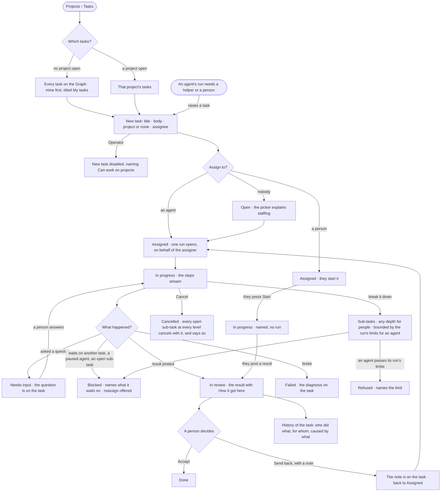

# PJ-12 · Write a task, hand it on and accept the result

**As** anyone with work to get done **I want** to write a task once, with or without a project, hand it to a person or
an agent, watch it run and accept the result **so that** one list tracks both and a stray task has a home without a
"misc" project. For an agent: *the agent proposes → the person decides.*

Tasks: [task.md](task.md) · Feature: [PJ-F01](../../feature.md)

## Who can

| Lens | Can | Otherwise sees |
|---|---|---|
| Admin | Write a task, assign it to a person or an agent, start, answer an agent's question, cancel, accept or send back a result; read every task they may see | A task on a private project they are not staffed on is absent |
| Operator | Read every task they may see, its thread, its runs and its state; open *How it got here* | *New task*, *Assign*, *Start*, *Cancel*, *Accept* and *Send back* disabled, naming *Can work on projects*. *With Can work on projects: as Admin* |

## Flow

## Acceptance criteria

| # | Given | When | Then |
|---|---|---|---|
| PJ-12.1 | A Graph with no tasks | a member opens Projects with no project open | it reads *No tasks yet* with *New task* |
| PJ-12.2 | No project open | the Tasks list shows | it lists every task on the Graph, the signed-in person's first under *My tasks*; a task with no project is in this list, never lost |
| PJ-12.3 | A project open | the Tasks list shows | it narrows to that project's tasks while the projects list keeps its place above |
| PJ-12.4 | The Tasks list | counts are drawn | the count of the listed tasks and how many sit in each state come from the engine, not from rows on screen |
| PJ-12.5 | A member who can work on projects | they save a new task with a title and a body | it is created with or without a project, in state *Open* |
| PJ-12.6 | A task with no assignee | its page opens | it reads *Open*, and the assignee picker explains that staffing fills the picker and is not a grant |
| PJ-12.7 | A task | it is assigned to a person | it reads *Assigned* and names them; nothing runs |
| PJ-12.8 | A task | it is assigned to an agent, staffed or not | exactly one run opens, on behalf of whoever assigned it, and the task reads *In progress* |
| PJ-12.9 | A task whose run is going | its page opens | the steps stream in `projects.task.thinking`, and *How it got here* shows the steps and sources so far |
| PJ-12.10 | A run asks a question | it is read | the task reads *Needs input* with the question on its thread; answering resumes the run |
| PJ-12.11 | A task waiting on an unmet dependency, a paused agent, an exhausted token budget or an open sub-task | its page opens | it reads *Blocked*, naming exactly what it waits on, with *Reassign* offered when the agent is paused |
| PJ-12.12 | A run that has posted a result | the task is read | it reads *In review*, shows the result, and *How it got here* shows its steps, sources and assumptions |
| PJ-12.13 | A task in review | a person presses *Accept* | it reads *Done*, History records who accepted it, and nobody but a person can have done so |
| PJ-12.14 | An agent's result | it is posted | the agent cannot accept it; no screen or call offers an agent acceptance |
| PJ-12.15 | A task in review | a person presses *Send back* and writes a note | the note is kept on the task, which returns to *Assigned* and may be started again |
| PJ-12.16 | A run that failed | the task is read | it reads *Failed* with the diagnosis on the task |
| PJ-12.17 | A task with open sub-tasks | its run settles | it stays *In progress*, listing them |
| PJ-12.18 | A task cancelled | its page is read | every open sub-task at every level below it is cancelled with it, and the page says so |
| PJ-12.27 | A person working a task | they add a sub-task to a sub-task, at any depth | it is created under its parent; no depth limit applies to people |
| PJ-12.28 | An agent's run making sub-tasks | one more would pass the run's limits — depth, count or tokens (RT-F04) | it is refused, naming the limit; the run carries on without it |
| PJ-12.29 | A task with any sub-task still open, at any level | the task is read | it reads *Blocked*, naming the open sub-tasks |
| PJ-12.30 | A task with sub-tasks | its counts are read | the engine gives the count by state for each level and a rolled-up total; Studio adds nothing up |
| PJ-12.19 | An archived project | its tasks are read | they are read only; a run already going finishes |
| PJ-12.20 | A task's *Runs* tab | it opens | it shows the Graph's runs filtered to this task, not a list of its own |
| PJ-12.21 | A task on a private project | a member who is not on the project asks for it | it reads as not found |
| PJ-12.22 | An Operator | they open a task | the thread, the state, the runs and *How it got here* read; *New task*, *Assign*, *Start*, *Cancel*, *Accept* and *Send back* are disabled, naming *Can work on projects* |
| PJ-12.23 | A task assigned to a person | they press *Start* | it reads *In progress* and names them; no run opens |
| PJ-12.24 | A person working a task | they post a result | it reads *In review* with the result, waiting for a person to accept or send it back |
| PJ-12.25 | An agent's run that needs a helper or a person | it raises a task from inside the run | the task is created in the run's project or none, reads who raised it and from which run, and *How it got here* opens that run |
| PJ-12.26 | A task | its *History* opens | every act on the task and each run's attempts read as one tree — who did it, on whose behalf and caused by what — with a delegated run under the step that opened it; the *on behalf of* line comes from the run, never from the task's text, and a skill reads *offered* or *reported*, never *used* |

## Screens

| Surface | Lens | First use | Empty after a filter | Loading | Has data | Failed | Agent working or proposing | No access |
|---|---|---|---|---|---|---|---|---|
| Tasks | Admin | projects.list · No tasks yet | projects.list · No tasks match | projects.list · Loading tasks | projects.list · Tasks | projects.list · Could not load tasks | projects.list · Tasks running | — |
| Tasks | Operator | projects.list · No tasks yet · Read only | projects.list · No tasks match | projects.list · Loading tasks | projects.list · Tasks · Read only | projects.list · Could not load tasks | projects.list · Tasks running | projects.list · Tasks · Read only |
| New task | Admin | projects.task · New | — | — | projects.task · Assign | projects.task · New refused | — | — |
| New task | Operator | — | — | — | — | — | — | projects.list · Tasks · Read only |
| A task | Admin | projects.task · Open | — | projects.task · Loading | projects.task · In review | projects.task · Could not load | projects.task.thinking | — |
| A task | Operator | projects.task · Open · Read only | — | projects.task · Loading | projects.task · In review · Read only | projects.task · Could not load | projects.task.thinking · Read only | projects.task · Read only |
| A task that cannot go on | Admin | — | — | — | projects.task · Blocked | projects.task · Failed | projects.task · Needs input | — |
| A task that cannot go on | Operator | — | — | — | projects.task · Blocked · Read only | projects.task · Failed · Read only | projects.task · Needs input · Read only | projects.task · Read only |
| A closed task | Admin | — | — | — | projects.task · Done | — | — | — |
| A closed task | Operator | — | — | — | projects.task · Done · Read only | — | — | projects.task · Read only |
| A task's History | Admin | projects.task · History · Nothing yet | — | projects.task · Loading | projects.task · History | projects.task · Could not load | projects.task · History | — |
| A task's History | Operator | projects.task · History · Nothing yet | — | projects.task · Loading | projects.task · History | projects.task · Could not load | projects.task · History | projects.task · History |
