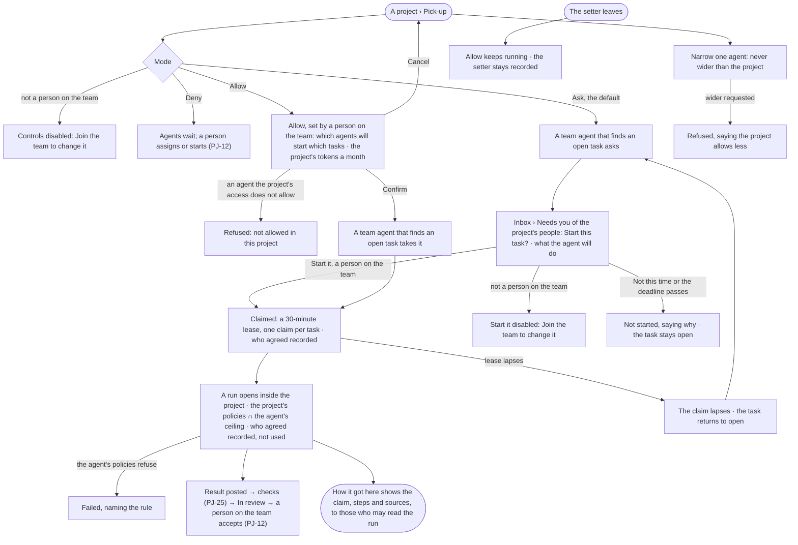

# PJ-15 · Let agents pick up tasks by hand, by asking or on their own

**As** a person on a project **I want** to choose whether its team agents wait to be started, ask first, or pick
tasks up themselves — and to narrow that for any one agent **so that** agents work without being started by hand,
never faster than we allowed, and the work keeps going whoever set it. *The agent proposes → the person decides.*

Tasks: [task.md](task.md) · Feature: [PJ-F01](../../feature.md)

## Who can

*Projects and tasks* follows the [permission catalogue](../../../../../../os/access/features/AC-F02-access-policies/feature.md#the-permission-catalogue);
pick-up is a setting of the project, its team's; a picked-up run reaches the project's policies ∩ the agent's ceiling — who set *Allow* or pressed *Start it* is recorded, never used for reach ([PJ-F01 › Access](../../feature.md#access)).

| Access | Can | Otherwise sees |
|---|---|---|
| Admin | Set the pick-up mode of any project and each team agent's narrower mode — *Allow* only for agents the project's access lets work there; answer an agent's ask to start; see every claim | *Allow* for an agent the project's access does not allow is refused — *Not allowed in this project* |
| Operator | As a person on the team: set the mode — *Allow* only for agents the project's access lets work there — and answer an ask to start; read the mode, every claim and every ask | Not on the team: the mode controls and *Start it* are disabled — *Join the team to change it* |

## Flow



```mermaid
sequenceDiagram
  actor M as Person on the team
  participant E as Engine
  participant A as Team agent
  actor D as Person on the team (Inbox)
  M->>E: sets the project to Deny, Ask or Allow, and may narrow an agent
  A->>E: looks for an open task it may take
  alt Deny
    E-->>A: nothing is offered
  else Ask
    A->>E: asks to start the task
    E->>D: Needs you: Start this task?
    D-->>E: Start it · Not this time
  else Allow
    Note over M,E: set only after the person on the team confirmed what agents will start and the project's tokens a month
    E->>E: claim the task for 30 minutes
  end
  E->>A: opens the run inside the project — the project's policies ∩ ceiling; who agreed recorded on the claim
  A-->>E: posts a result, with its steps and sources
  E-->>M: checks run · the task reads In review
```

## Acceptance criteria

| # | Given | When | Then |
|---|---|---|---|
| PJ-15.1 | A project | its Pick-up opens | it shows the project's mode — *Allow*, *Ask* or *Deny* — *Ask* for a project never set, and each team agent's own mode beside it |
| PJ-15.2 | A person on the project, or an Admin | they change the project's mode | it is saved, History records who and from what to what, and the next look an agent takes uses it |
| PJ-15.3 | A project in *Deny*, or an agent not on the team | an agent could take an open task | it does not; nothing is asked and nothing is claimed |
| PJ-15.4 | A project in *Ask* | a team agent finds an open task | it asks in the *Needs you* of the project's people — which task, which agent and what it will do — and does not start |
| PJ-15.5 | An ask | a person on the team presses *Start it* | the task is claimed, the claim records who agreed, and a run opens inside the project, reaching the project's policies ∩ the agent's ceiling (PJ-15.19) |
| PJ-15.6 | An ask | the person presses *Not this time*, or its deadline passes | nothing starts, the ask says why, and the task stays open |
| PJ-15.7 | A project a person on the team set to *Allow* | a team agent finds an open task | it claims it with no ask and a run opens inside the project, reaching the project's policies ∩ the agent's ceiling — the setter recorded on the claim, not used for reach — inside the project's *Tokens a month* (CP-F04) — at it, it claims nothing |
| PJ-15.8 | A task | an agent claims it | the claim is a lease of 30 minutes, the task shows who holds it and until when, and a second agent cannot claim it |
| PJ-15.9 | A claim | its 30 minutes pass without a run opening | the claim lapses, the task returns to open and shows that it lapsed |
| PJ-15.10 | An agent given a narrower mode than the project | it looks for work | it behaves by its own mode; Deny over Ask over Allow |
| PJ-15.11 | An attempt to give an agent a wider mode than the project | it is saved | it is refused, saying the project allows less; nothing is saved |
| PJ-15.12 | An agent that is paused or retired | a task is open | it takes nothing, and its row on Pick-up says why |
| PJ-15.13 | A task picked up by an agent | its run settles | the result is posted to the task, its checks run (PJ-25), and an agent never accepts it — a person on the team does (PJ-12) |
| PJ-15.14 | A claimed or picked-up task | a person who may read its run opens it | *How it got here* shows the claim, who agreed, the steps and the sources; anyone else reads that it ran, its status and its tokens |
| PJ-15.15 | A task on an archived project | an agent looks for work | it takes nothing |
| PJ-15.16 | An Operator not on the team | they open Pick-up | it reads; the mode controls are disabled — *Join the team to change it* |
| PJ-15.17 | A person on the project, or an Admin | they choose *Allow* | it shows which team agents would start which open tasks now, and the project's *Tokens a month* they run within — used and left, set in its Access (CP-F04); it is saved only on *Confirm*, History records who set *Allow*, and an agent the project's access does not allow is refused — *Not allowed in this project* |
| PJ-15.18 | A project a person on the team set to *Allow* | the setter leaves the team, or loses a policy of their own | *Allow* keeps running unchanged — joining or leaving never changes what the project's runs reach; the setter stays recorded; the task's text is read by the agent as data, never as instructions |
| PJ-15.19 | A picked-up or scheduled run inside a project | it is checked | each step reaches the project's policies ∩ the agent's ceiling ∩ the run scope, like any run in the project; the person who set *Allow* or pressed *Start it* is recorded on the run and their own policies are not read; a step refused fails the task, naming the rule — pick-up never widens what the project or the agent may do |
| PJ-15.20 | An ask to start a task | a person not on the team opens it in *Needs you* | it reads; *Start it* is disabled — *Join the team to change it* |

## Screens

| Surface | Access | First use | Empty after a filter | Loading | Has data | Failed | Agent working or proposing | No access |
|---|---|---|---|---|---|---|---|---|
| Pick-up | Admin | projects.projects · Detail · Pick-up · No team agents | — | projects.projects · Detail · Pick-up · Loading | projects.projects · Detail · Pick-up | projects.projects · Detail · Pick-up · Could not save | projects.projects · Detail · Pick-up · Claims running | — |
| Pick-up | Operator | projects.projects · Detail · Pick-up · No team agents | — | projects.projects · Detail · Pick-up · Loading | projects.projects · Detail · Pick-up | projects.projects · Detail · Pick-up · Could not save | projects.projects · Detail · Pick-up · Claims running | projects.projects · Detail · Pick-up · Not a person on the team |
| Choose Allow | Admin | — | — | projects.projects · Detail · Pick-up · Loading | projects.projects · Detail · Pick-up · Confirm Allow | projects.projects · Detail · Pick-up · Agent not granted | — | — |
| Choose Allow | Operator | — | — | projects.projects · Detail · Pick-up · Loading | projects.projects · Detail · Pick-up · Confirm Allow | projects.projects · Detail · Pick-up · Agent not granted | — | projects.projects · Detail · Pick-up · Not a person on the team |
| A claimed task | Admin | — | — | — | projects.tasks · Detail · Claimed | projects.tasks · Detail · Claim lapsed | projects.tasks · Detail · How it got here | — |
| A claimed task | Operator | — | — | — | projects.tasks · Detail · Claimed | projects.tasks · Detail · Claim lapsed | projects.tasks · Detail · How it got here | projects.tasks · Detail · How it got here · Content withheld |
| An agent asks to start a task | Admin | — | — | — | inbox · Start this task? | inbox · Start this task? · Not started | inbox · Start this task? | — |
| An agent asks to start a task | Operator | — | — | — | inbox · Start this task? | inbox · Start this task? · Not started | inbox · Start this task? | inbox · Start this task? · Agent not granted |
