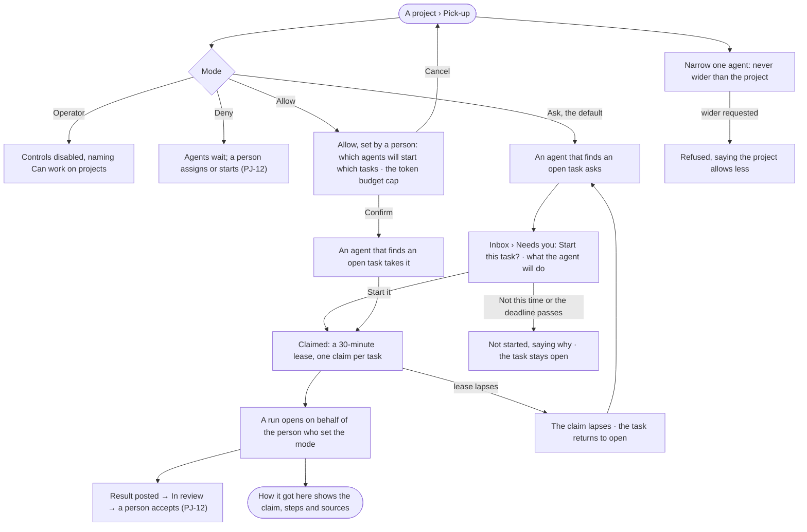
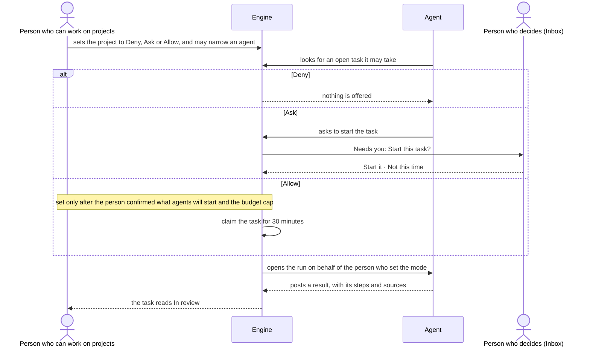

# PJ-15 · Let agents pick up tasks by hand, by asking or on their own

**As** someone who can work on projects **I want** to choose, per project, whether its agents wait to be started, ask
first, or pick tasks up themselves — and to narrow that for any one agent **so that** agents work without being started
by hand, and never faster than I allowed. *The agent proposes → the person decides.*

Tasks: [task.md](task.md) · Feature: [PJ-F01](../../feature.md)

## Who can

| Lens | Can | Otherwise sees |
|---|---|---|
| Admin | Set a project's pick-up mode and each agent's narrower mode; answer an agent's ask to start; see every claim | — |
| Operator | Read the mode, each agent's mode, every claim and every ask | The mode controls and *Start it* · *Not this time* disabled, naming *Can work on projects*. *With Can work on projects: as Admin* |

## Flow

## Acceptance criteria

| # | Given | When | Then |
|---|---|---|---|
| PJ-15.1 | A project | its Pick-up opens | it shows the project's mode — *Allow*, *Ask* or *Deny* — *Ask* for a project never set, and each staffed agent's own mode beside it |
| PJ-15.2 | A member who can work on projects | they change the project's mode | it is saved, History records who and from what to what, and the next look an agent takes uses it |
| PJ-15.3 | A project in *Deny* | an agent could take an open task | it does not; nothing is asked and nothing is claimed — Deny opens no run, so there is no ask for more (AC-14.13) |
| PJ-15.4 | A project in *Ask* | an agent finds an open task it may take | it asks in the Inbox's *Needs you* — which task and what it will do — and does not start |
| PJ-15.5 | An ask | the person presses *Start it* | the task is claimed and a run opens on behalf of the person who set the mode |
| PJ-15.6 | An ask | the person presses *Not this time*, or its deadline passes | nothing starts, the ask says why, and the task stays open |
| PJ-15.7 | A project a person set to *Allow* | an agent finds an open task it may take | it claims it with no ask and a run opens, inside the token budget cap shown when it was set |
| PJ-15.8 | A task | an agent claims it | the claim is a lease of 30 minutes, the task shows who holds it and until when, and a second agent cannot claim it |
| PJ-15.9 | A claim | its 30 minutes pass without a run opening | the claim lapses, the task returns to open and shows that it lapsed |
| PJ-15.10 | An agent given a narrower mode than the project | it looks for work | it behaves by its own mode; Deny over Ask over Allow |
| PJ-15.11 | An attempt to give an agent a wider mode than the project | it is saved | it is refused, saying the project allows less; nothing is saved |
| PJ-15.12 | An agent that is paused or retired | a task is open | it takes nothing, and its row on Pick-up says why |
| PJ-15.13 | A task picked up by an agent | its run settles | the result is posted to the task as *In review*; an agent never accepts it, and a person does (PJ-12) |
| PJ-15.14 | A claimed or picked-up task | the person opens its run | *How it got here* shows the claim, the steps and the sources |
| PJ-15.15 | A task on an archived project | an agent looks for work | it takes nothing |
| PJ-15.16 | An Operator | they open Pick-up or an ask in *Needs you* | both read; the mode controls, *Start it* and *Not this time* are disabled, naming *Can work on projects* |
| PJ-15.17 | A member who can work on projects | they choose *Allow* | it shows which staffed agents would start which open tasks now, and the token budget cap they run within; it is saved only on *Confirm*, and History records who set Allow |
| PJ-15.18 | A project a person set to *Allow* | an agent picks up a task | its run is bounded by both the person who set Allow and the task's author, and the task's text is read as data, never as instructions; when the setter loses the right to set Allow, the project returns to *Ask* and History records why |
| PJ-15.19 | A project's pick-up value | an agent looks for work | it is a line like any other: the strictest of the project's, the agent's own and every rule for everyone binds, so a *For everyone* Deny on starting work holds whatever the project says |

## Screens

| Surface | Lens | First use | Empty after a filter | Loading | Has data | Failed | Agent working or proposing | No access |
|---|---|---|---|---|---|---|---|---|
| Pick-up | Admin | projects.project · Pick-up · No agents staffed | — | projects.project · Pick-up · Loading | projects.project · Pick-up | projects.project · Pick-up · Could not save | projects.project · Pick-up · Claims running | — |
| Pick-up | Operator | projects.project · Pick-up · No agents staffed · Read only | — | projects.project · Pick-up · Loading | projects.project · Pick-up · Read only | projects.project · Pick-up · Could not load | projects.project · Pick-up · Claims running | projects.project · Pick-up · Read only |
| Choose Allow | Admin | — | — | projects.project · Pick-up · Loading | projects.project · Pick-up · Confirm Allow | projects.project · Pick-up · Could not save | — | — |
| Choose Allow | Operator | — | — | — | — | — | — | projects.project · Pick-up · Read only |
| A claimed task | Admin | — | — | — | projects.task · Claimed | projects.task · Claim lapsed | projects.task.thinking | — |
| A claimed task | Operator | — | — | — | projects.task · Claimed · Read only | projects.task · Claim lapsed · Read only | projects.task.thinking · Read only | projects.task · Read only |
| An agent asks to start a task | Admin | — | — | — | inbox · Start this task? | inbox · Start this task? · Not started | inbox · Start this task? | — |
| An agent asks to start a task | Operator | — | — | — | inbox · Start this task? · Waiting on a person who can work on projects | inbox · Start this task? · Not started | inbox · Start this task? · Waiting on a person who can work on projects | inbox · Start this task? · Waiting on a person who can work on projects |
