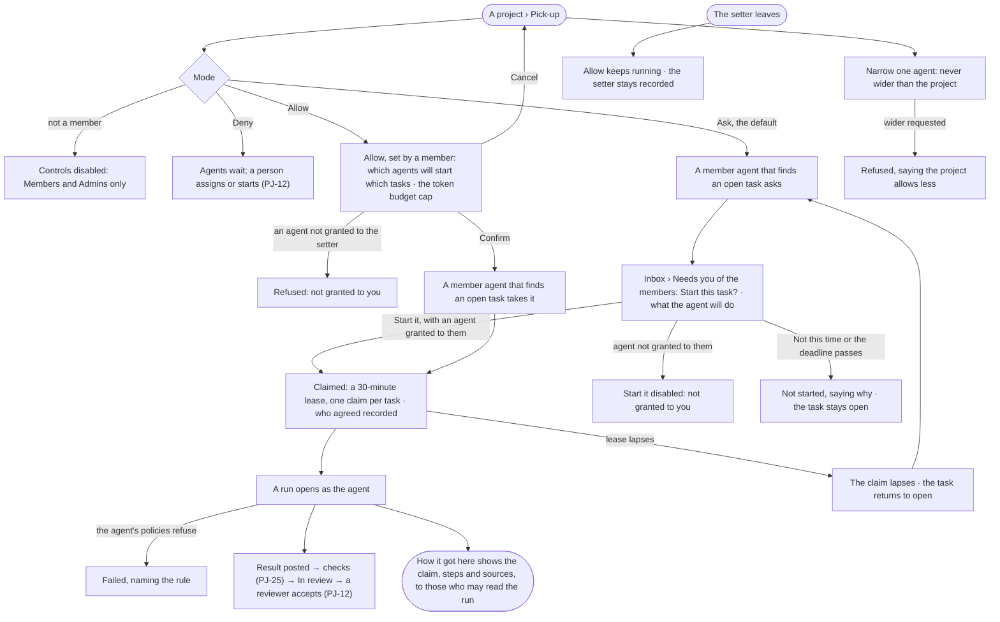
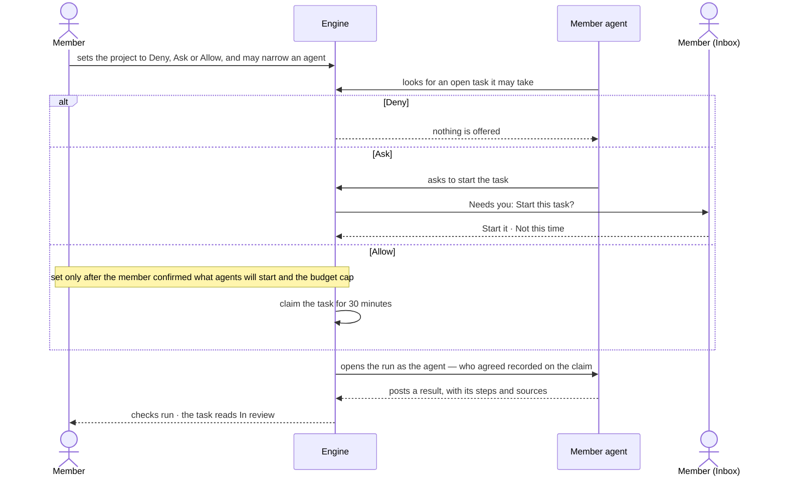

# PJ-15 · Let agents pick up tasks by hand, by asking or on their own

**As** a member of a project **I want** to choose whether its member agents wait to be started, ask first, or pick
tasks up themselves — and to narrow that for any one agent **so that** agents work without being started by hand,
never faster than we allowed, and the work keeps going whoever set it. *The agent proposes → the person decides.*

Tasks: [task.md](task.md) · Feature: [PJ-F01](../../feature.md)

## Who can

*Projects and tasks* is *Acts* for every role in the [role table](../../../../../../os/access/features/AC-F02-access-policies/feature.md#the-role-table);
pick-up is a setting of the project, its members' and the Admins' ([PJ-F01 › Access](../../feature.md#access)).

| Lens | Can | Otherwise sees |
|---|---|---|
| Admin | Set the pick-up mode of any project and each member agent's narrower mode — *Allow* only for agents granted to them; answer an agent's ask to start on a project they are a member of; see every claim | *Allow* for an agent not granted to them is refused — *Not granted to you* |
| Operator | Set the mode on a project they are a member of — *Allow* only for agents granted to them; answer an ask to start on such a project, with an agent granted to them; read the mode, every claim and every ask; a Modeller the same | On a project they are not a member of, the mode controls are disabled — *Members and Admins only*. *Start it* is disabled when the agent is not granted to them — *Not granted to you* |

## Flow

## Acceptance criteria

| # | Given | When | Then |
|---|---|---|---|
| PJ-15.1 | A project | its Pick-up opens | it shows the project's mode — *Allow*, *Ask* or *Deny* — *Ask* for a project never set, and each member agent's own mode beside it |
| PJ-15.2 | A member of the project, or an Admin | they change the project's mode | it is saved, History records who and from what to what, and the next look an agent takes uses it |
| PJ-15.3 | A project in *Deny*, or an agent that is not a member | an agent could take an open task | it does not; nothing is asked and nothing is claimed |
| PJ-15.4 | A project in *Ask* | a member agent finds an open task | it asks in the *Needs you* of the project's members — which task, which agent and what it will do — and does not start |
| PJ-15.5 | An ask | a member to whom that agent is granted presses *Start it* | the task is claimed, the claim records who agreed, and a run opens as the agent |
| PJ-15.6 | An ask | the person presses *Not this time*, or its deadline passes | nothing starts, the ask says why, and the task stays open |
| PJ-15.7 | A project a member set to *Allow* | a member agent finds an open task | it claims it with no ask and a run opens as the agent, the setter recorded on the claim, inside the token budget cap shown when it was set |
| PJ-15.8 | A task | an agent claims it | the claim is a lease of 30 minutes, the task shows who holds it and until when, and a second agent cannot claim it |
| PJ-15.9 | A claim | its 30 minutes pass without a run opening | the claim lapses, the task returns to open and shows that it lapsed |
| PJ-15.10 | An agent given a narrower mode than the project | it looks for work | it behaves by its own mode; Deny over Ask over Allow |
| PJ-15.11 | An attempt to give an agent a wider mode than the project | it is saved | it is refused, saying the project allows less; nothing is saved |
| PJ-15.12 | An agent that is paused or retired | a task is open | it takes nothing, and its row on Pick-up says why |
| PJ-15.13 | A task picked up by an agent | its run settles | the result is posted to the task, its checks run (PJ-25), and an agent never accepts it — a reviewer does (PJ-12) |
| PJ-15.14 | A claimed or picked-up task | a person who may read its run opens it | *How it got here* shows the claim, who agreed, the steps and the sources; anyone else reads that it ran, its status and its tokens |
| PJ-15.15 | A task on an archived project | an agent looks for work | it takes nothing |
| PJ-15.16 | An Operator or a Modeller who is not a member | they open Pick-up | it reads; the mode controls are disabled — *Members and Admins only* |
| PJ-15.17 | A member of the project, or an Admin | they choose *Allow* | it shows which member agents would start which open tasks now, and the token budget cap they run within; it is saved only on *Confirm*, History records who set *Allow*, and an agent not granted to the setter is refused — *Not granted to you* |
| PJ-15.18 | A project a member set to *Allow* | the setter leaves, or loses the grant of an agent it covers | the mode keeps running as it was and the setter stays recorded; the task's text is read by the agent as data, never as instructions |
| PJ-15.19 | A picked-up run | it is checked | it runs as the agent, checked by the agent's Access Policies within the run scope like any run; a rule that refuses it fails the task, naming the rule — pick-up never widens what the agent may do |
| PJ-15.20 | An ask to start a task with an agent not granted to the reader | they open it in *Needs you* | it reads; *Start it* is disabled — *Not granted to you* |

## Screens

| Surface | Lens | First use | Empty after a filter | Loading | Has data | Failed | Agent working or proposing | No access |
|---|---|---|---|---|---|---|---|---|
| Pick-up | Admin | projects.project · Pick-up · No member agents | — | projects.project · Pick-up · Loading | projects.project · Pick-up | projects.project · Pick-up · Could not save | projects.project · Pick-up · Claims running | — |
| Pick-up | Operator | projects.project · Pick-up · No member agents | — | projects.project · Pick-up · Loading | projects.project · Pick-up | projects.project · Pick-up · Could not save | projects.project · Pick-up · Claims running | projects.project · Pick-up · Not a member |
| Choose Allow | Admin | — | — | projects.project · Pick-up · Loading | projects.project · Pick-up · Confirm Allow | projects.project · Pick-up · Agent not granted | — | — |
| Choose Allow | Operator | — | — | projects.project · Pick-up · Loading | projects.project · Pick-up · Confirm Allow | projects.project · Pick-up · Agent not granted | — | projects.project · Pick-up · Not a member |
| A claimed task | Admin | — | — | — | projects.task · Claimed | projects.task · Claim lapsed | projects.task.thinking | — |
| A claimed task | Operator | — | — | — | projects.task · Claimed | projects.task · Claim lapsed | projects.task.thinking | projects.task.thinking · Content withheld |
| An agent asks to start a task | Admin | — | — | — | inbox · Start this task? | inbox · Start this task? · Not started | inbox · Start this task? | — |
| An agent asks to start a task | Operator | — | — | — | inbox · Start this task? | inbox · Start this task? · Not started | inbox · Start this task? | inbox · Start this task? · Agent not granted |
