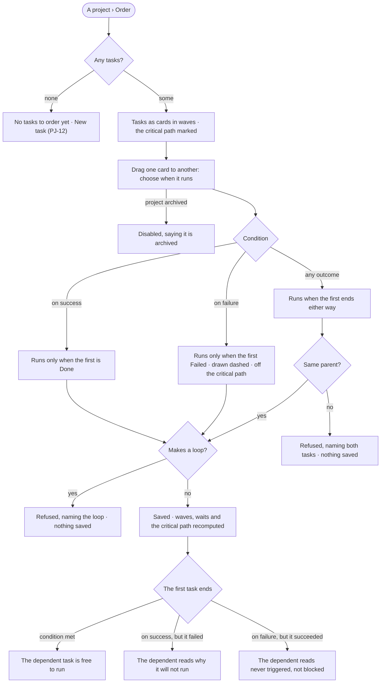

# PJ-18 · Order tasks by what they wait on

**As** someone planning a project's work **I want** to say that one task waits on another's success, its failure or
either outcome, and see the order that follows **so that** a task that only matters when something breaks has a way to
say so, and nobody keeps an order by hand.

Tasks: [task.md](task.md) · Feature: [PJ-F01](../../feature.md)

## Who can

*Projects and tasks* is *Acts* for every role in the [role table](../../../../../../os/access/features/AC-F02-access-policies/feature.md#the-role-table),
on every project the person can see.

| Lens | Can | Otherwise sees |
|---|---|---|
| Admin | Draw and remove a dependency, choose its condition; read the order, the waves and the critical path | On an archived project, *Draw a dependency* and *Remove* disabled, saying it is archived |
| Operator | The same, on every project they can see; a Modeller the same | On an archived project, *Draw a dependency* and *Remove* disabled, saying it is archived |

## Flow

## Acceptance criteria

| # | Given | When | Then |
|---|---|---|---|
| PJ-18.1 | A project with no tasks | its Order tab opens | it reads *No tasks to order yet* with *New task* |
| PJ-18.2 | A project with tasks | its Order tab opens | the tasks are cards in waves, a wave being the number of dependency hops from the start, with the critical path marked |
| PJ-18.3 | A person who can see the project | they drag one card onto another and choose a condition | a dependency is saved with *on success*, *on failure* or *any outcome*, and the dependent task lists what it waits on |
| PJ-18.4 | A dependency that would make a loop | it is saved | it is refused, naming the tasks in the loop; nothing is saved |
| PJ-18.5 | A task whose dependency is *on success* and has not yet succeeded | the task is read | it reads *Blocked*, naming that task and the condition |
| PJ-18.6 | A task whose dependency is *on success* and the first task failed | the task is read | it reads why it will not run, naming the failed task, rather than sitting blocked in silence |
| PJ-18.7 | A task whose dependency is *on failure* and the first task failed | the first task ends | the dependent task is free to run |
| PJ-18.8 | A task whose dependency is *on failure* and the first task succeeded | the first task ends | the dependent task reads *Never triggered*, not *Blocked* |
| PJ-18.9 | A task whose dependency is *any outcome* | the first task ends in any state | the dependent task is free to run |
| PJ-18.10 | A dependency *on failure* | the Order tab is drawn | its edge is dashed and the critical path ignores it |
| PJ-18.11 | The Order | waves, waits and the critical path are drawn | each is the engine's derivation; nobody types an order, and no order can be set by hand |
| PJ-18.12 | Two tasks that do not share a parent — one a sub-task of the other, at different levels, or in different projects | a dependency between them is saved | it is refused, naming both tasks and that a dependency joins tasks with the same parent; nothing is saved |
| PJ-18.16 | Sub-tasks of one parent | its Order is read | they order among themselves in waves of their own, and the parent waits on them all |
| PJ-18.13 | A dependency | a person who can see the project removes it | the waves, waits and critical path are recomputed, and History records it |
| PJ-18.14 | A task blocked or never triggered | the person opens its History | it shows which dependency, which outcome and which condition decided it |
| PJ-18.15 | An archived project | its Order tab opens | it reads; *Draw a dependency* and *Remove* are disabled, saying the project is archived |

## Screens

| Surface | Lens | First use | Empty after a filter | Loading | Has data | Failed | Agent working or proposing | No access |
|---|---|---|---|---|---|---|---|---|
| Order | Admin | projects.project · Order · No tasks to order | — | projects.project · Order · Loading | projects.project · Order | projects.project · Order · Loop refused | projects.project · Order · Tasks running | — |
| Order | Operator | projects.project · Order · No tasks to order | — | projects.project · Order · Loading | projects.project · Order | projects.project · Order · Loop refused | projects.project · Order · Tasks running | projects.project · Order · Archived |
| A task and what it waits on | Admin | — | — | — | projects.task · Waiting on | projects.task · Will not run | projects.task · Never triggered | — |
| A task and what it waits on | Operator | — | — | — | projects.task · Waiting on | projects.task · Will not run | projects.task · Never triggered | — |
