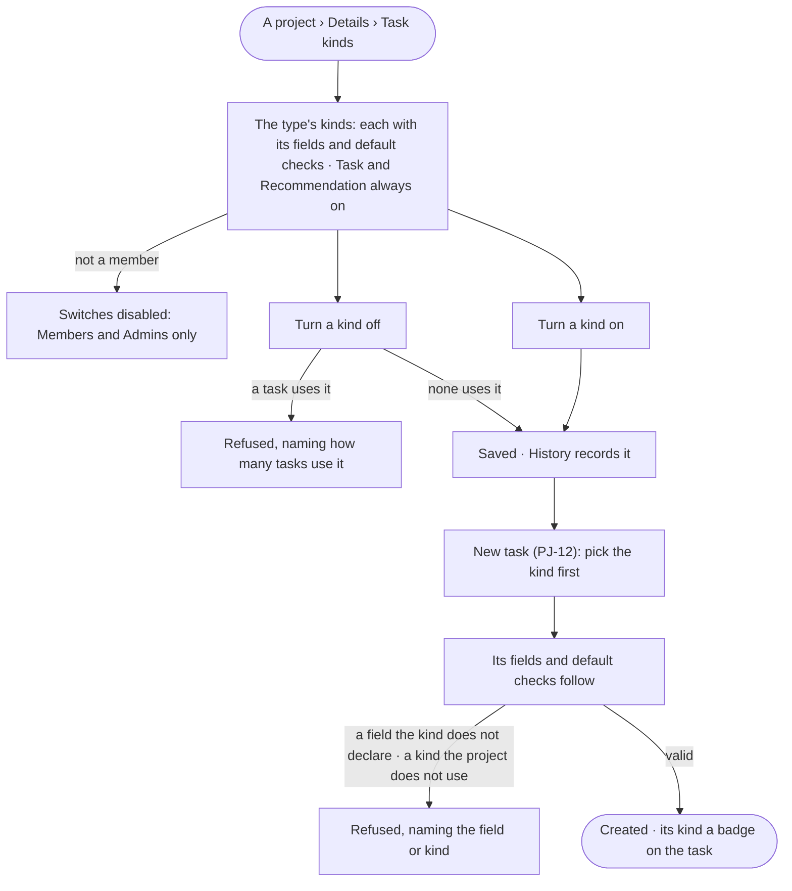

# PJ-20 · Give a project its kinds of task

**As** a member of a project **I want** the project to offer the kinds of task its work needs — each asking for its own
fields and bringing its own checks **so that** every task starts with what that kind of work needs and nobody writes
the same fields by hand each time.

Tasks: [task.md](task.md) · Feature: [PJ-F01](../../feature.md)

## Who can

*Projects and tasks* is *Acts* for every role in the [role table](../../../../../../os/access/features/AC-F02-access-policies/feature.md#the-role-table);
which kinds a project uses is a setting, its members' and the Admins' ([PJ-F01 › Access](../../feature.md#access)).

| Lens | Can | Otherwise sees |
|---|---|---|
| Admin | Turn any of the type's task kinds on or off on any project; write a task of any kind the project uses | — |
| Operator | Turn kinds on or off on a project they are a member of; write a task of any kind the project uses; a Modeller the same | On a project they are not a member of, the kind switches read, disabled — *Members and Admins only* |

## Flow

## Acceptance criteria

| # | Given | When | Then |
|---|---|---|---|
| PJ-20.1 | A project | its Details › *Task kinds* opens | it lists every kind its type declares — each with its fields and default checks — and which the project uses; *Task* and *Recommendation* are always on and cannot be turned off |
| PJ-20.2 | A member or an Admin | they turn a kind on or off | it is saved, *New task* offers only the kinds on, and History records who and which kind |
| PJ-20.3 | *New task* on a project | it opens | the kind is asked first; picking it brings that kind's fields and its default checks (PJ-25) |
| PJ-20.4 | A task of a kind the project does not use, or a field its kind does not declare | it is saved | it is refused, naming the kind or the field and why; nothing is saved |
| PJ-20.5 | A kind used by any task | a member turns it off | it is refused, naming how many tasks use it; nothing changes |
| PJ-20.6 | A task of a kind | it is listed or opened | its kind reads as a badge beside its title, in the type's words; shared places — My tasks, Needs you, search — show the same badge |
| PJ-20.7 | An Operator or a Modeller who is not a member | they open *Task kinds* | the kinds read; the switches are disabled — *Members and Admins only*; a call is refused the same way |
| PJ-20.8 | A type installed by a Team pack | a project of it is created | its kinds are offered as the built-in ones are; no kind is written in Studio |

## Screens

| Surface | Lens | First use | Empty after a filter | Loading | Has data | Failed | Agent working or proposing | No access |
|---|---|---|---|---|---|---|---|---|
| Task kinds | Admin | projects.project · Task kinds · Only the two | — | projects.project · Task kinds · Loading | projects.project · Task kinds | projects.project · Task kinds · Kind in use | — | — |
| Task kinds | Operator | projects.project · Task kinds · Only the two | — | projects.project · Task kinds · Loading | projects.project · Task kinds | projects.project · Task kinds · Kind in use | — | projects.project · Task kinds · Not a member |
| New task by kind | Admin | projects.task · New · Pick a kind | — | — | projects.task · New · Kind fields | projects.task · New · Field refused | — | — |
| New task by kind | Operator | projects.task · New · Pick a kind | — | — | projects.task · New · Kind fields | projects.task · New · Field refused | — | projects.task · Withheld |
