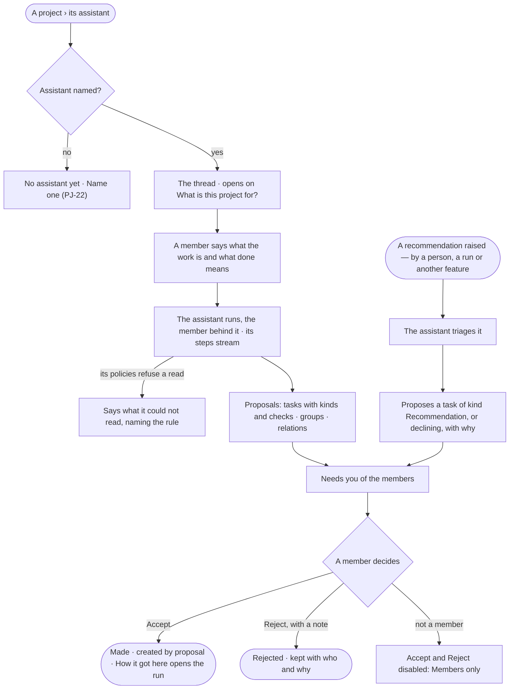
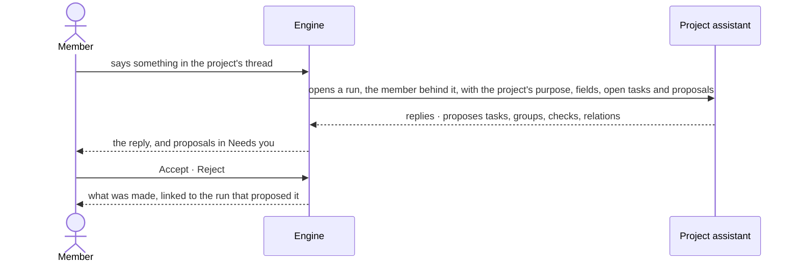

# PJ-21 · Ideate with the project assistant

**As** a member of a project **I want** to talk the work through with the project's assistant and have it turn what we
said — and the recommendations others raise — into tasks, groups and checks I can accept **so that** shaping the work
is a conversation, not a form, and nothing lands on the project without a person's yes. *The agent proposes → the
person decides.*

Tasks: [task.md](task.md) · Feature: [PJ-F01](../../feature.md)

## Who can

*Projects and tasks* is *Acts* for every role in the [role table](../../../../../../os/access/features/AC-F02-access-policies/feature.md#the-role-table);
the thread reads through the person's default agent, and a proposal is accepted by the project's members
([PJ-F01 › Access](../../feature.md#access)).

| Lens | Can | Otherwise sees |
|---|---|---|
| Admin | Talk with the assistant of any project their default agent may Read; raise a recommendation; accept or reject a proposal on a project they are a member of | Not a member: *Accept* and *Reject* disabled — *Members only* |
| Operator | The same; a Modeller the same | Not a member: *Accept* and *Reject* disabled — *Members only*. A project their default agent may not Read: the thread reads *Withheld* |

## Flow

## Acceptance criteria

| # | Given | When | Then |
|---|---|---|---|
| PJ-21.1 | A project with no assistant named | its assistant region opens | it reads *No assistant yet*, with *Name one* for its members and the Admins (PJ-22) |
| PJ-21.2 | A project with an assistant, no thread yet | its assistant region opens | the thread opens on *What is this project for?* with the project's purpose above it |
| PJ-21.3 | A member says something in the thread | it is sent | a run of the assistant opens, the speaker behind it, with the project's purpose, fields, open tasks and open proposals as its context; its steps stream to those who may read the run |
| PJ-21.4 | The assistant's run | it replies | its reply is in the thread, and any task, group, check or relation it proposes is a proposal listed under the reply and in the members' Needs you — nothing is made yet |
| PJ-21.5 | A proposal | a member accepts it | what it proposes is made — a task of its kind with its fields and checks, a group, a check, a relation — reads *created by proposal*, and the proposal reads accepted, by whom |
| PJ-21.6 | A proposal | a member rejects it with a note | it reads rejected, by whom and why, and stays in the thread |
| PJ-21.7 | A recommendation raised for the project — by a person, a run or another feature | it arrives | it is a proposal of kind *Recommendation* in the thread; the assistant triages it, proposing a task of kind *Recommendation* or declining it with a reason, and a member decides |
| PJ-21.8 | A proposal or a reply | a person who may read its run opens *How it got here* | it shows the assistant's steps and sources; anyone else reads that it ran, its status and its tokens |
| PJ-21.9 | A proposal and a person who is not a member | they open it | it reads; *Accept* and *Reject* are disabled — *Members only*; a call is refused the same way |
| PJ-21.10 | The assistant's run | a read its Access Policies refuse | the reply says what it could not read, naming the rule; the project grants it nothing beyond its policies |
| PJ-21.11 | The assistant | it proposes | it never accepts its own proposal; no screen or call offers an agent acceptance |
| PJ-21.12 | A recommendation or a proposal citing another project's copy | it is read | it shows as far as the reader's default agent may Read its sources ([GP-F02](../../../../../../os/graph/features/GP-F02-memory/feature.md#rules)), else *Withheld — your agent may not read {resource}* |
| PJ-21.13 | The thread failing to load, or the run failing | it happens | the thread says why, with *Try again*; a message already sent stays |

## Screens

| Surface | Lens | First use | Empty after a filter | Loading | Has data | Failed | Agent working or proposing | No access |
|---|---|---|---|---|---|---|---|---|
| The assistant's thread | Admin | projects.assistant · What is this project for? | — | projects.assistant · Loading | projects.assistant · Thread | projects.assistant · Could not load | projects.assistant · Thinking | projects.assistant · No assistant yet |
| The assistant's thread | Operator | projects.assistant · What is this project for? | — | projects.assistant · Loading | projects.assistant · Thread | projects.assistant · Could not load | projects.assistant · Thinking | projects.assistant · Withheld |
| Proposals | Admin | projects.assistant · No proposals | — | projects.assistant · Loading | projects.assistant · Proposals | projects.assistant · Proposal refused | projects.assistant · Proposals waiting | projects.assistant · Proposals · Not a member |
| Proposals | Operator | projects.assistant · No proposals | — | projects.assistant · Loading | projects.assistant · Proposals | projects.assistant · Proposal refused | projects.assistant · Proposals waiting | projects.assistant · Proposals · Not a member |
| A recommendation | Admin | — | — | — | projects.assistant · Recommendation | — | projects.assistant · Recommendation · Triaging | — |
| A recommendation | Operator | — | — | — | projects.assistant · Recommendation | — | projects.assistant · Recommendation · Triaging | projects.assistant · Recommendation · Withheld |
| A proposal in Needs you | Admin | — | — | inbox · Loading | inbox · A proposal | inbox · Could not load | — | — |
| A proposal in Needs you | Operator | — | — | inbox · Loading | inbox · A proposal | inbox · Could not load | — | — |
