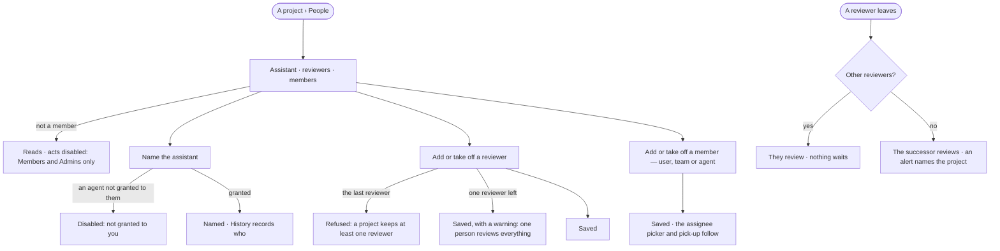

# PJ-22 · Name the project assistant and its reviewers

**As** a member of a project **I want** to name the agent that assists the project, the people who review its results
and the people, teams and agents on it **so that** the work has one agent shaping it, results are accepted by the
people who should, and nothing stops when one of them leaves.

Tasks: [task.md](task.md) · Feature: [PJ-F01](../../feature.md)

## Who can

*Projects and tasks* is *Acts* for every role in the [role table](../../../../../../os/access/features/AC-F02-access-policies/feature.md#the-role-table);
a project's people are a setting, its members' and the Admins'; reviewers and members are slots
([AC-F07 › Slots and fallbacks](../../../../../../os/access/features/AC-F07-ownership/feature.md#slots-and-fallbacks)).

| Lens | Can | Otherwise sees |
|---|---|---|
| Admin | On any project: name the assistant among agents granted to them; add or take off reviewers and members — agents among those granted to them | An agent not granted to them is disabled in the picker — *Not granted to you* |
| Operator | The same on a project they are a member of; a Modeller the same | On a project they are not a member of, *People* reads, its acts disabled — *Members and Admins only*. An agent not granted to them is disabled — *Not granted to you* |

## Flow

## Acceptance criteria

| # | Given | When | Then |
|---|---|---|---|
| PJ-22.1 | A project | its *People* tab opens | it shows the project assistant, the reviewers and the members — users, teams and agents — each with who added them and when |
| PJ-22.2 | A member or an Admin | they name an agent granted to them as the project assistant | it is saved, History records who named it, and the project's thread and triage use it from the next message (PJ-21) |
| PJ-22.3 | A project with a new assistant | the old one had open proposals | they stay open, attributed to the agent that made them |
| PJ-22.4 | An agent not granted to the person | they open the assistant or members picker | the agent is disabled — *Not granted to you*; a call naming it is refused the same way |
| PJ-22.5 | A member or an Admin | they add a person as reviewer | the person reviews the project's results from then on (PJ-12), and History records it |
| PJ-22.6 | A project with one reviewer | someone takes that reviewer off | it is refused — *A project keeps at least one reviewer*; nothing changes |
| PJ-22.7 | A project left with a single reviewer | it is saved | it is saved, and *People* warns that one person reviews every result |
| PJ-22.8 | A reviewer who is deactivated | a result waits in review | the other reviewers review it; with none left, the successor becomes a reviewer and an alert names the project ([AC-23](../../../../../../os/access/features/AC-F03-directory/stories/AC-23-deactivate-a-person-who-leaves/story.md)) |
| PJ-22.9 | An Operator or a Modeller who is not a member | they open *People* | it reads; every act is disabled — *Members and Admins only*; a call is refused the same way |
| PJ-22.10 | A member added or taken off | the assignee picker or Pick-up is next read | it lists the members as they are now; taking off an agent removes its narrower pick-up mode, and a claim it holds runs out |
| PJ-22.11 | Any member | they are a member | being a member grants no reach: a member agent's run reaches what its Access Policies allow within the run scope, and a person reads the project as far as their default agent may |

## Screens

| Surface | Lens | First use | Empty after a filter | Loading | Has data | Failed | Agent working or proposing | No access |
|---|---|---|---|---|---|---|---|---|
| People | Admin | projects.project · People · Only the creator | — | projects.project · People · Loading | projects.project · People | projects.project · People · Last reviewer refused | — | — |
| People | Operator | projects.project · People · Only the creator | — | projects.project · People · Loading | projects.project · People | projects.project · People · Last reviewer refused | — | projects.project · People · Not a member |
| Name the assistant | Admin | projects.project · People · No assistant | — | projects.project · People · Loading agents | projects.project · People · Assistant named | projects.project · People · Agent not granted | — | — |
| Name the assistant | Operator | projects.project · People · No assistant | — | projects.project · People · Loading agents | projects.project · People · Assistant named | projects.project · People · Agent not granted | — | projects.project · People · Not a member |
| Reviewers | Admin | — | — | — | projects.project · People · Reviewers | projects.project · People · One reviewer warning | — | — |
| Reviewers | Operator | — | — | — | projects.project · People · Reviewers | projects.project · People · One reviewer warning | — | projects.project · People · Not a member |
