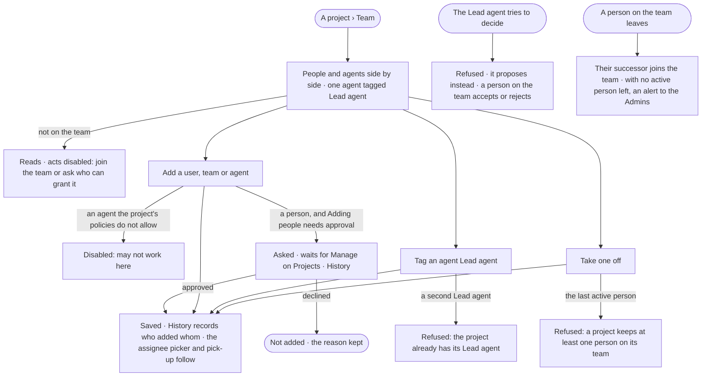

# PJ-22 · Set the project team and its Lead agent

**As** a person on a project **I want** to put people and agents on its team side by side and tag one agent its
**Lead agent** **so that** an agent coordinates the work, every decision a person must give reaches the team's people,
and nothing stops when one of them leaves.

Tasks: [task.md](task.md) · Feature: [PJ-F01](../../feature.md)

## Who can

Every person on a project's team may change its team; Manage on Projects may on any project. There are no roles inside
a project, and joining grants nothing outside it ([PJ-F01 › Access](../../feature.md#access)).

| Lens | Can | Otherwise sees |
|---|---|---|
| Admin | On any project: add users, teams and the agents the project's policies let work here, tag one Lead agent, take one off; approve a join where the project is set to *Adding people needs approval* | — |
| Operator | The same on a project they are on; a join on a project that needs approval is asked for | On a project they are not on, *Team* reads, its acts disabled — *Join the team or ask {who can grant}*; an agent access does not allow is disabled — *May not work here* |

## Flow

## Acceptance criteria

| # | Given | When | Then |
|---|---|---|---|
| PJ-22.1 | A project | its *Team* tab opens | it shows people, teams and agents side by side, who added each and when; the Lead agent reads *Lead agent* |
| PJ-22.2 | A person on the team | they tag an agent the project's policies allow as *Lead agent* | it is saved, History records who, and the project's thread and triage use it from the next message (PJ-21) |
| PJ-22.3 | A project whose Lead agent changes | the old one had open proposals | they stay open, attributed to the agent that made them |
| PJ-22.4 | An agent the project's policies do not let work here | a person opens the team picker | the agent is disabled — *May not work here*; a call naming it is refused the same way |
| PJ-22.5 | A person added to the team | they open the project | they may do everything inside it — write and assign tasks, accept proposals, plans and results, change its settings and narrow its access — and History records who added them |
| PJ-22.6 | A project with one active person on its team | someone takes them off | it is refused — *A project keeps at least one person on its team.*; nothing changes |
| PJ-22.7 | A project left with a single person on its team | it is saved | it is saved, and *Team* warns that one person decides everything |
| PJ-22.8 | A person on the team who is deactivated | a result waits in review | the other people on the team decide it; their successor joins the team; with no active person left, an alert to the Admins names the project ([AC-23](../../../../../../os/access/features/AC-F03-directory/stories/AC-23-deactivate-a-person-who-leaves/story.md)) |
| PJ-22.9 | A person not on the team, without Manage on Projects | they open *Team* | it reads; every act is disabled — *Join the team or ask {who can grant}*; a call is refused the same way |
| PJ-22.10 | Someone added or taken off | the assignee picker or Pick-up is next read | it lists the team as it is now; taking off an agent removes its narrower pick-up mode, and a claim it holds runs out |
| PJ-22.11 | Anyone joining or leaving the team | a run of the project starts | what it reaches is unchanged — the project's policies ∩ the agent's ceiling; being on the team grants nothing outside the project |
| PJ-22.13 | The Lead agent | it would write a task, a group, a check or a relation on the project, set a goal, change the team or its access, approve its plan or accept a result | the engine refuses it — *Only a person decides — {agent} may propose it.* — and it lands as a proposal in the Needs you of the project's people; *How it got here* shows the proposal's steps and sources |
| PJ-22.14 | A project with a Lead agent | someone tags a second agent | it is refused — *{project} already has {agent} as its Lead agent.*; nothing changes |
| PJ-22.15 | The Lead agent | it assigns an open task to another agent on the team | the task is assigned and a run opens, reaching the project's policies ∩ that agent's ceiling; the assignment is in History |
| PJ-22.16 | The project is set to *Adding people needs approval* | a person on the team adds a person | the join waits as an ask in the Inbox of those with Manage on Projects; approved, they join; declined, the reason is kept; History records both |

## Screens

| Surface | Lens | First use | Empty after a filter | Loading | Has data | Failed | Agent working or proposing | No access |
|---|---|---|---|---|---|---|---|---|
| Team | Admin | projects.projects · Detail · Team · Only the creator | — | projects.projects · Detail · Team · Loading | projects.projects · Detail · Team | projects.projects · Detail · Team · Last person refused | projects.projects · Detail · Team · Lead agent proposing | — |
| Team | Operator | projects.projects · Detail · Team · Only the creator | — | projects.projects · Detail · Team · Loading | projects.projects · Detail · Team | projects.projects · Detail · Team · Last person refused | projects.projects · Detail · Team · Lead agent proposing | projects.projects · Detail · Team · Not on the team |
| Add to the team | Admin | projects.projects · Detail · Team · Add | — | projects.projects · Detail · Team · Loading people and agents | projects.projects · Detail · Team · Added | projects.projects · Detail · Team · Agent may not work here | — | — |
| Add to the team | Operator | projects.projects · Detail · Team · Add | — | projects.projects · Detail · Team · Loading people and agents | projects.projects · Detail · Team · Added | projects.projects · Detail · Team · Agent may not work here | — | projects.projects · Detail · Team · Join asked |
| Lead agent | Admin | — | — | — | projects.projects · Detail · Team · Lead agent | projects.projects · Detail · Team · One person warning | — | — |
| Lead agent | Operator | — | — | — | projects.projects · Detail · Team · Lead agent | projects.projects · Detail · Team · One person warning | — | projects.projects · Detail · Team · Not on the team |
