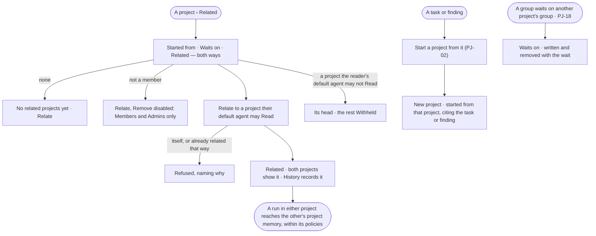

# PJ-23 · Relate a project to another or start one from it

**As** a member of a project **I want** to say which projects it is related to, start a new project from one of its
tasks or findings, and see which projects it waits on **so that** work that grows out of other work keeps its thread,
and its agents reach the context of the projects it belongs with — and only those.

Tasks: [task.md](task.md) · Feature: [PJ-F01](../../feature.md)

## Who can

*Projects and tasks* is *Acts* for every role in the [role table](../../../../../../os/access/features/AC-F02-access-policies/feature.md#the-role-table);
relating is a setting, its members' and the Admins', on projects the person's default agent may Read
([PJ-F01 › Access](../../feature.md#access)).

| Lens | Can | Otherwise sees |
|---|---|---|
| Admin | Relate any project to another their default agent may Read; start a project from a task or finding; remove a relation | A project their default agent may not Read is not offered |
| Operator | The same, on a project they are a member of; start a project from any task or finding they may read; a Modeller the same | On a project they are not a member of, *Relate* and *Remove* are disabled — *Members and Admins only* |

## Flow

## Acceptance criteria

| # | Given | When | Then |
|---|---|---|---|
| PJ-23.1 | A project | its *Related* tab opens | it lists the projects it started from, waits on and is related to, and those that started from, wait on or are related to it — each with its head and the relation |
| PJ-23.2 | A project with no relations | *Related* opens | it reads *No related projects yet*, with *Relate* for its members and the Admins |
| PJ-23.3 | A member or an Admin | they relate the project to another their default agent may Read | both projects list *Related*, and History records who |
| PJ-23.4 | A task or a finding | a person presses *Start a project from this* | *New project* opens with *Started from* set to its project and citing the task or finding; once created, both projects list the relation |
| PJ-23.5 | A group that waits on another project's group (PJ-18) | it is saved | both projects list *Waits on*; removing the last such wait removes the relation |
| PJ-23.6 | A project related to itself, or to one already related that way | it is saved | it is refused — *{project} is already {relation}*; nothing is saved |
| PJ-23.7 | A run of a task on a project | it reads project memory | it reaches its own project, the projects related to it by any relation, and its task — nothing else, whatever its policies allow beyond ([AC-F04](../../../../../../os/access/features/AC-F04-what-an-agent-may-touch/feature.md#rules)) |
| PJ-23.8 | An Operator or a Modeller who is not a member | they open *Related* | it reads; *Relate* and *Remove* are disabled — *Members and Admins only*; a call is refused the same way |
| PJ-23.9 | A related project the reader's default agent may not Read | *Related* lists it | its head reads; its content reads *Withheld — your agent may not read `project/{key}`* |
| PJ-23.10 | A relation | a member removes it | both projects stop listing it, a run started after it reaches only the projects still related, and History records it; *Waits on* is removed only with its group waits |

## Screens

| Surface | Lens | First use | Empty after a filter | Loading | Has data | Failed | Agent working or proposing | No access |
|---|---|---|---|---|---|---|---|---|
| Related | Admin | projects.project · Related · None yet | — | projects.project · Related · Loading | projects.project · Related | projects.project · Related · Refused | — | — |
| Related | Operator | projects.project · Related · None yet | — | projects.project · Related · Loading | projects.project · Related | projects.project · Related · Refused | — | projects.project · Related · Not a member |
| A related project withheld | Admin | — | — | — | projects.project · Related · Withheld | — | — | projects.project · Related · Withheld |
| A related project withheld | Operator | — | — | — | projects.project · Related · Withheld | — | — | projects.project · Related · Withheld |
| Start a project from this | Admin | projects.new · Started from | — | projects.new · Loading people | projects.new · Started from · Filled | projects.new · Refused | — | — |
| Start a project from this | Operator | projects.new · Started from | — | projects.new · Loading people | projects.new · Started from · Filled | projects.new · Refused | — | — |
