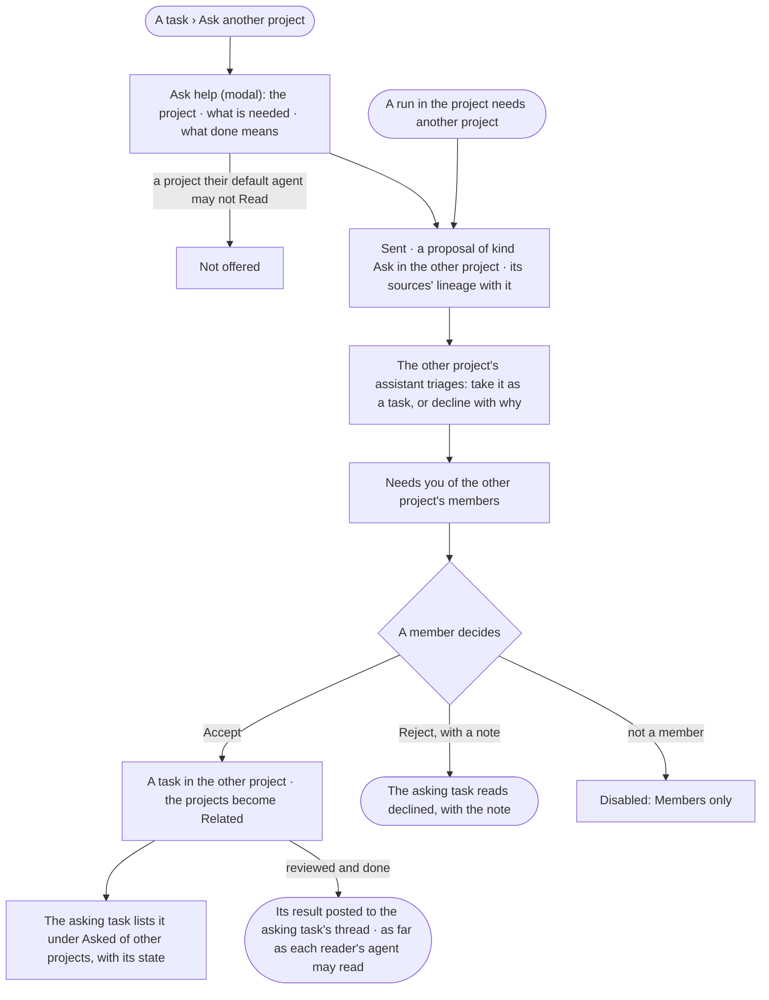
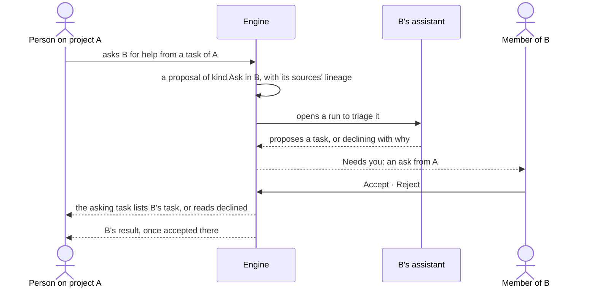

# PJ-24 · Ask another project for help

**As** someone working a task **I want** to ask another project for the part of it that is theirs — and have their
assistant and members decide whether to take it on **so that** work crosses projects without anyone writing tasks
into a project that is not theirs, and the answer comes back to my task. *The agent proposes → the person decides.*

Tasks: [task.md](task.md) · Feature: [PJ-F01](../../feature.md)

## Who can

*Projects and tasks* is *Acts* for every role in the [role table](../../../../../../os/access/features/AC-F02-access-policies/feature.md#the-role-table);
a person asks when their default agent may Read both projects; the other project's members accept
([PJ-F01 › Access](../../feature.md#access)).

| Lens | Can | Otherwise sees |
|---|---|---|
| Admin | Ask any project their default agent may Read for help from a task they may read; accept or reject an ask on a project they are a member of | A project their default agent may not Read is not offered as a target |
| Operator | The same; a Modeller the same | Not a member of the asked project: the ask reads there, *Accept* and *Reject* disabled — *Members only* |

## Flow

## Acceptance criteria

| # | Given | When | Then |
|---|---|---|---|
| PJ-24.1 | A task on a project | a person presses *Ask another project* | a modal asks for the project, what is needed and what done means; it offers only projects their default agent may Read |
| PJ-24.2 | An ask sent | the engine saves it | it is a proposal of kind *Ask* in the other project, naming the asking task and project, with its sources' lineage; nothing is written into the other project's tasks |
| PJ-24.3 | A run in a project that needs another project | it asks through `projects.asks.create` | the ask is made the same way, naming the run and its task |
| PJ-24.4 | An ask arriving | the other project's assistant triages it | it proposes taking it as a task — kind, fields and checks — or declining it with a reason, and the ask waits in the members' Needs you |
| PJ-24.5 | An ask | a member of the asked project accepts it | a task is made there, the two projects list *Related*, and the asking task lists it under *Asked of other projects* with its state |
| PJ-24.6 | An ask | a member rejects it with a note | the asking task reads that it was declined, by whom and why |
| PJ-24.7 | The task an ask made | a reviewer accepts it | its result is posted to the asking task's thread; each reader reads it as far as their default agent may Read its sources |
| PJ-24.8 | A person whose default agent may not Read both projects | they ask | it is refused — *Withheld — your agent may not read `project/{key}`*; nothing is sent |
| PJ-24.9 | An ask and a person who is not a member of the asked project | they open it | it reads as far as their default agent may Read; *Accept* and *Reject* are disabled — *Members only* |
| PJ-24.10 | An ask or its triage | a person who may read the run opens *How it got here* | it shows the asking run or the triage run's steps and sources; anyone else reads that it ran, its status and its tokens |

## Screens

| Surface | Lens | First use | Empty after a filter | Loading | Has data | Failed | Agent working or proposing | No access |
|---|---|---|---|---|---|---|---|---|
| Ask another project | Admin | projects.ask_help | projects.ask_help · No project matches | projects.ask_help · Loading projects | projects.ask_help · Filled | projects.ask_help · Refused | — | — |
| Ask another project | Operator | projects.ask_help | projects.ask_help · No project matches | projects.ask_help · Loading projects | projects.ask_help · Filled | projects.ask_help · Refused | — | projects.ask_help · Refused |
| An ask in the asked project | Admin | — | — | projects.assistant · Loading | projects.assistant · Ask from a project | — | projects.assistant · Ask · Triaging | projects.assistant · Ask · Not a member |
| An ask in the asked project | Operator | — | — | projects.assistant · Loading | projects.assistant · Ask from a project | — | projects.assistant · Ask · Triaging | projects.assistant · Ask · Not a member |
| Asked of other projects | Admin | — | — | projects.task · Loading | projects.task · Asked of other projects | projects.task · Ask declined | projects.task · Asked · Waiting | — |
| Asked of other projects | Operator | — | — | projects.task · Loading | projects.task · Asked of other projects | projects.task · Ask declined | projects.task · Asked · Waiting | projects.task · Asked · Withheld |
| An ask in Needs you | Admin | — | — | inbox · Loading | inbox · An ask from a project | inbox · Could not load | — | — |
| An ask in Needs you | Operator | — | — | inbox · Loading | inbox · An ask from a project | inbox · Could not load | — | — |
