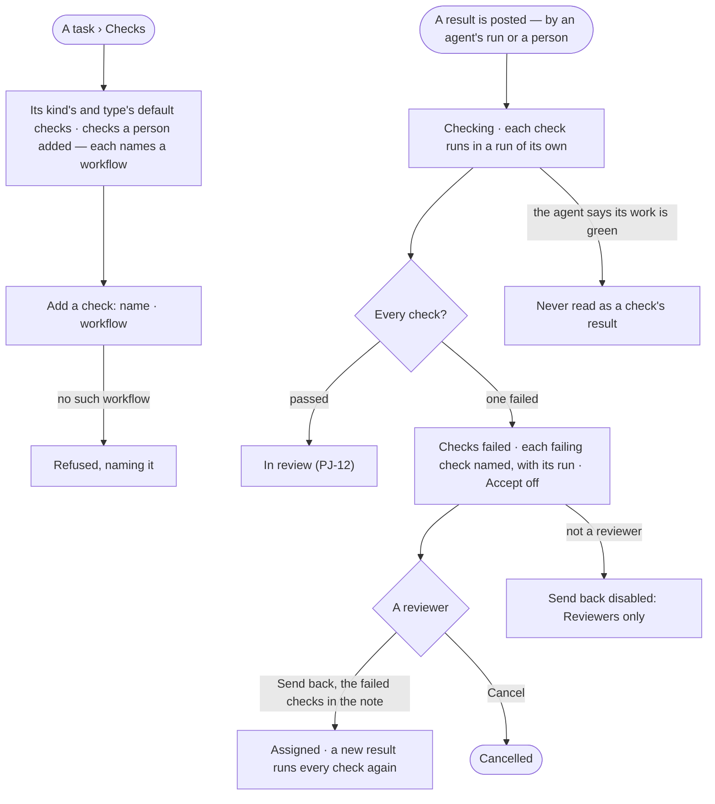
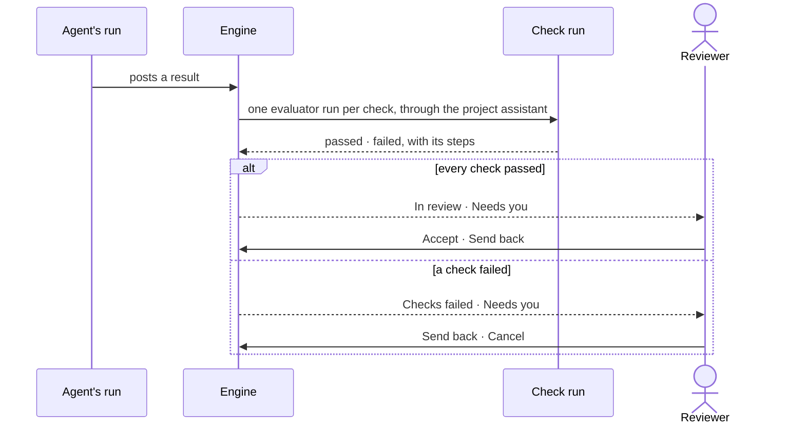

# PJ-25 · Gate a task on its checks

**As** a reviewer of a project **I want** a task's result checked by workflows that run on their own before it reaches
me **so that** I never accept work on an agent's word that it is done, and I read only results that passed what a
machine can prove.

Tasks: [task.md](task.md) · Feature: [PJ-F01](../../feature.md)

## Who can

*Projects and tasks* is *Acts* for every role in the [role table](../../../../../../os/access/features/AC-F02-access-policies/feature.md#the-role-table);
checks are added by anyone who may write the task; a result is accepted by the project's reviewers
([PJ-F01 › Access](../../feature.md#access)).

| Lens | Can | Otherwise sees |
|---|---|---|
| Admin | Add or take off a task's checks before a result is posted; read every check's result; send back a task whose checks failed on a project they review | Not a reviewer: *Send back* disabled — *Reviewers only* |
| Operator | The same, on every task their default agent may Read; a Modeller the same | Not a reviewer: *Send back* disabled — *Reviewers only*. A check's run they may not read: that it ran, its outcome and its tokens — *Content withheld* |

## Flow

## Acceptance criteria

| # | Given | When | Then |
|---|---|---|---|
| PJ-25.1 | A task of a kind, on a project of a type | it is created | its kind's and its type's default checks are on it, each naming its workflow |
| PJ-25.2 | A task before a result is posted | a person adds a check naming a workflow, or takes one off | it is saved and History records who |
| PJ-25.3 | A result posted on a task with checks | the engine takes it | the task reads *Checking*, naming each check; each runs its workflow in an evaluator run of its own, through the project assistant — never in the run that did the work |
| PJ-25.4 | Every check of the latest result | each passed | the task reads *In review* and the reviewers are told in Needs you (PJ-12) |
| PJ-25.5 | A check of the latest result | it failed | the task reads *Checks failed*, naming each failing check and opening its run; it is listed in the reviewers' Needs you |
| PJ-25.6 | A task whose checks have not all passed | a reviewer tries *Accept* | *Accept* is off — *{n} checks have not passed — {check}*; a call is refused the same way |
| PJ-25.7 | A task with checks failed | a reviewer sends it back | it reads *Assigned* with the failed checks in the note; the next result runs every check again — a failed check is never re-run on its own |
| PJ-25.8 | An agent's result | it says its own tests or checks are green | that claim is shown as part of the result and never counts as a check's result; only a check's run writes one |
| PJ-25.9 | A check naming a workflow that does not exist | it is saved | it is refused — *There is no workflow {key}*; nothing is saved |
| PJ-25.10 | A check's run | a person who may read it opens *How it got here* | it shows the workflow's steps and sources; anyone else reads that it ran, its outcome and its tokens |
| PJ-25.11 | A project with no assistant | a result's checks run | they run through the built-in Assistant, named as such on each check |
| PJ-25.12 | A task with checks failed and a person who is not a reviewer | they open it | the failures read; *Send back* is disabled — *Reviewers only* |

## Screens

| Surface | Lens | First use | Empty after a filter | Loading | Has data | Failed | Agent working or proposing | No access |
|---|---|---|---|---|---|---|---|---|
| A task's checks | Admin | projects.task · Checks · None | — | projects.task · Checks · Loading | projects.task · Checks | projects.task · Checks · Workflow refused | projects.task · Checking | — |
| A task's checks | Operator | projects.task · Checks · None | — | projects.task · Checks · Loading | projects.task · Checks | projects.task · Checks · Workflow refused | projects.task · Checking | projects.task · Withheld |
| Checks failed | Admin | — | — | — | projects.task · Checks failed | projects.task · Checks failed · Accept off | — | projects.task · Checks failed · Not a reviewer |
| Checks failed | Operator | — | — | — | projects.task · Checks failed | projects.task · Checks failed · Accept off | — | projects.task · Checks failed · Not a reviewer |
| A check's run | Admin | — | — | projects.task.thinking · Loading | projects.task.thinking · Check | projects.task.thinking · Check failed | projects.task.thinking · Check running | — |
| A check's run | Operator | — | — | projects.task.thinking · Loading | projects.task.thinking · Check | projects.task.thinking · Check failed | projects.task.thinking · Check running | projects.task.thinking · Content withheld |
| Checks failed in Needs you | Admin | — | — | inbox · Loading | inbox · Checks failed | inbox · Could not load | — | — |
| Checks failed in Needs you | Operator | — | — | inbox · Loading | inbox · Checks failed | inbox · Could not load | — | — |
