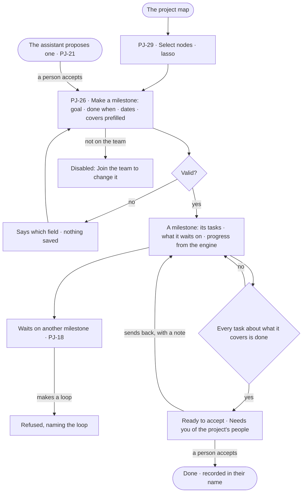

# PJ-26 · Make a milestone from a selection

**As** someone planning a project's work **I want** to select nodes on the project's map and make a milestone of them — with its goal, what done means, optional dates, and a person's yes to accept it **so that** a stretch of work has an end I can see, ordered after the milestones it waits on, and nobody calls it done on an agent's word.

Tasks: [task.md](task.md) · Feature: [PJ-F01](../../feature.md)

## Who can

| Access | Can | Otherwise sees |
|---|---|---|
| Admin | Make, edit, order and accept a milestone on any project they may read; the project assistant proposes one | On an archived project the acts are disabled, saying it is archived |
| Operator | The same, on every project they are on the team of | On a project they are not on the team of, *Make a milestone* and *Accept* are disabled — *Join the team to change it* |

## Flow

## Acceptance criteria

| # | Given | When | Then |
|---|---|---|---|
| PJ-26.1 | A person on the team has selected nodes on the project map (PJ-29) | they choose *Make a milestone* | a form opens with the selection as what it **covers**, asking a name, a goal and *done when* |
| PJ-26.2 | The form | it is saved | it is a group (PJ-18) that also has a goal, a done-when, optional start and end dates and its covers; it is listed on the Order and on the map |
| PJ-26.3 | A name, goal or done-when left empty, or an end date before its start | it is saved | it is refused naming the field and why; nothing is saved |
| PJ-26.4 | A milestone with no dates | the Order is read | it is placed by what it waits on alone; dates only mark it, they never order it |
| PJ-26.5 | A selection holding a node the person may not read | they make the milestone | it is refused naming that it is withheld; nothing is saved |
| PJ-26.6 | A milestone | a person makes it wait on another milestone, of this project or another | the wait follows PJ-18.18 to PJ-18.20, loops and cross-project refusals included |
| PJ-26.7 | A milestone with covers | its progress is read | it shows the engine's tasks done of tasks total for the tasks *about* or *changing* what it covers; Studio formats it and never adds up |
| PJ-26.8 | Every task about what a milestone covers is *Done* and every check of them passed | the engine settles it | the milestone reads *Ready to accept* and waits in the Needs you of the project's people; no agent can accept it |
| PJ-26.9 | A milestone ready to accept | a person on the team accepts it | it reads *Done*, recorded in their name; a send-back with a note returns it to *Open* |
| PJ-26.10 | A milestone the project assistant proposed | it is opened | *How it got here* shows the assistant's steps, the nodes it read and who accepted |
| PJ-26.11 | An Operator not on the team, or an archived project | they reach *Make a milestone* or *Accept* | it is disabled, saying *Join the team to change it* or that the project is archived; a call is refused the same way |

## Screens

| Surface | Access | First use | Empty after a filter | Loading | Has data | Failed | Agent working or proposing | No access |
|---|---|---|---|---|---|---|---|---|
| Milestones | Admin | projects.projects · Detail · Milestones · None yet | projects.projects · Detail · Milestones · Nothing matches | projects.projects · Detail · Milestones · Loading | projects.projects · Detail · Milestones | projects.projects · Detail · Milestones · Refused | projects.projects · Detail · Milestones · Proposed | — |
| Milestones | Operator | projects.projects · Detail · Milestones · None yet | projects.projects · Detail · Milestones · Nothing matches | projects.projects · Detail · Milestones · Loading | projects.projects · Detail · Milestones | projects.projects · Detail · Milestones · Refused | projects.projects · Detail · Milestones · Proposed | projects.projects · Detail · Milestones · Not on the team |
| Make a milestone | Admin | — | — | projects.graph · Make a milestone · Saving | projects.graph · Make a milestone | projects.graph · Make a milestone · Refused | — | — |
| Make a milestone | Operator | — | — | projects.graph · Make a milestone · Saving | projects.graph · Make a milestone | projects.graph · Make a milestone · Refused | — | projects.graph · Make a milestone · Not on the team |
| Accept a milestone | Admin | — | — | — | projects.projects · Detail · Milestones · Ready to accept | projects.projects · Detail · Milestones · Refused | — | — |
| Accept a milestone | Operator | — | — | — | projects.projects · Detail · Milestones · Ready to accept | projects.projects · Detail · Milestones · Refused | — | projects.projects · Detail · Milestones · Not on the team |
