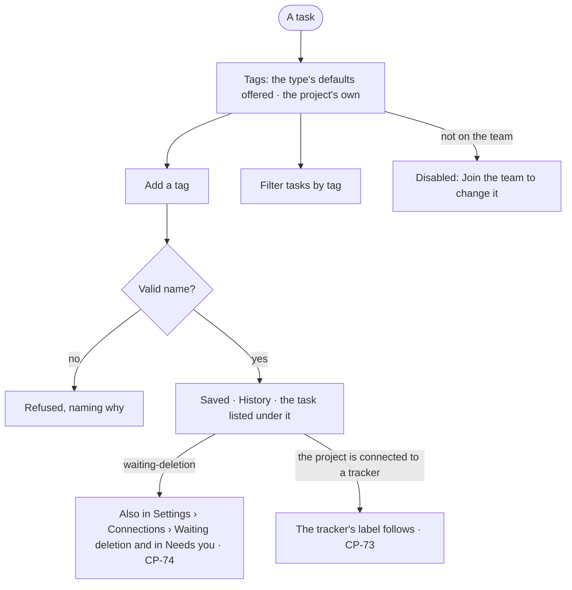

# PJ-27 · Tag a task

**As** a person on a project **I want** to tag a task — story, bug, test, review, audit, research, duplicate, waiting-deletion, or a tag of the project's own — **so that** I can filter work, route it to the agent who does that kind of work, and carry the same labels to the tracker the project is connected to.

Tasks: [task.md](task.md) · Feature: [PJ-F01](../../feature.md)

## Who can

| Access | Can | Otherwise sees |
|---|---|---|
| Admin | Add and remove tags on any task of any project; add a tag of the project's own | On an archived project the acts are disabled, saying it is archived |
| Operator | The same on every project they are on the team of | On a project they are not on the team of, the tags read; the acts are disabled — *Join the team to change it* |

## Flow

## Acceptance criteria

| # | Given | When | Then |
|---|---|---|---|
| PJ-27.1 | A project of a type | a task is written or opened | it offers the tags the type ships as defaults — the software type: story · bug · test · review · audit · duplicate · waiting-deletion; the research type: research · review · duplicate · waiting-deletion — and the project's own tags |
| PJ-27.2 | A person on the team | they add or remove a tag | it is saved, History records who and which tag, and a task may carry any number of tags |
| PJ-27.3 | A tag that is empty, longer than 32 characters or has a space | it is saved | it is refused naming why; nothing is saved |
| PJ-27.4 | A task kind that only labelled the work — *Story*, *Bug* | a project of a type is read | it is a tag; a kind remains only where it asks for fields of its own (*Task*, *Recommendation*, PJ-20) |
| PJ-27.5 | Tasks | a person filters by a tag | the list narrows to it, in the project and in *My tasks*; the badge reads in the type's words |
| PJ-27.6 | An agent in a run | it adds or removes a tag on a task its policies let it write | it is saved and shown as the agent's act; an act outside its policies is refused, naming the rule |
| PJ-27.7 | A project connected to an issue tracker | a tag is added or removed | the label of the same name follows on the linked issue (CP-73.5) |
| PJ-27.8 | A task tagged *waiting-deletion* | it is saved | it reads in Settings › Connections and in Needs you (CP-74); the tag never deletes anything |
| PJ-27.9 | An Operator not on the team, or an archived project | they add a tag | it is disabled, saying *Join the team to change it* or that the project is archived; a call is refused the same way |

## Screens

| Surface | Access | First use | Empty after a filter | Loading | Has data | Failed | Agent working or proposing | No access |
|---|---|---|---|---|---|---|---|---|
| Tags on a task | Admin | projects.tasks · Detail · Tags · None yet | — | projects.tasks · Detail · Tags · Loading | projects.tasks · Detail · Tags | projects.tasks · Detail · Tags · Refused | projects.tasks · Detail · Tags · Agent tagged | — |
| Tags on a task | Operator | projects.tasks · Detail · Tags · None yet | — | projects.tasks · Detail · Tags · Loading | projects.tasks · Detail · Tags | projects.tasks · Detail · Tags · Refused | projects.tasks · Detail · Tags · Agent tagged | projects.tasks · Detail · Tags · Not on the team |
| Filter by tag | Admin | — | projects.tasks · Tag filter · Nothing matches | projects.tasks · Tag filter · Loading | projects.tasks · Tag filter | — | — | — |
| Filter by tag | Operator | — | projects.tasks · Tag filter · Nothing matches | projects.tasks · Tag filter · Loading | projects.tasks · Tag filter | — | — | projects.tasks · Tag filter |
