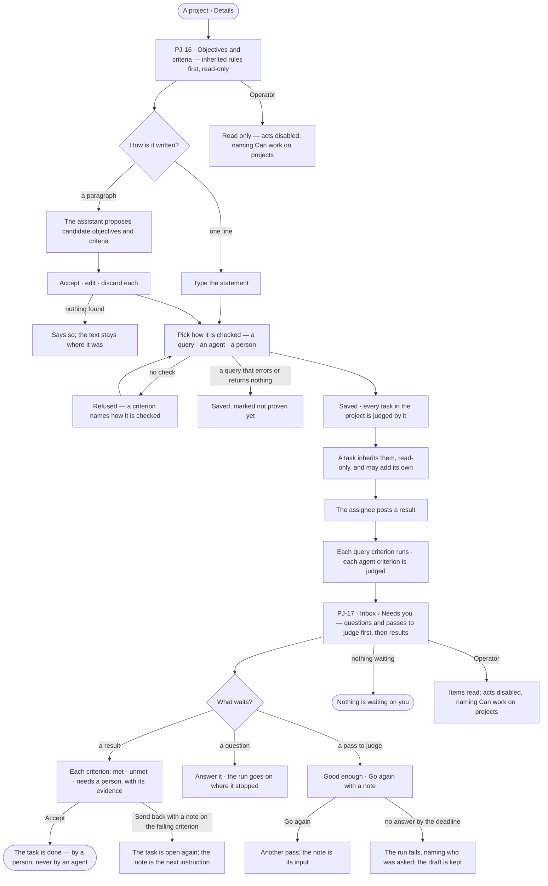
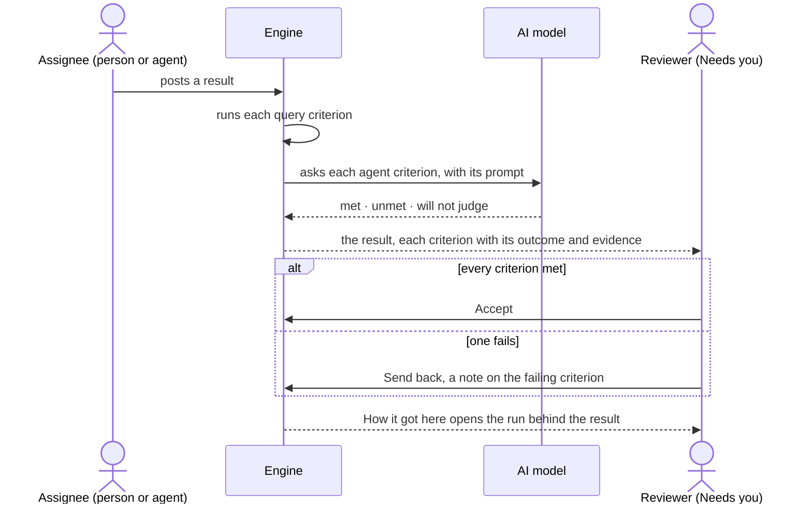

# Objectives and review

> A project's goal and its *done* are written as short statements an agent can cite and a check can prove; whatever
> waits on a person — a result to accept, a question an agent asked, a pass to judge — reaches them in one list. The
> decisions it helps make: *is this work done, by the criteria we agreed?* — and, when it is not, *which criterion
> failed, and what should happen next?*

## User journey

Journeys this feature is a step of: [J03 · Give an agent work and decide on the result](../../../../journeys/J03-give-an-agent-work-and-decide-on-the-result.md)

## Stories

| ID | Story | Status |
|---|---|---|
| PJ-16 | [Say what done means](stories/PJ-16-say-what-done-means/story.md) | idea |
| PJ-17 | [Decide what waits on me](stories/PJ-17-decide-what-waits-on-me/story.md) | idea |

## Access

| Act | Role (`.claude/team/TEAM.md` §7) | Everyone else sees |
|---|---|---|
| Read a project's objectives, criteria and every outcome | Operator — every member who can see the project | — |
| Add, edit or remove an objective or a project criterion; add a task's own criterion | `contributor` · shown as *Can work on projects* · Admin | Read only; each act disabled, naming *Can work on projects* |
| Accept or send back a result · answer an agent's question on a task · judge a pass | `contributor` · shown as *Can work on projects* · Admin — a person, never an agent | The item reads; its acts are disabled, naming *Can work on projects* |
| A project's rules | MO-F06 — *Can shape the model* | As MO-F06 says |

## States

| State | What the person sees |
|---|---|
| First use | A project with no criteria: *No criteria yet — a task here is accepted by eye*, with *Add an objective* and *Add a criterion*. Needs you with nothing in it: *Nothing is waiting on you*, as good news |
| Empty after a filter | Needs you filtered by kind, agent or age with no match: *Nothing matches*, with *Clear filters* |
| Loading | The Details section and Needs you drawn at once; rows load in place |
| Has data | Objectives, each with the criteria that measure it, then criteria standing alone; Needs you grouped — questions and passes first, then results |
| Failed | The list could not load, saying why, with *Try again*. A criterion whose check could not run reads *needs a person*, with the error under it — never *unmet* |
| Agent working or proposing | The assistant's candidate objectives and criteria from a pasted paragraph, each to accept, edit or discard; an agent criterion being judged reads *checking* |
| No access | Objectives, criteria and every item in Needs you read; every act disabled, naming *Can work on projects* |

## Rules

| Rule | Detail |
|---|---|
| An objective is one statement | On a project, with no body — a paragraph is two objectives |
| A criterion says how it is checked | *A query* (it must return) · *An agent* (a judgement prompt, previewed on a past result) · *A person* (decided at review). One with no check is refused at save |
| Criteria measure objectives, or stand alone | Linking a criterion to an objective is optional |
| A task inherits by reference | A task is judged by its project's criteria, read-only and live — editing a project criterion changes what every open task is judged by. A task may add its own, and may have none |
| A check that cannot run needs a person | A query that errors and an agent that will not judge read *needs a person*, showing the error or the prompt it was given — never *unmet* |
| A check never proven | A query that errored or returned nothing when saved is marked *not proven yet*; it still reaches review and a person decides it |
| Outcomes keep what they judged | An outcome keeps the criterion's statement as it was checked; an edit applies only to results not judged yet |
| Accepting is one deliberate act | Every criterion met still waits for *Accept*; nothing is accepted on its own. A result with no criteria says it is being taken on trust |
| A send-back names its criterion | The note sits on the criterion that failed and becomes the task's next instruction |
| Only a person closes a task | An agent posts results; a person accepts. An agent that judges a criterion gives an outcome, never an acceptance |
| One list of what waits | Needs you holds every item waiting on a person: an agent's question on a task and a pass to judge first, because a run is stopped on each; then results to accept. Approvals before a run acts are AC-F05's; suggested changes EX-F07's — all in the same list |
| A question resumes its run | Answering continues the run where it stopped |
| A pass to judge | *Good enough* settles the loop · *Go again* with a note runs another pass with the note as its input; the item shows what the pass produced, which pass it is, how many remain and the tokens spent. Unanswered by its deadline, the run fails naming who was asked, and the draft is kept; five *Go again* with no *Good enough* fail the run, every pass and note kept |
| Work items only | Needs you lists what an agent or a person raised — never a graph row because data looked odd |
| Shared, and signed | Anyone who can work on projects may act on any item; History says who did |
| Nothing is written to the source | Objectives, criteria and outcomes live in Invana's own store, never in the connected database |
| Leans on | Projects and tasks (PJ-F01) · Rules (MO-F06 — a project's rules sit in its Details, inherited first) · Suggested changes (EX-F07) · the Inbox (GR-F05) · runs and their trace (AG-F03) |

## Data touched

| Record | Read or write |
|---|---|
| Objectives — project, statement, open · met · dropped, order | Write · read |
| Criteria — project or task, the objective it measures, statement, how it is checked, the check, revision | Write · read |
| Criterion outcomes — the criterion and its revision, the statement checked, the task, met · unmet · needs a person, evidence, who checked | Write · read |
| Tasks and their latest run (PJ-F01, AG-F03) | Read · accept or send back |
| Questions and passes waiting in runs | Read · answer |
| History rows of every accept, send-back, answer and judgement (AC-F06) | Write |

## Decisions

| Decision | Detail |
|---|---|
| Goals belong to a project | A Graph has rules, not goals; objectives and criteria sit on a project |
| Statements, not paragraphs | Prose is an input: a pasted paragraph becomes candidates a person accepts; nothing stores a paragraph of *done* |
| Review is Inbox › Needs you | There is one place for what waits on a person; Projects adds its kinds to it rather than a queue of its own |
| A revision, not versions | A criterion carries a revision; its outcomes keep the statement they judged |
| Rules are MO-F06's | A project's working rules are written and checked as MO-F06 says; this feature shows them, inherited first, beside the criteria |

## Open questions

| Question | Who answers |
|---|---|
| Does a query criterion re-run on every result, or only when asked? Recommend: on every result — the reviewer sees fresh evidence without asking | Ravi |
| Is an objective closed by hand, or only by its criteria being met? Recommend: by hand, with its criteria's outcomes shown — an objective can be met by work no criterion measures | Ravi |

## Not building

| Item | Why not |
|---|---|
| Waivers on a criterion | A waiver is a policy decision; a criterion is met, unmet or needs a person |
| Weights, scores and pass thresholds | A criterion is met or it is not |
| Editing an inherited criterion on a task | Narrowing is adding the task's own |
| Criteria on a Graph | A Graph states rules; goals live with the work |
| Assigning a review item to one person | The list is shared; History says who acted |
| Items raised by data conditions | An agent noticing is what creates work |
| Accepting many results at once | Acceptance is per result, with its evidence |
