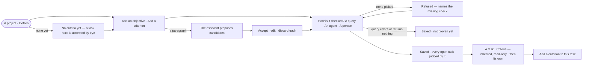

# PJ-16 · Say what done means

**As** the person accountable for a project **I want** its goal and its *done* written as statements an agent can
cite and a check can prove **so that** accepting work is a judgement about named criteria — and a send-back says
which one failed.

Tasks: [task.md](task.md) · Feature: [PJ-F02](../../feature.md)

## Who can

| Lens | Can | Otherwise sees |
|---|---|---|
| Admin | Add, edit and remove objectives and project criteria; add a task's own criteria; accept or discard the assistant's candidates | — |
| Operator | Read every objective, criterion and outcome of a project they can see | *Add an objective*, *Add a criterion*, *Edit*, *Remove* and *Paste a paragraph* disabled, naming *Can work on projects*. *With Can work on projects: as Admin* |

## Flow

## Acceptance criteria

| # | Given | When | Then |
|---|---|---|---|
| PJ-16.1 | A project with no objectives or criteria | a member opens its Details | it reads *No criteria yet — a task here is accepted by eye*, with *Add an objective* and *Add a criterion* — never as an error |
| PJ-16.2 | A member who can work on projects | they add an objective | it is saved as one statement on the project, with no body |
| PJ-16.3 | A new criterion | it is saved with no way of being checked | it is refused, naming the missing check |
| PJ-16.4 | A new criterion checked by a query | it is saved | the query runs once; if it errors or returns nothing the criterion is saved marked *not proven yet* |
| PJ-16.5 | A new criterion checked by an agent | its prompt is written | it is previewed on a past result of the project before saving |
| PJ-16.6 | A criterion | it is saved with or without an objective | it lists under the objective it measures, or under *Standing alone* |
| PJ-16.7 | A member pastes a paragraph | the assistant reads it | candidate objectives and criteria are proposed, each to accept, edit or discard; nothing is saved until accepted |
| PJ-16.8 | A pasted paragraph that resolves to nothing | the assistant reads it | it says so, and the text stays where it was |
| PJ-16.9 | Candidates the assistant proposed | the person opens *How it got here* | it shows which sentence each candidate came from |
| PJ-16.10 | A project with criteria | a task in it is opened | its Criteria lists the project's first, read-only, then the task's own |
| PJ-16.11 | A task | a member adds a criterion to it | it applies to that task alone; the inherited ones are unchanged |
| PJ-16.12 | A task with no criteria of its own in a project with none | it is opened | it reads *No criteria — accepted by eye*, and the task can still be worked and accepted |
| PJ-16.13 | A project criterion edited while a task's result is in review | the result is reviewed | outcomes already recorded keep the statement they judged; criteria not yet judged use the new statement |
| PJ-16.14 | A project's rules | its Details is opened | the Graph's and the install's rules read first, dimmed and read-only, then the project's own (MO-F06) |
| PJ-16.15 | An Operator | they open a project's Details and a task's Criteria | both read; *Add an objective*, *Add a criterion*, *Edit*, *Remove* and *Paste a paragraph* are disabled, naming *Can work on projects* |

## Screens

| Surface | Lens | First use | Empty after a filter | Loading | Has data | Failed | Agent working or proposing | No access |
|---|---|---|---|---|---|---|---|---|
| A project › Details — objectives and criteria | Admin | projects.project · No criteria yet | — | projects.project · Loading | projects.project · Objectives and criteria | projects.project · Criterion refused | projects.project · Candidates from a paragraph | — |
| A project › Details — objectives and criteria | Operator | projects.project · No criteria yet · Read only | — | projects.project · Loading | projects.project · Objectives and criteria · Read only | projects.project · Could not load | projects.project · Candidates from a paragraph · Read only | projects.project · Objectives and criteria · Read only |
| A task › Criteria | Admin | projects.task · No criteria | — | projects.task · Loading | projects.task · Criteria | projects.task · Criterion not proven yet | — | — |
| A task › Criteria | Operator | projects.task · No criteria · Read only | — | projects.task · Loading | projects.task · Criteria · Read only | projects.task · Criterion not proven yet | — | projects.task · Criteria · Read only |
