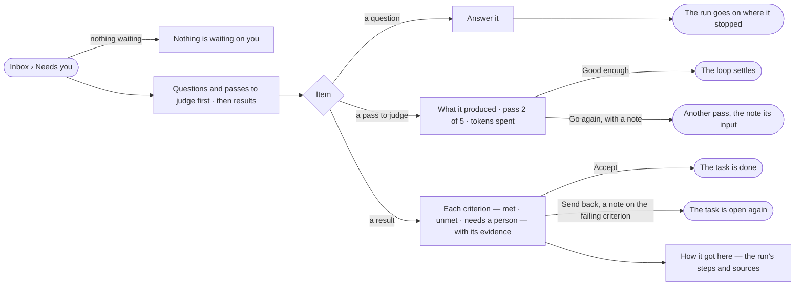

# PJ-17 · Decide what waits on me

**As** the person project work waits on **I want** one list of the results, questions and passes waiting for me,
with what each needs **so that** nothing sits stopped because I did not know it was asking — the agent proposes a
result, and I decide whether it is done.

Tasks: [task.md](task.md) · Feature: [PJ-F02](../../feature.md)

## Who can

| Lens | Can | Otherwise sees |
|---|---|---|
| Admin | Accept or send back a result; answer an agent's question on a task; judge a pass — on any item in the Graph | — |
| Operator | Read every item in Needs you from projects they can see, and its evidence | *Accept*, *Send back*, *Answer*, *Good enough* and *Go again* disabled, naming *Can work on projects*. *With Can work on projects: as Admin* |

## Flow

## Acceptance criteria

| # | Given | When | Then |
|---|---|---|---|
| PJ-17.1 | Nothing waits on the member | they open Inbox › Needs you | it reads *Nothing is waiting on you*, as good news |
| PJ-17.2 | Questions, passes to judge and results waiting | Needs you opens | questions and passes are listed first, then results; each item says what it is, which project and task, who raised it and its age |
| PJ-17.3 | A result | it is opened | every criterion the task is judged by shows *met*, *unmet* or *needs a person*, each with its evidence |
| PJ-17.4 | A result whose query check errored, or whose agent check would not judge | it is opened | that criterion reads *needs a person*, with the error or the prompt it was given — never *unmet* |
| PJ-17.5 | A result with every criterion met | it is opened | *Accept* is still one deliberate act; nothing was accepted on its own |
| PJ-17.6 | A result with no criteria | it is opened | it says it is being taken on trust; *Accept* and *Send back* stay available |
| PJ-17.7 | A result | the member presses *Send back* with a note on one criterion | the note sits on that criterion, the task is open again, and the note is its next instruction |
| PJ-17.8 | A result posted by an agent | the member opens *How it got here* | it shows the run's steps and sources |
| PJ-17.9 | An agent's question on a task | the member answers it | the item leaves Needs you and the run goes on where it stopped |
| PJ-17.10 | A pass to judge | it is opened | it shows what the pass produced, which pass it is, how many remain and the tokens spent |
| PJ-17.11 | A pass to judge | the member presses *Go again* with a note | another pass runs with the note as its input |
| PJ-17.12 | A pass nobody judges | its deadline passes | the run fails, naming who was asked; the draft is kept, never accepted |
| PJ-17.13 | Five *Go again* and no *Good enough* | the fifth pass is judged *Go again* | the run fails, and every pass and its note stay on the record |
| PJ-17.14 | Needs you | the member filters by kind, agent or age and nothing matches | it reads *Nothing matches*, with *Clear filters* |
| PJ-17.15 | An item raised for another person | a member who can work on projects acts on it | it is decided, and History says who acted |
| PJ-17.16 | An agent | it tries to accept a result | it is refused; only a person closes a task |
| PJ-17.17 | An Operator | they open Needs you and an item | both read, with their evidence; *Accept*, *Send back*, *Answer*, *Good enough* and *Go again* are disabled, naming *Can work on projects* |

## Screens

| Surface | Lens | First use | Empty after a filter | Loading | Has data | Failed | Agent working or proposing | No access |
|---|---|---|---|---|---|---|---|---|
| Inbox › Needs you | Admin | inbox · Nothing is waiting on you | inbox · Nothing matches | inbox · Loading | inbox · Needs you · Project work | inbox · Could not load | inbox · Needs you · A question from an agent | — |
| Inbox › Needs you | Operator | inbox · Nothing is waiting on you | inbox · Nothing matches | inbox · Loading | inbox · Needs you · Project work · Read only | inbox · Could not load | inbox · Needs you · A question from an agent · Read only | inbox · Needs you · Project work · Read only |
| A result to accept | Admin | — | — | projects.task · Loading | projects.task · Result to accept | projects.task · Check needs a person | projects.task · Criteria being checked | — |
| A result to accept | Operator | — | — | projects.task · Loading | projects.task · Result to accept · Read only | projects.task · Check needs a person | projects.task · Criteria being checked | projects.task · Result to accept · Read only |
| A pass to judge | Admin | — | — | inbox · Loading | inbox · A pass to judge | inbox · Pass deadline passed | inbox · A pass to judge · Running | — |
| A pass to judge | Operator | — | — | inbox · Loading | inbox · A pass to judge · Read only | inbox · Pass deadline passed | inbox · A pass to judge · Running | inbox · A pass to judge · Read only |
| How it got here | Admin | — | — | projects.task.thinking · Loading | projects.task.thinking | projects.task.thinking · Could not load | projects.task.thinking · Running | — |
| How it got here | Operator | — | — | projects.task.thinking · Loading | projects.task.thinking | projects.task.thinking · Could not load | projects.task.thinking · Running | — |
