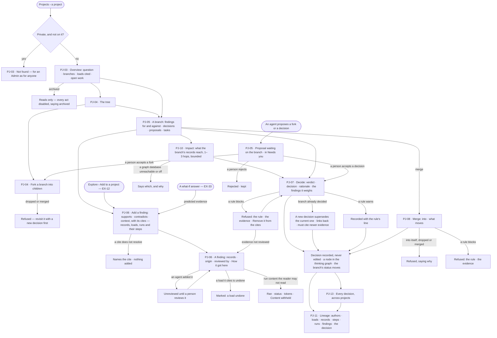
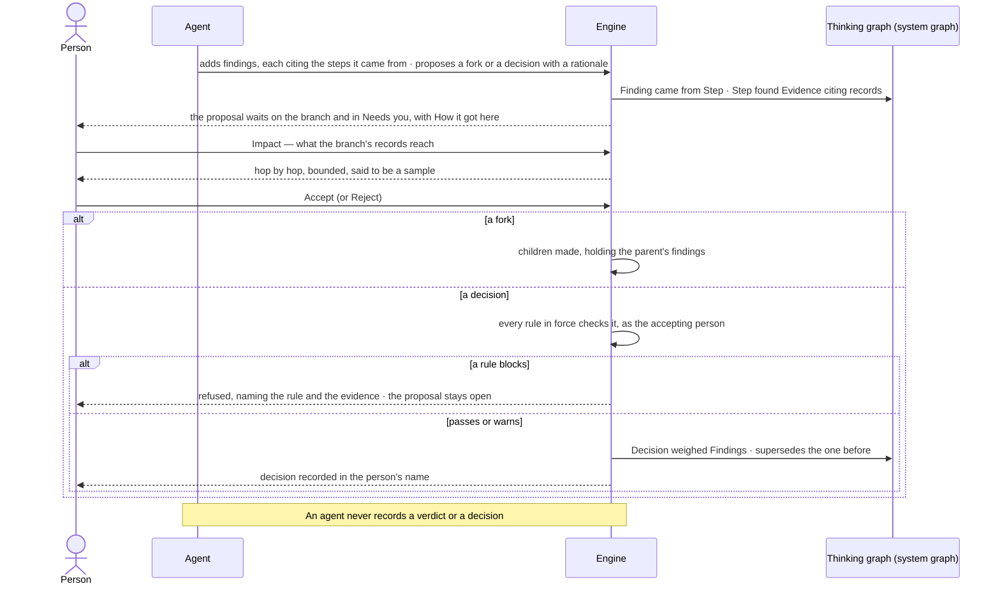

# Branches, findings and decisions

> A project is one question. Its lines of inquiry are branches; the evidence for and against each is a finding, citing
> the records and the steps of the runs it came from; a person closes a line with a verdict and a decision that the
> rules check, sees what it reaches before committing, and never edits it — a later decision supersedes it. Agents
> propose; people decide. The decisions it helps make: *which line do we pursue, park, drop or merge — what does it
> rest on, and what does it reach?*

## User journey

Journeys this feature is a step of: [J03 · Give an agent work and decide on the result](../../../../journeys/J03-give-an-agent-work-and-decide-on-the-result.md)

## Stories

| ID | Story | Status |
|---|---|---|
| PJ-03 | [See where a project stands](stories/PJ-03-see-where-a-project-stands/story.md) | idea |
| PJ-04 | [Fork a line of inquiry and see the tree](stories/PJ-04-fork-a-line-of-inquiry-and-see-the-tree/story.md) | idea |
| PJ-05 | [Read a branch with its evidence and proposals](stories/PJ-05-read-a-branch-with-its-evidence-and-proposals/story.md) | idea |
| PJ-06 | [Weigh a finding and the records behind it](stories/PJ-06-weigh-a-finding-and-the-records-behind-it/story.md) | idea |
| PJ-07 | [Record a verdict and a decision the rules check](stories/PJ-07-record-a-verdict-and-a-decision-the-rules-check/story.md) | idea |
| PJ-08 | [Merge what one branch learned into another](stories/PJ-08-merge-what-one-branch-learned-into-another/story.md) | idea |
| PJ-10 | [See what a decision reaches](stories/PJ-10-see-what-a-decision-reaches/story.md) | idea |
| PJ-11 | [Follow a decision back to the original authors](stories/PJ-11-follow-a-decision-back-to-the-original-authors/story.md) | idea |
| PJ-13 | [Audit every decision in one place](stories/PJ-13-audit-every-decision-in-one-place/story.md) | idea |

## Access

Who may do what is the [role table](../../../../os/access/features/AC-F02-access-policies/feature.md#the-role-table):
*Branches, findings and decisions* is *Acts* for Operator, Modeller and Admin — on every project the person can see
([PJ-F01](../PJ-F01-projects-and-tasks/feature.md#access)), reading records through the agents they may use.

| Act | Who | Everyone else sees |
|---|---|---|
| Read a project's branches, findings, decisions, proposals, lineage and the Decisions page | Anyone who can see the project | A private project is absent for anyone not on it, an Admin included; a link reads *Not found* |
| Fork, merge, add or review a finding, record a verdict and a decision, accept or reject a proposal, file a task on a branch | A person who can see the project — Operator · Modeller · Admin | On an archived project, each act is disabled, saying it is archived |
| Add findings, propose a fork or a decision | An agent, in a run on the project | A proposal reads as waiting, with its rationale and *How it got here* |
| Record a verdict or a decision | A person, never an agent | An agent can only propose |
| Read the records a finding cites, and an impact reach | Through the agents the reader may use, under their Access Policies ([AC-F02](../../../../os/access/features/AC-F02-access-policies/feature.md)) | A kind the reader's agents may not read is not shown and never reached |
| Read the run and steps behind a finding or a proposal | The person behind the run, the agent's owners, Admins ([CP-F10](../../../../os/control/features/CP-F10-runs-and-how-the-agents-are-doing/feature.md)) | That it ran, its status and its tokens — *Content withheld* |
| Own a decision | Nobody — a decision is not owned: it is immutable and only superseded ([AC-F07](../../../../os/access/features/AC-F07-ownership/feature.md)) | — |

## States

| State | What the person sees |
|---|---|
| First use | A project just started: the question as one open branch, *No findings yet*; a branch with no findings says so with *Add a finding*; Decisions says *No decisions yet*; Impact with no record cites says *Add a finding that cites a record* |
| Empty after a filter | The lineage narrowed by *Show* to a source that holds nothing says so |
| Loading | The page is drawn at once; the lists, the tree, the lineage and the impact rings fill in |
| Has data | The overview, tree, branch, finding, impact, decisions and lineage as their stories describe |
| Failed | The page could not load, saying why, with *Try again*; an act the engine refuses names the reason and changes nothing; an impact reach that cannot read a graph database names it |
| Agent working or proposing | A proposal waits on its branch, an agent's finding reads *Unreviewed*; each opens *How it got here*; an impact reach says which hop it is on |
| No access | A private project does not open. A run the reader may not read shows that it ran, its status and its tokens — *Content withheld*. A record the reader's agents may not read is not shown |

## Rules

| Rule | Detail |
|---|---|
| The type carries the words | Engine, API and specs always say Project · Task · Branch · Finding · Decision. A project's type relabels them in Studio **inside the project only** — its heading, tabs, dialogs and report (below). Shared places — Projects, My tasks, Inbox › Needs you, Decisions, search, History — keep the generic words with the type as a badge. The records underneath are the same for every type; changing the type only relabels |
| Where types come from | The built-in types and the project types a Domain pack installs (CP-F02); none is written in Studio |
| One question, one tree | A project has one question; its first branch is the question as asked, open. Branches live inside the project and are never projects of their own |
| Branch status | open (the question, or a line not yet worked) · pursuing · parked (evidence kept) · dropped (kept, struck through) · merged. A decision moves it: pursue, park, drop, merge |
| Fork | Children hold the parent's findings and the loads they cite; open tasks stay on the parent; the parent's status does not change |
| A finding has a stance | supports · contradicts · context; it cites records (graph database, kind and record ID), loads (by stable id and content hash), runs and the steps of a run. Origin and review come from where it was added |
| Findings live in the thinking graph | Every finding is a node in the system graph; an agent's finding links to the steps it came from, and through them to the evidence and the records they read ([AG-F09](../../../agents/features/AG-F09-thinking-graph-and-memory/feature.md)) |
| Predicted is not observed | A finding from a what-if answer ([EX-33](../../../explore/features/EX-F05-when-it-cannot-answer-and-how-it-reasons/stories/EX-33-ask-what-if-and-read-the-prediction-as-evidence/story.md)) cites evidence labelled *predicted* and reads *predicted* beside its stance wherever it shows; balances count it apart |
| A person's finding is reviewed; an agent's is not | A person's is reviewed by them at once; an agent's waits for a person's *Review* |
| Verdict | In the type's words, separate from the decision; it addresses every contradicting finding on the branch |
| A decision weighs findings | A decision cites the findings it weighs; through them it reaches the steps, runs, evidence and records behind it. It is a node in the thinking graph, linked to each finding it weighed |
| Rules check every decision | The rules in force on the deployment and on the project that check a decision (SE-F07): block refuses, naming the rule and the evidence that broke it; warn records it with a line; report records the check in History |
| Superseded, never edited | A decision is never edited or deleted. Revisiting one is a new decision that names the one it supersedes, links back to it and cites a finding added after it; the older one reads *Superseded*, linking to the decision that supersedes it |
| Not owned | A decision belongs to its project and names who decided; nobody owns it, hands it over or changes it |
| Merge is a decision | It carries chosen findings into another branch of the same project; findings are shared, never copied; both branches keep their history; the source is always marked merged |
| Agents propose | A fork or a decision, with a rationale; a person accepts or rejects; accepting a decision runs the full rule check as the accepting person. An open proposal is listed in the Inbox › Needs you of the project's owners and people ([CP-F08](../../../../os/control/features/CP-F08-the-inbox/feature.md)) |
| Impact starts from the evidence | Impact starts from the records the branch's findings cite, every stance, and walks 1, 2 or 3 hops (2 by default) across every graph database, joined on identity links; each hop is what the one before reached, less what was already reached |
| Impact is bounded, and says so | At most 12 records expanded per hop, each to 50 neighbours, the most reached first; a cut reach reads *A sample — more lies beyond* (NFR-PERF-5) |
| Impact reads as the person | An impact reach is one run of the built-in Assistant with the reader behind it, under its Access Policies; a kind the reader's agent may not read is never reached; every read is in the ledger |
| How sure is the evidence's | How many of the findings it starts from a person reviewed, and the sources of the loads they cite — upload, CLI, API or by hand — and their licences — never a score |
| Reach only | Impact reads what a decision touches; it predicts nothing — a what-if is a question in Explore ([EX-F05](../../../explore/features/EX-F05-when-it-cannot-answer-and-how-it-reasons/feature.md)). No figure in any currency |
| Loads cited | The loads a branch's findings cite — no second list. A load undone in Records flags every finding and decision that cites it |
| Private projects | Seen only by their owners and the people on them, an Admin included (PJ-F01) |
| Run privacy | The run and steps behind a finding, a proposal or a lineage node read to the person behind the run, its agent's owners and Admins; anyone else reads that it ran, its status and its tokens |
| Archived | An archived project reads; every act is disabled |
| Numbers are the engine's | Branch, finding, decision and proposal numbers, balances, impact counts and *current · recorded* are stored or counted by the engine; Studio formats them |
| Leans on | Projects and tasks (PJ-F01) · loads and undoing a load (RC-F02) · adding an answer as a finding (EX-F02) · what-if answers (EX-F05) · expanding records (EX-F01) · runs, run privacy and *How it got here* (CP-F10) · rules (SE-F07) · the thinking graph (AG-F09) · identity links (SE-F06) |

| Project type | A project is a | A task is a | A branch is a | Evidence is a | Verdict | Decision |
|---|---|---|---|---|---|---|
| Research | Study | Task | Hypothesis | Finding | supported · refuted · inconclusive | pursue · park · drop |
| Investigation | Case | Action | Lead | Evidence | confirmed · ruled out · open | escalate · monitor · close |
| Policy | Review | Task | Option | Evidence | effective · harmful · unclear | adopt · amend · reject |
| General | Project | Task | Option | Evidence | supported · against · unclear | choose · park · drop |

| A type also carries | Detail |
|---|---|
| Default rules | The rules in force on a new project of the type (SE-F07); its owners may add more |
| Suggested agents and skills | Offered first when staffing the project or a task; never added without a person's yes |
| A report template | What a report of the type opens with (PJ-F05) |

## Data touched

| Record | Read or write |
|---|---|
| Branches — number, parent, title, status, merged into | Write · read |
| Findings — statement, stance, cites, predicted, added by (person or agent), reviewed by | Write · read |
| Decisions — verdict, decision, rationale, the findings it weighs, addressed findings, merged into, supersedes, rules checked, warnings, decided by | Write · read |
| Proposals — fork or decision, rationale, agent, the run, accepted or rejected, by whom | Write · read |
| Tasks filed on a branch (PJ-F01) | Write · read |
| Finding and decision nodes and their edges in the thinking graph (AG-F09) | Write through the outbox · read |
| Loads cited, and the notice when one is undone (RC-F02) | Read |
| Runs and steps cited, and who may read them (CP-F10) | Read |
| Records cited and reached, through the reader's agent (EX-F01) | Read |
| Rules in force (SE-F07) | Read |
| History rows of every fork, finding, review, decision and proposal (AC-F06) | Write · read |

## Engine

The low-level design: what this feature stores, serves and refuses. Conventions — naming, errors, lists, events — are
[system-design.md](../../../../system-design.md) §§ 6–8; this section only fills them in.

### Records

| Table | Columns | Notes |
|---|---|---|
| `projects_branches` | `project_id` · `number` · `parent_id?` · `title` · `body` · `status` (`open` · `pursuing` · `parked` · `dropped` · `merged`) · `merged_into_id?` · `created_by_kind` · `created_by_id` | The first branch is the question as asked, written at project create |
| `projects_findings` | `project_id` · `branch_id` (added on) · `number` · `statement` · `stance` (`supports` · `contradicts` · `context`) · `cites[]` · `predicted` · `added_by_kind` (`user` · `agent`) · `added_by_id` · `run_id?` · `reviewed_by_id?` · `reviewed_at?` | A cite is `{kind: record · load · run · step, ref}`; a record cite is `{graph_database, kind, record_id}`; a load cite is resolved on add to its stable id and content hash; a step cite is `{run_id, step_id}`. `predicted` is set when any cite is evidence labelled *predicted*. A person's finding is written with `reviewed_by_id` set to them. No route updates `statement`, `stance` or `cites[]` |
| `projects_branch_findings` | `branch_id` · `finding_id` · `via` (`own` · `fork` · `merge`) | A branch's evidence is its links |
| `projects_decisions` | `project_id` · `branch_id` · `number` · `verdict` · `choice` · `rationale` · `cites[]` (finding ids) · `addresses[]` · `into_branch_id?` · `supersedes_id?` (unique) · `checks[]` · `warnings[]` · `decided_by_id` · `decided_at` | `choice` is `pursue` · `park` · `drop` · `merge`; `checks[]` the rules it was checked against. Not owned: no `access_owners` row. No route updates or deletes a row |
| `projects_proposals` | `project_id` · `branch_id` · `number` · `kind` (`fork` · `decision`) · `payload` · `rationale` · `status` (`open` · `accepted` · `rejected`) · `agent_id` · `run_id` · `behind_id` (the person behind that run) · `resolved_by_id?` · `note` · `result` | Attributed to the agent and the run that made it |

An impact reach stores nothing of its own: it is a run ([CP-F10](../../../../os/control/features/CP-F10-runs-and-how-the-agents-are-doing/feature.md#engine)), its reads ledgered ([AC-F09](../../../../os/access/features/AC-F09-what-left-the-platform/feature.md#engine)).

### Reads

| Record | Owner |
|---|---|
| Projects, their type, owners and people · the private-project filter · tasks filed on a branch | [PJ-F01](../PJ-F01-projects-and-tasks/feature.md#engine) |
| Loads, their content hash, source, licence and whether one was undone | [RC-F02](../../../records/features/RC-F02-bring-records-in/feature.md#engine) |
| Runs and steps cited, their status and tokens, and who may read their content | [CP-F10](../../../../os/control/features/CP-F10-runs-and-how-the-agents-are-doing/feature.md#engine) |
| The thinking graph — node and edge kinds, a decision's sources | [AG-F09](../../../agents/features/AG-F09-thinking-graph-and-memory/feature.md#engine) |
| Evidence labelled *predicted* from a what-if | [EX-F05](../../../explore/features/EX-F05-when-it-cannot-answer-and-how-it-reasons/feature.md#engine) |
| Expanding a record to its neighbours, through an agent | [EX-F01](../../../explore/features/EX-F01-the-board-and-its-canvas/feature.md#engine) |
| Identity links that join records across graph databases | [SE-F06](../../../semantics/features/SE-F06-links-and-mappings/feature.md#engine) |
| Rules in force, and the rule-check event | [SE-F07](../../../semantics/features/SE-F07-rules/feature.md#engine) |
| An Explore answer added as a finding | [EX-F02](../../../explore/features/EX-F02-share-and-present-an-answer/feature.md#engine) |
| The Assistant and its Access Policies | [AC-F02](../../../../os/access/features/AC-F02-access-policies/feature.md#engine) |
| History | [AC-F06](../../../../os/access/features/AC-F06-history/feature.md#engine) |

### Routes

| Route, after `/api/v1/projects` | Does | Story |
|---|---|---|
| `GET /{key}/branches` | The tree | PJ-03 · PJ-04 |
| `GET /{key}/branches/{n}` | A branch with its findings, decisions, proposals and tasks | PJ-05 |
| `POST /{key}/branches/{n}/fork` | Fork into named children | PJ-04 |
| `GET /{key}/branches/{n}/findings` · `POST /{key}/branches/{n}/findings` | A branch's findings · add one | PJ-05 · PJ-06 |
| `GET /{key}/branches/{n}/decisions` · `POST /{key}/branches/{n}/decisions` | A branch's decisions, newest first · record one — a merge is a decision with `choice = merge` and `into` | PJ-07 · PJ-08 |
| `POST /{key}/branches/{n}/proposals` | An agent proposes a fork or a decision | PJ-05 |
| `POST /{key}/branches/{n}/impact` | `{hops: 1–3}` → `202` `{run_id}` — opens the reach as a run of the Assistant, the caller behind it | PJ-10 |
| `GET /{key}/branches/{n}/impact/{run_id}` | `ImpactRead` — the hops landed so far, while the run goes on | PJ-10 |
| `GET /{key}/findings/{n}` · `POST /{key}/findings/{n}/review` | A finding · a person reviews it | PJ-06 |
| `GET /{key}/proposals` · `POST /{key}/proposals/{n}/accept` · `POST /{key}/proposals/{n}/reject` | Proposals · accept · reject | PJ-05 |
| `GET /{key}/decisions` · `GET /decisions` | A project's decisions · every decision the reader may see, across projects | PJ-11 · PJ-13 |
| `GET /{key}/decisions/{n}/lineage` | The decision's lineage: its findings, their steps, runs, evidence, records and loads, and each load's authors | PJ-11 |

| `ImpactRead` | Notes |
|---|---|
| `status` · `hop_now` · `hops` | The run's status; the hop being read; the hops asked for |
| `start` | `{records, findings, reviewed}` — the records the branch's findings cite, how many findings, how many a person reviewed |
| `rings[]` | Per hop: `{hop, by_kind: [{kind, count}], links: [{from_kind, relationship, to_kind, count}]}` |
| `most_reached[]` | Up to 20: `{graph_database, kind, record_id, label, hop, reached_by}` |
| `how_sure` | `{reviewed, of, sources: [{source, count}], licences: [{licence, count}]}` |
| `sample` · `cut_at` | `sample` is true when a bound cut the reach; `cut_at` names the hop |
| `unread[]` | Graph databases the reach could not read: `{graph_database, why}` — unreachable or switched off, and by whom |

### Events

| Event | When |
|---|---|
| `projects.branches.fork` | Children made |
| `projects.findings.add` · `projects.findings.review` | A finding added · reviewed |
| `projects.decisions.record` | A decision recorded, a merge included |
| `projects.proposals.submit` · `accept` · `reject` | A proposal's three acts |
| — | An impact reach writes its run's events ([CP-F10](../../../../os/control/features/CP-F10-runs-and-how-the-agents-are-doing/feature.md#engine)) and none of its own |

### Refusals

| Status | When | Sentence | Criterion |
|---|---|---|---|
| 404 | A private project the caller is not on | [PJ-F01 › Refusals](../PJ-F01-projects-and-tasks/feature.md#refusals) | PJ-03.9 · PJ-11.8 · PJ-13.6 |
| 403 | An agent records a verdict or a decision | *An agent proposes — a person decides.* | PJ-05.13 · PJ-07.15 |
| 422 | A fork with a child not titled | *Each child needs a title.* | PJ-04.7 |
| 422 | A record, load, run or step cite that does not resolve | *`{cite}` does not resolve — nothing was added.* | PJ-06.3 |
| 422 | A contradicting finding linked to the branch not in `addresses` | *The verdict does not address {fN}.* | PJ-07.4 |
| 422 | A superseding decision that cites no finding added after the one it supersedes | *Cite evidence newer than {dN}.* | PJ-07.11 |
| 405 | An edit or delete of a decision, or of a finding's statement, stance or cites | *A decision is never changed — supersede it.* · *A finding is never changed — add a newer one.* | PJ-07.12 · PJ-06.9 |
| 422 | A merge into itself, into a dropped branch or into a merged one | *Cannot merge into {bN} — {why}.* | PJ-08.8 |
| 409 | A fork of a dropped or merged branch | *{bN} is {status} — revisit it with a new decision first.* | PJ-04.6 |
| 409 | A rule in force blocks the decision or the merge | *blocked by rule — "{statement}" (because {because}): {reason}*, one line per blocking rule joined by `; ` | PJ-05.10 · PJ-07.5 · PJ-08.10 |
| 409 | A decision on a decided branch that does not name the current one in `supersedes` | *{bN} is decided — supersede {dN}.* | API only — Studio supersedes without asking (PJ-07.10) |
| 409 | Acting on a proposal already accepted or rejected | *{pN} is already {status}.* | PJ-05.12 |
| 409 | Any write to an archived project | [PJ-F01 › Refusals](../PJ-F01-projects-and-tasks/feature.md#refusals) | PJ-03.11 · PJ-04.12 · PJ-05.14 · PJ-06.15 · PJ-07.16 · PJ-08.12 |
| 422 | An impact reach with `hops` outside 1–3 | *Impact walks 1, 2 or 3 hops.* | API only — PJ-10.3 offers only these |
| 403 | An impact reach by a person who may not use the Assistant | *You may not use Assistant — ask {owner}.* | PJ-10.13 |
| 422 | An impact reach on a branch whose findings cite no record | *{bN} cites no record — add a finding that cites one.* | PJ-10.1 |
| — | A graph database the reach needs is unreachable or switched off | Not a refusal: the reach goes on without it and `unread[]` names it, and who switched it off | PJ-10.8 |
| 404 | A branch, finding, decision or proposal of another project | *Not found.* | API only — each is addressed by number inside its project |

### CLI

| Command | Does |
|---|---|
| — | No command of its own; lineage and impact are not built for the command line |

### Mechanisms

| Mechanism | How |
|---|---|
| Canonical words are stored | Verdicts `supported` · `refuted` · `inconclusive`; choices `pursue` · `park` · `drop` · `merge`. The type table in [Rules](#rules) is read on the way out, so changing a type rewrites nothing |
| Numbers per project | `number` on branches, findings, decisions and proposals counts from 1 in each project (`b3`, `f4`, `d2`, `p1`) |
| Evidence is links | Fork writes `projects_branch_findings` rows `via = fork` for each child; merge writes `via = merge` for the chosen findings. A finding row is never copied |
| Into the thinking graph | Each finding and decision is written to the system graph through the outbox ([AG-F09](../../../agents/features/AG-F09-thinking-graph-and-memory/feature.md#engine)): `Finding` with `CAME_FROM` → each `Step` it cites or the run's step that added it; `Decision` with `WEIGHED` → each cited `Finding` and `SUPERSEDES` → the decision it replaces |
| A decision moves its branch | `pursue` → `pursuing` · `park` → `parked` · `drop` → `dropped` · `merge` → `merged` (and `merged_into_id`); a fork alone never moves it |
| Superseding | A decision with `supersedes_id` marks the earlier one superseded on read — the earlier row is never written to |
| Rules check before writing | Every active rule whose check names `projects.decisions.record`, at deployment and project scope: block → 409 and nothing written, events included; warn → `warnings[]`; report → the rule-check event only |
| What a rule can check on a decision | Two check kinds: `evidence.reviewed` (every cited finding reviewed by a person) · `evidence.not_undone` (no cited finding cites a load since undone) |
| Accepting a proposal | Accepting a decision proposal runs the full decide as the accepting person; a refusal leaves it open. No route takes an agent as the decider |
| A merge with no findings named | Carries every finding linked to the source |
| A load undone | Read on every read of a finding or decision that cites it, never stored |
| Records read as the reader | A record cite opens, and a lineage or impact reads, through the built-in Assistant with the reader behind it; a kind its policies deny is left out, `records_withheld` counted |
| Run content withheld | A run or step cite the reader may not read ([CP-F10](../../../../os/control/features/CP-F10-runs-and-how-the-agents-are-doing/feature.md#engine)) returns `{run_id, status, tokens, content_withheld: true}` |
| Lineage | `GET /{key}/decisions/{n}/lineage` walks the thinking graph from the decision ([AG-F09 `GET /thinking/decisions/{id}/sources`](../../../agents/features/AG-F09-thinking-graph-and-memory/feature.md#routes)) and adds each cited load's authors and source file from RC-F02 — every node a stored record, nothing inferred |
| The impact reach | One run of the built-in Assistant, the caller behind it. Hop 0 is the records the branch's findings cite, every stance; each hop expands at most 12 records — the most reached first — each to at most 50 neighbours, through one query step per graph database joined on identity links; a record already reached is not counted again. The run writes `rings[]` as each hop lands; `sample` is set when a bound cut it. A graph database unreachable or switched off is skipped and named in `unread[]`. Every read is a ledger row |
| Impact counts | `rings[].by_kind`, `links[]`, `most_reached[]` and `how_sure` are counted by the engine; Studio formats them |
| Decision counts | `GET /{key}/decisions` and `GET /decisions` return `total` and `current` — the listed decisions no later one supersedes |
| Hidden projects | Every read here applies the private-project filter of [PJ-F01 › Mechanisms](../PJ-F01-projects-and-tasks/feature.md#mechanisms) |

## System impact

| HLD section | Change | NFRs |
|---|---|---|
| § 6 Data and storage | Five append-mostly tables in Invana's own store; findings and decisions also nodes in the system graph through the outbox; no new store | — |
| § 8 APIs and events | The routes and events above | — |
| § 10 AI and agents | Agents add findings and propose; only a person records a verdict or a decision, checked by the rules; an impact reach is a bounded run of the Assistant as the reader | NFR-PERF-5 |

## Decisions

| Decision | Detail |
|---|---|
| Launched types | Research · Investigation · Policy · General are offered at creation (PJ-F01); a Domain pack may add more |
| Studio fills in what the engine requires | *Decide* addresses every contradicting finding and supersedes the current decision without asking |
| A refusal names what broke | A rule's refusal is drawn as a card naming the rule and the findings, with *Remove fN from the cites*; reviewing one is the finding page's *Review* |
| The tree is drawn | A fork is an edge, a merge a dashed *merged* edge, a dropped branch hollow; clicking a branch opens it; fork, decide and merge are acts on its page. The Overview keeps the indented list |
| Merge asks only what moves | What moves is also what the decision cites; the source is always marked merged — there is no *stays parked* |
| Levels of the path are named | *Projects › the project › H2 · title › the finding's statement*; a project, branch and finding are named for what they are, never their key |
| The page's state survives a reload | The open tab, branch, finding and decision ride in the address; moving to another project clears them |
| A finding's page | The statement is its title; *Added by* and *reviewed by* name the person or agent, as *By* does on Decisions; a run cite reads `run 8195c5e8` and a step cite `run 8195c5e8 · step 4`, each opening the run |
| A decision cites findings, not steps | A decision weighs findings; the steps, runs and records it rests on are reached through them in the thinking graph — one path, so lineage and recall agree |
| Lineage is built from records | A decision, the findings it weighed, their steps, runs, evidence and loads, each load's author chain — never inferred; every node opens its source; *Show* narrows the loads and their authors to one source; a list of every node's hops under the drawing serves readers who cannot use it |
| Who decided | Decisions names the decider for every reader who can see the project; *Export for audit* is a CSV of the rows shown |
| Current is counted by the engine | *2 current · 5 recorded*; it reads *5* alone when they match |
| Add from Explore | A settled answer reaches *Add a finding* through *Add to a project* (EX-12); a what-if answer arrives the same way, its evidence *predicted* |
| Impact is a tab of the project | The branch and the hops are picked on it and kept on reload; it is read each time, never saved as a record |
| One branch at a time | Impact shows one branch's reach; switching the branch replaces it |
| Words for every reader | The impact rings are also listed in words, every group and link, for a reader who cannot see them |
| Impact is drawn on the layered canvas | A column per hop, a node per kind at that hop with its count, an edge per relationship joining two groups ([EX-F01](../../../explore/features/EX-F01-the-board-and-its-canvas/feature.md)) |

## Open questions

| Question | Who answers |
|---|---|
| May a branch be decided with no findings cited? Recommend: yes, the dialog says *This cites nothing* and the rules decide whether to block it, so a project can record a decision taken without evidence rather than hide it | Ravi |

## Not building

| Item | Why not |
|---|---|
| Editing or deleting a decision or a finding | Immutable is the point; a newer finding or a superseding decision replaces |
| Owning a decision | Decisions are not owned; they are superseded |
| Agents deciding | Agents propose; people decide |
| Type authoring in Studio | Types are built in or come from a Domain pack (CP-F02) |
| Relabelling shared places | A list that mixes types must read one way; the type shows as a badge |
| A load list per branch | The loads cited are the ones its findings cite |
| A *Loads* tab, and a branch's *Runs* and *Schedules* tabs | Not yet: the Overview lists the loads cited; runs and schedules are listed elsewhere |
| A *stays parked* choice on merge | A merge always marks the source merged |
| Lineage and impact from the command line | Not yet; Studio draws them from the same records |
| Simulating on a branch | A what-if is a question in Explore whose answer is *predicted* evidence ([EX-33](../../../explore/features/EX-F05-when-it-cannot-answer-and-how-it-reasons/stories/EX-33-ask-what-if-and-read-the-prediction-as-evidence/story.md)); it reaches a branch as a finding |
| What-if values per node in impact | Impact reads reach only |
| Comparing two branches' impact side by side | One branch at a time |
| Impact saved as a record | A decision cites findings, not a reach |
| Reports drafted from the records | PJ-F05 |
