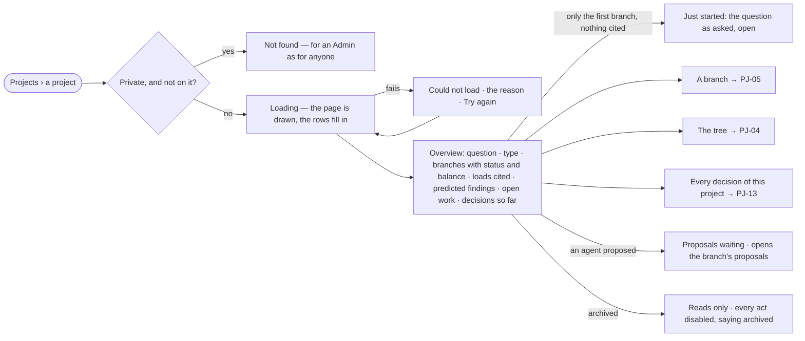

# PJ-03 · See where a project stands

**As** a decision maker **I want** a project's overview — its question, its branches, the loads it cited, what is only
predicted, and the work still open **so that** I know where the quest stands before I act on it.

Tasks: [task.md](task.md) · Feature: [PJ-F03](../../feature.md)

## Who can

*Branches, findings and decisions* is *Acts* for every role in the [role table](../../../../../../os/access/features/AC-F02-access-policies/feature.md#the-role-table),
on every project the person can see ([PJ-F01](../../../PJ-F01-projects-and-tasks/feature.md#access)).

| Lens | Can | Otherwise sees |
|---|---|---|
| Admin | Read the overview of any project they can see; open its branches, findings and decisions | A private project they are not on reads *Not found* — Admins are not exempt |
| Operator | The same, and every act on the page; a Modeller the same | A private project they are not on reads *Not found*. On an archived project every act is disabled, saying it is archived |

## Flow

## Acceptance criteria

| # | Given | When | Then |
|---|---|---|---|
| PJ-03.1 | A project just created | a person who can see it opens it | the overview reads its question and type, and one branch — the question as asked — open, with *No findings yet* |
| PJ-03.2 | A project with branches | the overview opens | each branch shows its number (*b1*), title, status (open · pursuing · parked · dropped · merged) and balance (*3 supports · 1 contradicts*), in the words of the project's type |
| PJ-03.3 | Findings that cite loads | the overview opens | *Loads cited* lists each load those findings cite, by its name, id and content hash, each opening the load in Records (RC-F02); there is no second list to keep |
| PJ-03.4 | Findings added from a what-if answer ([EX-33](../../../../../explore/features/EX-F05-when-it-cannot-answer-and-how-it-reasons/stories/EX-33-ask-what-if-and-read-the-prediction-as-evidence/story.md)) | the overview opens | each branch's balance counts them apart, labelled *predicted*, so a prediction never reads as an observation |
| PJ-03.5 | A project with open tasks | the overview opens | it counts the open tasks and lists them, each opening its task |
| PJ-03.6 | A branch with proposals waiting | the overview opens | the branch shows *N proposals waiting*, opening that branch's proposals |
| PJ-03.7 | A project, a branch or a finding open | the shell's header shows the path | it reads *Projects › the project › H2 · title › the finding's statement*, each level linking one level up; the project is named by its name, never its key |
| PJ-03.8 | A branch, finding or decision open on the page | the person reloads or shares the address | it opens on the same branch, finding or decision; moving to another project clears them |
| PJ-03.9 | A private project and a person not on it | they open its address | it reads *Not found*, as if it did not exist — for an Admin as for anyone |
| PJ-03.10 | The engine cannot return the project | the page loads | it says *Could not load* with the reason and *Try again*; nothing partial is drawn as complete |
| PJ-03.11 | An archived project | the overview opens | it reads in full; every act is disabled, saying the project is archived |
| PJ-03.12 | An Operator or a Modeller who can see the project | they open its overview | it reads in full and every act on it is theirs, as for an Admin |

## Screens

| Surface | Lens | First use | Empty after a filter | Loading | Has data | Failed | Agent working or proposing | No access |
|---|---|---|---|---|---|---|---|---|
| Overview | Admin | projects.project · Just started | — | projects.project · Loading | projects.project | projects.project · Could not load | projects.project · Proposals waiting | projects.project · Not found |
| Overview | Operator | projects.project · Just started | — | projects.project · Loading | projects.project | projects.project · Could not load | projects.project · Proposals waiting | projects.project · Not found |
| An archived project | Admin | — | — | — | projects.project · Archived | — | — | — |
| An archived project | Operator | — | — | — | projects.project · Archived | — | — | — |
