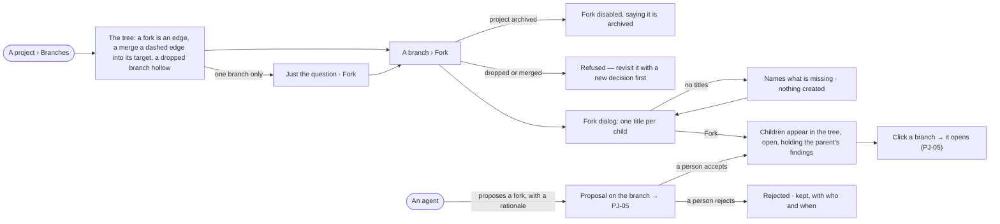

# PJ-04 · Fork a line of inquiry and see the tree

**As** a decision maker **I want** to fork a branch into several lines of inquiry and see them as a tree **so that** I
explore alternatives side by side without losing any of them. An agent may propose a fork; I decide whether it happens.

Tasks: [task.md](task.md) · Feature: [PJ-F03](../../feature.md)

## Who can

*Branches, findings and decisions* is *Acts* for every role in the [role table](../../../../../../os/access/features/AC-F02-access-policies/feature.md#the-role-table),
on every project the person can see ([PJ-F01](../../../PJ-F01-projects-and-tasks/feature.md#access)).

| Lens | Can | Otherwise sees |
|---|---|---|
| Admin | Read the tree; fork any open, pursuing or parked branch into children; accept or reject an agent's fork proposal | A dropped or merged branch cannot be forked — *Revisit it with a new decision first*; on an archived project every act is disabled |
| Operator | The same; a Modeller the same | As Admin. Another person's run: that it ran, its status and its tokens — *How it got here* reads *Content withheld* |

## Flow

## Acceptance criteria

| # | Given | When | Then |
|---|---|---|---|
| PJ-04.1 | A project | a person who can see it opens its Branches tab | the tree is drawn: a fork as an edge from parent to child, a merge as a dashed *merged* edge into the branch it went into, a dropped branch hollow; the Overview keeps the same branches as an indented list |
| PJ-04.2 | A project with only its first branch | the tree opens | it shows the question as one open branch with *Fork* |
| PJ-04.3 | A person who can see the project | they fork a branch into children, naming each | each child appears under the parent, open, numbered next in the project (*b4*), holding every finding its parent holds |
| PJ-04.4 | A fork | it is made | the parent's open tasks stay on the parent, and the parent's status does not change |
| PJ-04.5 | A fork | the findings are inherited | they are the same findings, not copies; the child's balance counts them |
| PJ-04.6 | A dropped or merged branch | someone tries to fork it | it is refused, saying to revisit it with a new decision first; nothing is created |
| PJ-04.7 | The fork dialog | it is confirmed with no child titled | it names what is missing and creates nothing |
| PJ-04.8 | An agent | it proposes a fork with a rationale | the proposal waits on the branch (PJ-05); no branch exists until a person accepts |
| PJ-04.9 | A fork proposal | a person who may read its run opens *How it got here* | it shows the agent's steps and sources behind the proposal; anyone else reads that the run ran, its status and its tokens |
| PJ-04.10 | A fork proposal | a person accepts it | the children appear as the proposal named them, and the proposal reads accepted, by whom |
| PJ-04.11 | A branch in the tree | the person clicks it | the branch opens (PJ-05) |
| PJ-04.12 | An archived project | someone opens the tree or a fork proposal | both read; *Fork*, *Accept* and *Reject* are disabled, saying the project is archived |
| PJ-04.13 | The engine cannot return the tree or refuses a fork | the page loads or the fork is made | it says *Could not load* / *Could not fork* with the reason and *Try again*; the tree is unchanged |

## Screens

| Surface | Lens | First use | Empty after a filter | Loading | Has data | Failed | Agent working or proposing | No access |
|---|---|---|---|---|---|---|---|---|
| The tree | Admin | projects.options · Just the question | — | projects.options · Loading | projects.options | projects.options · Could not load | projects.options · Fork proposed | projects.project · Not found |
| The tree | Operator | projects.options · Just the question | — | projects.options · Loading | projects.options | projects.options · Could not load | projects.options · Fork proposed | projects.project · Not found |
| Fork | Admin | — | — | — | projects.options · Fork | projects.options · Fork refused | — | — |
| Fork | Operator | — | — | — | projects.options · Fork | projects.options · Fork refused | — | projects.options · Archived |
