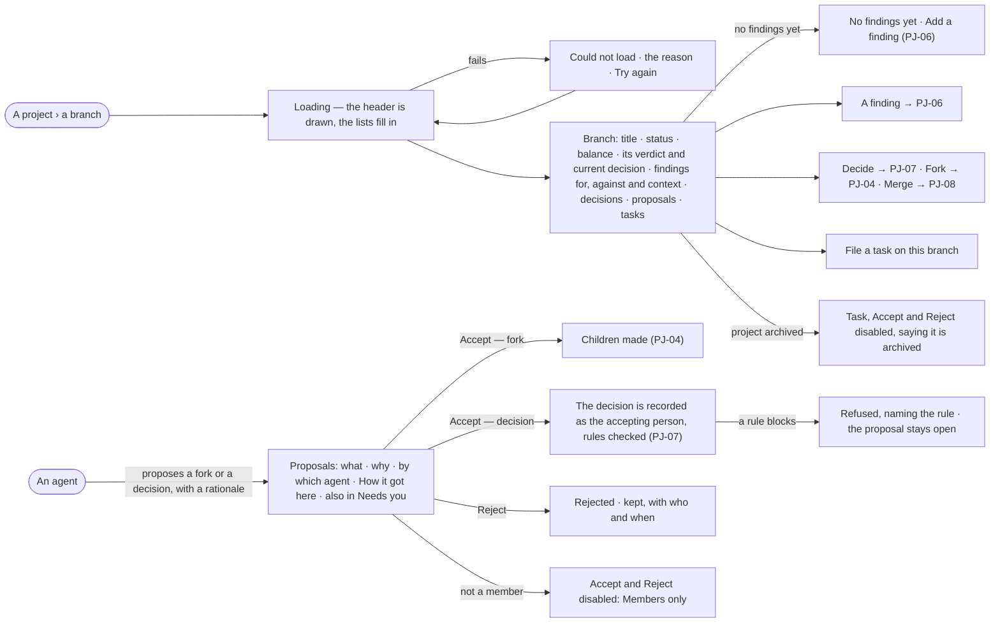

# PJ-05 · Read a branch with its evidence and proposals

**As** a decision maker **I want** a branch with its hypothesis, verdict, the evidence for and against, what agents
proposed and the tasks filed on it **so that** work and evidence sit together, counter-evidence included, and I decide
what an agent proposed.

Tasks: [task.md](task.md) · Feature: [PJ-F03](../../feature.md)

## Who can

*Branches, findings and decisions* is *Acts* for every role in the [role table](../../../../../../os/access/features/AC-F02-access-policies/feature.md#the-role-table),
on every project the person's default agent may Read; a proposal is accepted or rejected by the project's members
([PJ-F01](../../../PJ-F01-projects-and-tasks/feature.md#access)).

| Lens | Can | Otherwise sees |
|---|---|---|
| Admin | Read every branch; file a task on it; accept or reject a proposal on a project they are a member of; open a finding, a decision, and the run behind a proposal as far as run privacy allows | On an archived project every act is disabled. Not a member: *Accept* and *Reject* disabled — *Members only* |
| Operator | The same; a Modeller the same | As Admin. A run they may not read: that it ran, its status and its tokens — *How it got here* reads *Content withheld* |

## Flow

## Acceptance criteria

| # | Given | When | Then |
|---|---|---|---|
| PJ-05.1 | A branch | a person whose default agent may Read the project opens it | it shows its number and title, status, balance (*3 supports · 1 contradicts*), the current verdict and decision if any, and the project's tasks filed on it |
| PJ-05.2 | A branch with findings | it opens | findings are grouped as supports, contradicts and context, each with its statement, who added it, whether a person reviewed it, and *predicted* when it rests on a what-if |
| PJ-05.3 | A branch with no findings | it opens | it reads *No findings yet* with *Add a finding* |
| PJ-05.4 | A branch decided more than once | it opens | its decisions list newest first, the current one marked and each superseded one saying which decision replaced it |
| PJ-05.5 | A person whose default agent may Read the project | they file a task from the branch | the task is created on this branch and the branch lists it |
| PJ-05.6 | An agent | it proposes a fork or a decision with a rationale | the branch lists the proposal as waiting — what it proposes, the rationale, which agent, its run and the person behind that run — it is listed in the Inbox › Needs you of the project's members, and nothing else changes |
| PJ-05.7 | A waiting proposal | a person who may read its run opens *How it got here* | it shows the agent's steps and sources behind the rationale; anyone else reads that the run ran, its status and its tokens |
| PJ-05.8 | A waiting fork proposal | a member accepts it | the children are made (PJ-04) and the proposal reads accepted, by whom |
| PJ-05.9 | A waiting decision proposal | a member accepts it | the decision is recorded in that person's name, with every rule in force checked (PJ-07); the proposal reads accepted |
| PJ-05.10 | A decision proposal a rule blocks | it is accepted | the refusal names the rule and the evidence, nothing is recorded, and the proposal stays open |
| PJ-05.11 | A waiting proposal | a member rejects it | it reads rejected, by whom and when, and stays listed |
| PJ-05.12 | A proposal already accepted or rejected | someone acts on it again | it is refused, saying it is already resolved |
| PJ-05.13 | Any agent | it tries to record a verdict or a decision | it cannot: verdicts and decisions are a person's, and an agent can only propose |
| PJ-05.14 | An archived project | someone opens a branch | it reads in full; *File a task*, *Accept* and *Reject* are disabled, saying the project is archived |
| PJ-05.15 | The engine cannot return the branch | the page loads | it says *Could not load* with the reason and *Try again* |
| PJ-05.16 | An agent's proposed fork or decision on a branch | it is shown | it names the option the agent recommends and why; a member accepts or rejects it with one click |
| PJ-05.17 | A waiting proposal and a person who is not a member of the project | they open it | it reads; *Accept* and *Reject* are disabled — *Members only*; a call is refused the same way |

## Screens

| Surface | Lens | First use | Empty after a filter | Loading | Has data | Failed | Agent working or proposing | No access |
|---|---|---|---|---|---|---|---|---|
| A branch | Admin | projects.options · A branch · No findings yet | — | projects.options · A branch · Loading | projects.options · A branch | projects.options · A branch · Could not load | projects.options · A branch · Proposal waiting | projects.project · Withheld |
| A branch | Operator | projects.options · A branch · No findings yet | — | projects.options · A branch · Loading | projects.options · A branch | projects.options · A branch · Could not load | projects.options · A branch · Proposal waiting | projects.project · Withheld |
| A proposal | Admin | — | — | — | projects.options · A branch · Proposal waiting | projects.options · A branch · Proposal refused | projects.options · A branch · Proposal waiting | projects.options · A branch · Proposal · Not a member |
| A proposal | Operator | — | — | — | projects.options · A branch · Proposal waiting | projects.options · A branch · Proposal refused | projects.options · A branch · Proposal waiting | projects.task.thinking · Content withheld |
