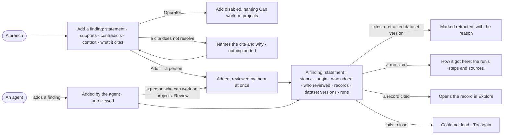

# PJ-06 · Weigh a finding and the records behind it

**As** a reviewer **I want** to add a finding to a branch and open any finding with every record behind it, who added it
and whether a person reviewed it **so that** a claim is checked against the data before a decision rests on it. An
agent may add a finding; I review it before it counts as reviewed.

Tasks: [task.md](task.md) · Feature: [PJ-F03](../../feature.md)

Adding an answer from Explore as a finding is [EX-12](../../../../../explore/features/EX-F02-share-and-present-an-answer/stories/EX-12-add-an-answer-to-a-project/story.md); this story is the same finding, added from the branch and read in Projects.

## Who can

| Lens | Can | Otherwise sees |
|---|---|---|
| Admin | Add a finding to any branch they can see; review any finding; open every finding and the records behind it | — |
| Operator | Open any finding and its records, origin, version and trace | *Add a finding* and *Review* disabled, naming *Can work on projects*. *With Can work on projects: as Admin* |

## Flow

## Acceptance criteria

| # | Given | When | Then |
|---|---|---|---|
| PJ-06.1 | A branch and a person who can work on projects | they add a finding with a statement, a stance (supports · contradicts · context) and what it cites | the finding is on the branch and counts in its balance; a person's finding is reviewed by them at once |
| PJ-06.2 | A finding cites a record, a dataset version or a run | it is added | each cite is kept: a dataset cite reads *dataset@version*, a run cite reads *run 8195c5e8* and opens the run |
| PJ-06.3 | A dataset cite that does not exist | the finding is added | it is refused, naming the cite; nothing is added |
| PJ-06.4 | Any finding | someone opens it | the statement is its title; it shows stance, origin, version, who added it and who reviewed it, named through the project's staff, the same names *By* uses on Decisions |
| PJ-06.5 | An agent | it adds a finding | the finding reads *Added by* the agent, *Unreviewed*, and shows no reviewer |
| PJ-06.6 | An agent's finding | the person opens *How it got here* | it shows the run's steps and sources behind the statement, each marked *Challenge this* |
| PJ-06.7 | An unreviewed finding | a person who can work on projects presses *Review* | it reads reviewed by that person, and a rule requiring person-reviewed evidence now accepts it |
| PJ-06.8 | A finding cites a dataset version its source retracted | someone opens it | it is marked retracted with the reason, and the finding stays |
| PJ-06.9 | A finding | newer evidence arrives | the finding is not edited or deleted: a newer finding is added beside it and both stay |
| PJ-06.10 | A finding added from an Explore answer | it opens here | it shows the answer's records, queries and dataset versions ([EX-12](../../../../../explore/features/EX-F02-share-and-present-an-answer/stories/EX-12-add-an-answer-to-a-project/story.md)) |
| PJ-06.11 | An Operator without *Can work on projects* | they open a finding or the add dialog | the finding reads in full; *Add a finding* and *Review* are disabled, naming *Can work on projects* |
| PJ-06.12 | The engine cannot return the finding, or refuses an add | the page loads or the add is made | it says *Could not load* / *Could not add the finding* with the reason and *Try again*; nothing is added |

## Screens

| Surface | Lens | First use | Empty after a filter | Loading | Has data | Failed | Agent working or proposing | No access |
|---|---|---|---|---|---|---|---|---|
| A finding | Admin | — | — | projects.finding · Loading | projects.finding | projects.finding · Could not load | projects.finding · Added by an agent | projects.project · Private |
| A finding | Operator | — | — | projects.finding · Loading | projects.finding · Read only | projects.finding · Could not load | projects.finding · Added by an agent · Read only | projects.project · Private |
| A retracted source | Admin | — | — | — | projects.finding · Retracted source | — | — | — |
| A retracted source | Operator | — | — | — | projects.finding · Retracted source · Read only | — | — | — |
| Add a finding | Admin | projects.finding · Add a finding | — | projects.finding · Adding | projects.finding · Add a finding | projects.finding · Add refused | — | — |
| Add a finding | Operator | — | — | — | — | — | — | projects.finding · Read only |
| How it got here | Admin | — | — | projects.task.thinking · Loading | projects.task.thinking | projects.task.thinking · Could not load | — | — |
| How it got here | Operator | — | — | projects.task.thinking · Loading | projects.task.thinking | projects.task.thinking · Could not load | — | — |
