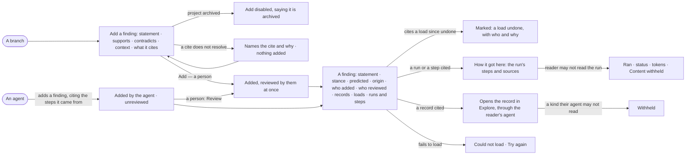

# PJ-06 · Weigh a finding and the records behind it

**As** a reviewer **I want** to add a finding to a branch and open any finding with every record behind it, who added it
and whether a person reviewed it **so that** a claim is checked against the data before a decision rests on it. An
agent may add a finding; I review it before it counts as reviewed.

Tasks: [task.md](task.md) · Feature: [PJ-F03](../../feature.md)

Adding an answer from Explore as a finding is [EX-12](../../../../../explore/features/EX-F02-share-and-present-an-answer/stories/EX-12-add-an-answer-to-a-project/story.md); this story is the same finding, added from the branch and read in Projects.

## Who can

*Branches, findings and decisions* is *Acts* for every role in the [role table](../../../../../../os/access/features/AC-F02-access-policies/feature.md#the-role-table),
on every project the person can see ([PJ-F01](../../../PJ-F01-projects-and-tasks/feature.md#access)).

| Lens | Can | Otherwise sees |
|---|---|---|
| Admin | Add a finding to any branch they can see; review any finding; open every finding, the records behind it through the agents they may use, and every run behind it | A record of a kind their agents may not read reads *Withheld*; on an archived project every act is disabled |
| Operator | The same; a Modeller the same | As Admin. Another person's run: that it ran, its status and its tokens — *How it got here* reads *Content withheld* |

## Flow

## Acceptance criteria

| # | Given | When | Then |
|---|---|---|---|
| PJ-06.1 | A branch and a person who can see the project | they add a finding with a statement, a stance (supports · contradicts · context) and what it cites | the finding is on the branch and counts in its balance; a person's finding is reviewed by them at once |
| PJ-06.2 | A finding cites a record, a load, a run or a run's step | it is added | each cite is kept: a record cite names its graph database and kind, a load cite reads its name and short content hash and opens the load (RC-F02), a run cite reads *run 8195c5e8* and a step cite *run 8195c5e8 · step 4*, each opening the run |
| PJ-06.3 | A record, load, run or step cite that does not exist | the finding is added | it is refused, naming the cite; nothing is added |
| PJ-06.4 | Any finding | someone opens it | the statement is its title; it shows stance, origin, version, who added it and who reviewed it, the same names *By* uses on Decisions |
| PJ-06.5 | An agent | it adds a finding | the finding reads *Added by* the agent, *Unreviewed*, shows no reviewer, and links to the steps it came from in the thinking graph ([AG-F09](../../../../../agents/features/AG-F09-thinking-graph-and-memory/feature.md)) |
| PJ-06.6 | An agent's finding | a person who may read its run opens *How it got here* | it shows the run's steps and sources behind the statement, each marked *Challenge this* |
| PJ-06.7 | An unreviewed finding | a person presses *Review* | it reads reviewed by that person, and a rule requiring person-reviewed evidence now accepts it |
| PJ-06.8 | A finding cites a load since undone in Records | someone opens it | it is marked *a load undone*, with who undid it and why, and the finding stays |
| PJ-06.9 | A finding | newer evidence arrives | the finding is not edited or deleted — no screen offers it and a call to change it is refused: a newer finding is added beside it and both stay |
| PJ-06.10 | A finding added from an Explore answer | it opens here | it shows the answer's records, queries and the loads they came from ([EX-12](../../../../../explore/features/EX-F02-share-and-present-an-answer/stories/EX-12-add-an-answer-to-a-project/story.md)) |
| PJ-06.11 | A finding citing a record of a kind the reader's agents may not read | they open it | that cite reads *Withheld*; the statement, the stance and every other cite read |
| PJ-06.12 | The engine cannot return the finding, or refuses an add | the page loads or the add is made | it says *Could not load* / *Could not add the finding* with the reason and *Try again*; nothing is added |
| PJ-06.13 | A finding added from a what-if answer ([EX-33](../../../../../explore/features/EX-F05-when-it-cannot-answer-and-how-it-reasons/stories/EX-33-ask-what-if-and-read-the-prediction-as-evidence/story.md)) | it is read anywhere | it reads *predicted* beside its stance, and its cites name the evidence labelled *predicted* |
| PJ-06.14 | A finding whose run the reader may not read — they are not behind it, do not own its agent and are not an Admin | they open *How it got here* | it reads that the run ran, its status and its tokens; the steps read *Content withheld* |
| PJ-06.15 | An archived project | someone opens a finding or the add dialog | the finding reads in full; *Add a finding* and *Review* are disabled, saying the project is archived |

## Screens

| Surface | Lens | First use | Empty after a filter | Loading | Has data | Failed | Agent working or proposing | No access |
|---|---|---|---|---|---|---|---|---|
| A finding | Admin | — | — | projects.finding · Loading | projects.finding | projects.finding · Could not load | projects.finding · Added by an agent | projects.project · Not found |
| A finding | Operator | — | — | projects.finding · Loading | projects.finding | projects.finding · Could not load | projects.finding · Added by an agent | projects.finding · Record withheld |
| A load undone | Admin | — | — | — | projects.finding · Load undone | — | — | — |
| A load undone | Operator | — | — | — | projects.finding · Load undone | — | — | — |
| Add a finding | Admin | projects.finding · Add a finding | — | projects.finding · Adding | projects.finding · Add a finding | projects.finding · Add refused | — | — |
| Add a finding | Operator | projects.finding · Add a finding | — | projects.finding · Adding | projects.finding · Add a finding | projects.finding · Add refused | — | projects.finding · Archived |
| How it got here | Admin | — | — | projects.task.thinking · Loading | projects.task.thinking | projects.task.thinking · Could not load | — | — |
| How it got here | Operator | — | — | projects.task.thinking · Loading | projects.task.thinking | projects.task.thinking · Could not load | — | projects.task.thinking · Content withheld |
