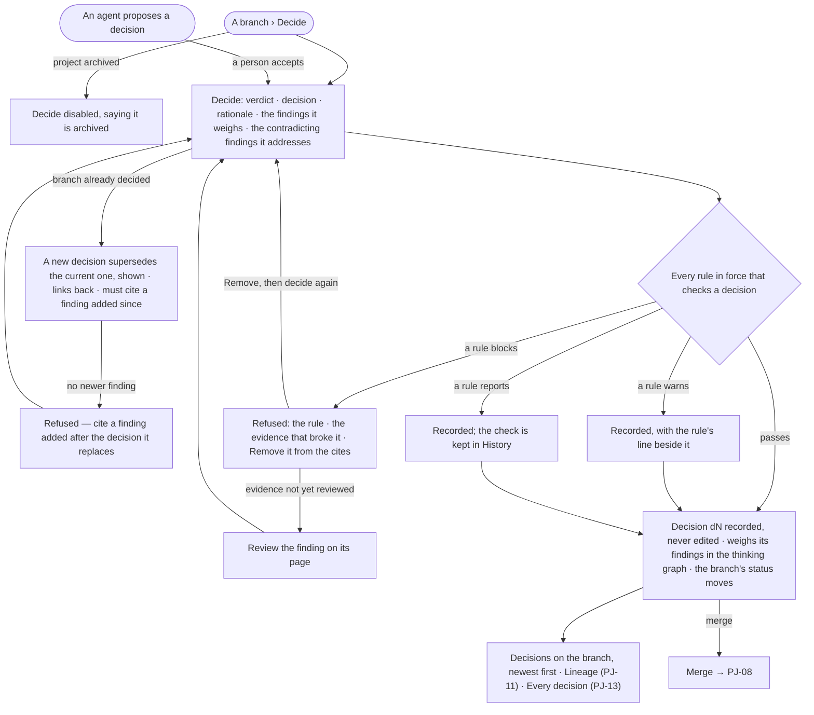

# PJ-07 · Record a verdict and a decision the rules check

**As** a decision maker **I want** to record a verdict and a decision on a branch — pursue, park, drop or merge — checked
by the rules in force, and to revisit it later with a new decision that supersedes, never overwrites **so that** what we
decided is deliberate, defensible and revisable. An agent may propose a decision; only a person records one.

Tasks: [task.md](task.md) · Feature: [PJ-F03](../../feature.md)

## Who can

*Branches, findings and decisions* is *Acts* for every role in the [role table](../../../../../../os/access/features/AC-F02-access-policies/feature.md#the-role-table),
on every project the person can see ([PJ-F01](../../../PJ-F01-projects-and-tasks/feature.md#access)).

| Lens | Can | Otherwise sees |
|---|---|---|
| Admin | Record a verdict and a decision on any branch they can see; supersede the current decision | Nobody edits, deletes or owns a decision; on an archived project *Decide* is disabled |
| Operator | The same; a Modeller the same | As Admin. Another person's run: that it ran, its status and its tokens — *How it got here* reads *Content withheld* |

## Flow

## Acceptance criteria

| # | Given | When | Then |
|---|---|---|---|
| PJ-07.1 | A branch and a person who can see the project | they press *Decide* | the dialog asks for a verdict and a decision in the words of the project's type, a rationale, and shows the findings the decision will weigh |
| PJ-07.2 | The dialog | the person records a verdict (supported · refuted · inconclusive, or the type's words) and a decision (pursue · park · drop · merge) with a rationale | decision *dN* is recorded in their name with its rationale and the rules it was checked against, and becomes a node in the thinking graph weighing each finding it cites — through them, the steps, runs and records behind it ([AG-F09](../../../../../agents/features/AG-F09-thinking-graph-and-memory/feature.md)) |
| PJ-07.3 | A decision recorded | it settles | the branch's status moves with it: pursue to pursuing, park to parked, drop to dropped, merge to merged; a fork alone never moves it |
| PJ-07.4 | A branch with contradicting findings | the person decides | the verdict addresses every one of them, the dialog listing each; the recorded decision names them |
| PJ-07.5 | A rule in force that blocks the decision | it is recorded | it is refused, naming the rule and the evidence that broke it, with *Remove fN from the cites*; nothing is recorded |
| PJ-07.6 | A decision refused because a cited finding is not reviewed | the person opens that finding | its page offers *Review*; reviewing it lets the decision pass |
| PJ-07.7 | A rule that warns | the decision is recorded | it is recorded and the rule's line shows beside it |
| PJ-07.8 | A rule that reports | the decision is recorded | it is recorded and the check is kept in History without a line on the decision |
| PJ-07.9 | Rules on the deployment and on the project that check a decision | a decision is recorded | all of them are read before anything is written |
| PJ-07.10 | A branch that already has a decision | the person decides again | the new decision names the one it supersedes and links back to it; both stay, newest first, the older one reading *Superseded*, linking to the new one |
| PJ-07.11 | A superseding decision | it cites no finding added after the one it replaces | it is refused, saying to cite newer evidence |
| PJ-07.12 | Any decision | someone looks for a way to edit, delete or hand it over | there is none: a decision is never changed and is not owned, only superseded; a call that edits or deletes one is refused, saying to supersede it |
| PJ-07.13 | A proposal for a decision | a person accepts it | the dialog records it as that person, every rule checked as in PJ-07.5; a refusal leaves the proposal open |
| PJ-07.14 | A decision from a proposal | a person who may read the proposal's run opens *How it got here* | it shows the agent's steps and sources behind the rationale; anyone else reads that the run ran, its status and its tokens |
| PJ-07.15 | Any agent | it tries to record a verdict or a decision | it cannot — an agent proposes, a person decides |
| PJ-07.16 | An archived project | someone opens a branch's decisions | every verdict, decision and rationale reads; *Decide* is disabled, saying the project is archived |
| PJ-07.17 | The engine cannot record the decision | the person presses *Decide* | it says *Could not record the decision* with the reason and *Try again*; nothing is recorded |

## Screens

| Surface | Lens | First use | Empty after a filter | Loading | Has data | Failed | Agent working or proposing | No access |
|---|---|---|---|---|---|---|---|---|
| Decide | Admin | — | — | projects.decide · Recording | projects.decide | projects.decide · Could not record | projects.decide · From a proposal | — |
| Decide | Operator | — | — | projects.decide · Recording | projects.decide | projects.decide · Could not record | projects.decide · From a proposal | projects.decide · Archived |
| Refused by a rule | Admin | — | — | — | — | projects.decide · Refused by a rule | projects.decide · Refused by a rule · From a proposal | — |
| Refused by a rule | Operator | — | — | — | — | projects.decide · Refused by a rule | projects.decide · Refused by a rule · From a proposal | — |
| Recorded with a warning | Admin | — | — | — | projects.decide · Recorded with a warning | — | — | — |
| Recorded with a warning | Operator | — | — | — | projects.decide · Recorded with a warning | — | — | — |
| Supersede | Admin | — | — | — | projects.decide · Supersede | projects.decide · Supersede refused | — | — |
| Supersede | Operator | — | — | — | projects.decide · Supersede | projects.decide · Supersede refused | — | projects.decide · Archived |
| A branch's decisions | Admin | projects.decide · No decision yet | — | projects.decide · Loading | projects.decide · This branch | projects.decide · Could not load | — | projects.project · Not found |
| A branch's decisions | Operator | projects.decide · No decision yet | — | projects.decide · Loading | projects.decide · This branch | projects.decide · Could not load | — | projects.project · Not found |
