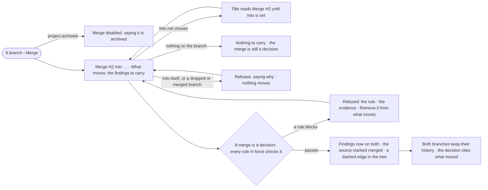

# PJ-08 · Merge what one branch learned into another

**As** a decision maker **I want** to carry what one branch learned into another **so that** lines of inquiry converge
without copying anything and both keep their history.

Tasks: [task.md](task.md) · Feature: [PJ-F03](../../feature.md)

## Who can

*Branches, findings and decisions* is *Acts* for every role in the [role table](../../../../../../os/access/features/AC-F02-access-policies/feature.md#the-role-table),
on every project the person can see ([PJ-F01](../../../PJ-F01-projects-and-tasks/feature.md#access)).

| Lens | Can | Otherwise sees |
|---|---|---|
| Admin | Merge any branch into another open, pursuing or parked branch of the same project | On an archived project *Merge* is disabled |
| Operator | The same; a Modeller the same | As Admin |

## Flow

## Acceptance criteria

| # | Given | When | Then |
|---|---|---|---|
| PJ-08.1 | A branch and a person who can see the project | they press *Merge* | the dialog is titled *Merge H2* until *Into* is set, then *Merge H2 into H4*, and asks only *Into* and *What moves* |
| PJ-08.2 | The dialog | *What moves* is left as it is | every finding on the source moves |
| PJ-08.3 | The dialog | the person chooses some findings | only those move |
| PJ-08.4 | The same dialog | it is confirmed | the decision it records cites exactly what moved; there is no second list to fill in |
| PJ-08.5 | A merge | it settles | the findings are now also on the target, not copied; the source is marked merged, always — there is no *stays parked* choice |
| PJ-08.6 | A merged branch | the tree opens | a dashed *merged* edge runs from the source into the target |
| PJ-08.7 | Both branches after a merge | someone opens either | each keeps its own findings, decisions and history |
| PJ-08.8 | A merge into the branch itself, into a dropped branch, or into a merged one | it is confirmed | it is refused, saying why; nothing moves |
| PJ-08.9 | A merge into a branch of another project | the person looks for it | there is none: *Into* lists only this project's branches |
| PJ-08.10 | A rule in force that blocks the merge | it is confirmed | it is refused, naming the rule and the evidence, with *Remove fN from what moves*; nothing moves |
| PJ-08.11 | A proposal to merge, made by an agent | a person accepts it | the merge is recorded as that person, rules checked (PJ-07); for those who may read the proposal's run, *How it got here* shows the agent's steps and sources |
| PJ-08.12 | An archived project | someone opens a merged branch | the merge reads; *Merge* is disabled, saying the project is archived |
| PJ-08.13 | The engine cannot complete the merge | it is confirmed | it says *Could not merge* with the reason and *Try again*; nothing moves |

## Screens

| Surface | Lens | First use | Empty after a filter | Loading | Has data | Failed | Agent working or proposing | No access |
|---|---|---|---|---|---|---|---|---|
| Merge | Admin | projects.options · Merge · Nothing to carry | — | projects.options · Merging | projects.options · Merge | projects.options · Merge refused | projects.options · Merge · From a proposal | — |
| Merge | Operator | projects.options · Merge · Nothing to carry | — | projects.options · Merging | projects.options · Merge | projects.options · Merge refused | projects.options · Merge · From a proposal | projects.options · Archived |
| A merged branch | Admin | — | — | projects.options · A branch · Loading | projects.options · A branch · Merged | projects.options · A branch · Could not load | — | projects.project · Not found |
| A merged branch | Operator | — | — | projects.options · A branch · Loading | projects.options · A branch · Merged | projects.options · A branch · Could not load | — | projects.project · Not found |
