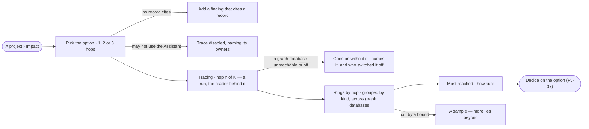

# PJ-10 · See what a decision reaches

**As** a decision maker **I want** to see what an option reaches across every graph database, hop by hop, starting
from the records its evidence cites **so that** I know which records a decision touches before I commit to it.

Tasks: [task.md](task.md) · Feature: [PJ-F03](../../feature.md)

## Who can

*Branches, findings and decisions* is *Acts* for every role in the [role table](../../../../../../os/access/features/AC-F02-access-policies/feature.md#the-role-table);
an impact reach is a read through the Assistant, under its Access Policies, with the reader behind it.

| Lens | Can | Otherwise sees |
|---|---|---|
| Admin | Trace any option's impact on a project they can see, pick its hops, open any record reached | A kind the Assistant's policies deny is never reached |
| Operator | The same; a Modeller the same | A kind the Assistant's policies deny for them is never reached; without the Assistant, *Trace* is disabled, naming its owners — *Ask {owner}* |

## Flow

## Acceptance criteria

| # | Given | When | Then |
|---|---|---|---|
| PJ-10.1 | An option whose findings cite no record | its impact is opened | it reads *Add a finding that cites a record* |
| PJ-10.2 | An option whose findings cite records | its impact is opened | it starts from those records, of every stance, in whichever graph databases hold them, and walks 2 hops by default |
| PJ-10.3 | Impact | the reader picks 1, 2 or 3 hops | each hop shows what the one before reached, less what was already reached, counted by kind — *2 hops · 38 Customer* — records joined across graph databases on identity links counted once |
| PJ-10.4 | Impact tracing | a hop is being read | it says which hop it is on, and earlier hops are drawn as they land |
| PJ-10.5 | A reach cut by a bound | it is drawn | at most 12 records were expanded per hop, each to 50 neighbours, the most reached first, and it reads *A sample — more lies beyond* |
| PJ-10.6 | A traced reach | it is read | the most reached records are listed with their kind and hop, and *How sure* names how many of the starting findings a person reviewed and the sources of the loads they cite — upload, CLI, API or by hand — and their licences |
| PJ-10.7 | A kind the Assistant's Access Policies deny for the reader | impact is traced | it is never reached |
| PJ-10.8 | A graph database that is unreachable or switched off | impact is traced | the reach goes on without it and names it — unreachable, or switched off and by whom |
| PJ-10.9 | A cited record gone from its graph database | impact is traced | it counts at hop 0 and reaches nothing |
| PJ-10.10 | Impact with an option and hops picked | the page is reloaded | the same option and hops are traced again |
| PJ-10.11 | A traced reach | it is read | every group and link is also listed in words, and no figure in any currency appears; every count is the engine's |
| PJ-10.12 | A traced reach | its run is read | it is a run of the Assistant with the reader behind it, and every read it made is listed in *What left the platform* ([AC-F09](../../../../../../os/access/features/AC-F09-what-left-the-platform/feature.md)) |
| PJ-10.13 | A reader who may not use the Assistant | they open Impact | *Trace* is disabled, naming the Assistant's owners — *Ask {owner}* |

## Screens

| Surface | Lens | First use | Empty after a filter | Loading | Has data | Failed | Agent working or proposing | No access |
|---|---|---|---|---|---|---|---|---|
| A project › Impact | Admin | projects.decide · Impact · No record cites | — | projects.decide · Impact · Loading | projects.decide · Impact | projects.decide · Impact · Database unread | projects.decide · Impact · Tracing | — |
| A project › Impact | Operator | projects.decide · Impact · No record cites | — | projects.decide · Impact · Loading | projects.decide · Impact | projects.decide · Impact · Database unread | projects.decide · Impact · Tracing | projects.decide · Impact · Assistant not usable |
