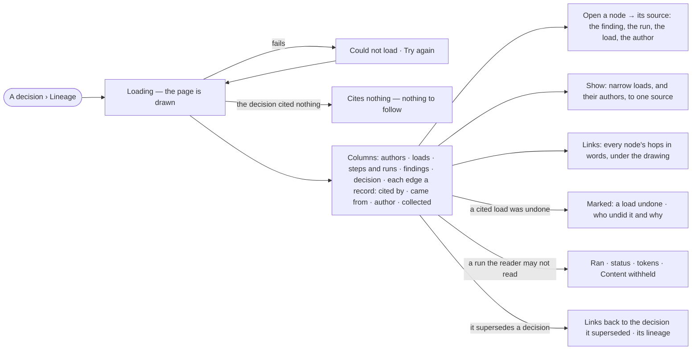

# PJ-11 · Follow a decision back to the original authors

**As** an auditor **I want** the lineage of a decision — the findings it weighed, the steps and runs they came from,
the records and loads behind them, the authors of that data, and the decision it superseded **so that** anyone can follow how we got here.

Tasks: [task.md](task.md) · Feature: [PJ-F03](../../feature.md)

## Who can

*Branches, findings and decisions* is *Acts* for every role in the [role table](../../../../../../os/access/features/AC-F02-access-policies/feature.md#the-role-table),
on every project the person can see ([PJ-F01](../../../PJ-F01-projects-and-tasks/feature.md#access)).

| Lens | Can | Otherwise sees |
|---|---|---|
| Admin | Read the lineage of any decision they can see; open every node's source, every run among them | A private project they are not on reads *Not found* |
| Operator | The same; a Modeller the same | A run they are not behind, whose agent they do not own, reads *Content withheld* in the lineage. There is no act on a lineage to refuse |

## Flow

## Acceptance criteria

| # | Given | When | Then |
|---|---|---|---|
| PJ-11.1 | A decision | someone opens its *Lineage* | it draws, left to right, authors · loads · steps and runs · findings · the decision, with each edge named for what it is: *cited by*, *came from*, *author*, *collected* |
| PJ-11.2 | The lineage | it is drawn | every node and edge comes from a stored record — the decision and the findings it weighed, the steps they came from and their runs, as the thinking graph holds them ([AG-F09](../../../../../agents/features/AG-F09-thinking-graph-and-memory/feature.md)), their load cites, each load's author and source file; nothing is inferred |
| PJ-11.3 | Any node | the person opens it | it opens its source: the finding, the run at its step, the load or the author |
| PJ-11.4 | The lineage | it is drawn | *Links* under the drawing names every node's hops in words (*cites run 8195c5e8 · cited by d1*), so a reader without the drawing, or a clipped label, loses nothing |
| PJ-11.5 | A lineage with loads from several sources | the person picks one under *Show* | loads, and their authors, narrow to that source; findings and runs stay |
| PJ-11.6 | A cited load that was undone in Records | the lineage opens | that node is marked *a load undone*, with who undid it and why, and the path through it stays |
| PJ-11.7 | A decision that cited no findings | its lineage opens | it says it cites nothing, and shows the decision alone |
| PJ-11.8 | A decision in a private project | a person not on it asks for its lineage | it reads *Not found* |
| PJ-11.9 | The engine cannot return the records | the lineage loads | it says *Could not load* with the reason and *Try again* |
| PJ-11.10 | A run in the lineage the reader may not read — they are not behind it, do not own its agent and are not an Admin | the lineage is drawn | its node reads that it ran, its status and its tokens — *Content withheld* — and the path through it stays |
| PJ-11.11 | A decision that supersedes another | its lineage opens | it links back to the decision it supersedes, which opens its own lineage |

## Screens

| Surface | Lens | First use | Empty after a filter | Loading | Has data | Failed | Agent working or proposing | No access |
|---|---|---|---|---|---|---|---|---|
| Lineage | Admin | projects.decide · Lineage · Cites nothing | projects.decide · Lineage · Nothing from this source | projects.decide · Lineage · Loading | projects.decide · Lineage | projects.decide · Lineage · Could not load | — | projects.project · Not found |
| Lineage | Operator | projects.decide · Lineage · Cites nothing | projects.decide · Lineage · Nothing from this source | projects.decide · Lineage · Loading | projects.decide · Lineage | projects.decide · Lineage · Could not load | — | projects.decide · Lineage · Content withheld |
| A load undone | Admin | — | — | — | projects.decide · Lineage · Load undone | — | — | — |
| A load undone | Operator | — | — | — | projects.decide · Lineage · Load undone | — | — | — |
