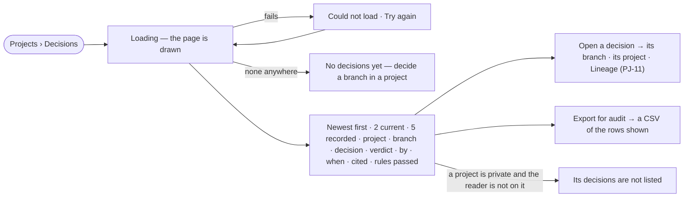

# PJ-13 · Audit every decision in one place

**As** an auditor **I want** every decision across the projects I may see — what it cited and the rules it passed —
newest first **so that** decisions can be audited in one place.

Tasks: [task.md](task.md) · Feature: [PJ-F03](../../feature.md)

## Who can

*Branches, findings and decisions* is *Acts* for every role in the [role table](../../../../../../os/access/features/AC-F02-access-policies/feature.md#the-role-table),
on every project the person can see ([PJ-F01](../../../PJ-F01-projects-and-tasks/feature.md#access)).

| Lens | Can | Otherwise sees |
|---|---|---|
| Admin | Read the Decisions page across every project they can see; open a decision, its project and its lineage; export the rows | Decisions of a private project they are not on are absent — Admins are not exempt |
| Operator | The same, and export the rows; a Modeller the same | Decisions of a private project they are not on are absent. Nothing on the page is an act to refuse |

## Flow

## Acceptance criteria

| # | Given | When | Then |
|---|---|---|---|
| PJ-13.1 | Decisions in several projects | a person opens Decisions | they list newest first across every project the person may see, each with its project, branch, decision, verdict, who decided and when |
| PJ-13.2 | The list | it is drawn | each decision shows the findings it weighed and the rules it passed, with any warning, and a superseded one names the decision that superseded it |
| PJ-13.3 | The page header | the list is drawn | it reads *2 current · 5 recorded*, as the engine counted them — current is the decisions no later one supersedes; it reads *5* alone when the two match |
| PJ-13.4 | A decision | the person opens it | it opens its branch in its project, and its lineage (PJ-11) |
| PJ-13.5 | A decision | the list names *By* | it names the person who decided — never an agent; a decision from a proposal also names the agent that proposed it |
| PJ-13.6 | A private project the reader is not on | the list is drawn | none of its decisions appear — for an Admin as for anyone |
| PJ-13.7 | The list | the person chooses *Export for audit* | a CSV of the rows shown downloads |
| PJ-13.8 | No decision in any project the reader can see | the page opens | it reads *No decisions yet* and says decisions are recorded on a branch |
| PJ-13.9 | The engine cannot return the list | the page loads | it says *Could not load* with the reason and *Try again* |
| PJ-13.10 | An Operator | they open Decisions | the whole page reads and exports; nothing on it is disabled |

## Screens

| Surface | Lens | First use | Empty after a filter | Loading | Has data | Failed | Agent working or proposing | No access |
|---|---|---|---|---|---|---|---|---|
| Every decision | Admin | projects.decide · Every decision · None yet | — | projects.decide · Every decision · Loading | projects.decide · Every decision | projects.decide · Every decision · Could not load | — | — |
| Every decision | Operator | projects.decide · Every decision · None yet | — | projects.decide · Every decision · Loading | projects.decide · Every decision | projects.decide · Every decision · Could not load | — | — |
