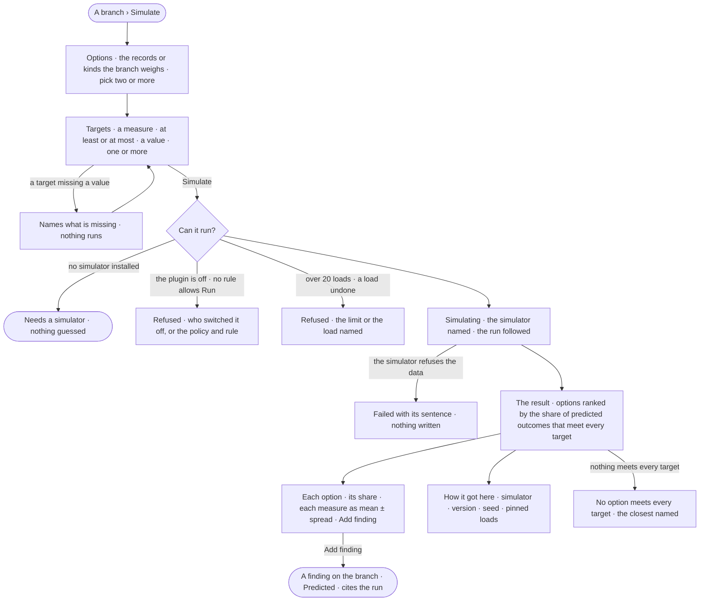

# PJ-32 · Simulate options against targets on a branch

**As** a decision maker **I want** to pick the options a branch is weighing and the targets they must meet, and have a
simulator predict which options meet every target **so that** I rank the options before I commit to one, and carry the
best into the branch as predicted evidence — never mistaken for what the records hold.

Tasks: [task.md](task.md) · Feature: [PJ-F03](../../feature.md)

## Who can

*Branches, findings and decisions* follows the [permission catalogue](../../../../../../os/access/features/AC-F02-access-policies/feature.md#the-permission-catalogue),
on every project the person can see ([PJ-F01](../../../PJ-F01-projects-and-tasks/feature.md#access)). A simulation is a
what-if of Explore ([EX-33](../../../../../explore/features/EX-F05-when-it-cannot-answer-and-how-it-reasons/stories/EX-33-ask-what-if-and-read-the-prediction-as-evidence/story.md)) asked from a branch.

| Access | Can | Otherwise sees |
|---|---|---|
| Admin | On a branch: pick options and targets, run the simulation, read the ranked result and its run, add an option as a finding | A branch that is dropped or merged, or an archived project: *Simulate* is disabled, saying why |
| Operator | The same | As Admin. Another person's run: that it ran, its status and its tokens — *How it got here* reads *Content withheld* |

## Flow

## Acceptance criteria

| # | Given | When | Then |
|---|---|---|---|
| PJ-32.1 | A branch that is open or pursuing, on a project that is not archived | the person presses *Simulate* | it opens on *Options* and *Targets*; a dropped or merged branch, or an archived project, reads it disabled, saying why |
| PJ-32.2 | *Options* | it is read | it lists the records or kinds the branch's findings cite and the subject model of the project offers; the person picks two or more; fewer is refused in place |
| PJ-32.3 | *Targets* | the person adds one | it is a measure the simulator declares, *at least* or *at most*, and a value; one or more are set; a target without a value is refused in place, naming it |
| PJ-32.4 | No simulator installed | *Simulate* is pressed | it reads *Simulation needs a simulator, and none is installed*, calm like a cannot answer; nothing is estimated and nothing runs |
| PJ-32.5 | The simulator's plugin switched off, or an agent whose Access Policies hold no rule allowing Run on it | *Simulate* is pressed | it is refused before it starts, naming the plugin and who switched it off, or the policy and the rule |
| PJ-32.6 | More than 20 loads behind the options, or one undone or unreadable to the person | *Simulate* is pressed | it is refused, naming the limit of 20 or the load; nothing runs |
| PJ-32.7 | A simulation running | the person watches | the step reads *Simulating ·* the simulator, under the steps that read the options; a reload reopens it and still follows the run |
| PJ-32.8 | A simulation that settled | the result is shown | the options are ranked by the share of predicted outcomes that meet every target, each with its share and each measure as a mean and a spread, under a line saying the rows are predictions, not observations; never in the table or drawing of the records |
| PJ-32.9 | A result in which no option meets every target | it is read | it reads *No option meets every target* and names the option closest to meeting them |
| PJ-32.10 | An option in the result | the person presses *Add finding* | a finding is added to the branch, still marked *Predicted*, citing the run, the simulator and its version, its seed and the option's share ([PJ-03.4](../PJ-03-see-where-a-project-stands/story.md)); it counts apart from observed findings on the branch's balance |
| PJ-32.11 | A simulation | *How it got here* is opened | it shows the steps, the options and targets, the simulator and its version, the seed and the pinned loads, and the tokens; a person who may not read the run reads that it ran, its status and its tokens |
| PJ-32.12 | The same options, targets, simulator version, pinned loads and seed | the simulation runs again | it gives the same rows; with no seed given, the seed Invana picked is kept |
| PJ-32.13 | The simulator cannot use the data | the step settles | it is failed with the simulator's own sentence; the records stand and nothing is written |
| PJ-32.14 | The engine cannot start or return the simulation | the page loads or it is run | it says *Could not simulate* with the reason and *Try again*; the branch is unchanged |

## Screens

| Surface | Access | First use | Empty after a filter | Loading | Has data | Failed | Agent working or proposing | No access |
|---|---|---|---|---|---|---|---|---|
| Simulate · options and targets | Admin | projects.branches · Simulate | — | projects.branches · Simulate · Loading | projects.branches · Simulate · Targets set | projects.branches · Simulate · Refused | — | — |
| Simulate · options and targets | Operator | projects.branches · Simulate | — | projects.branches · Simulate · Loading | projects.branches · Simulate · Targets set | projects.branches · Simulate · Refused | — | projects.branches · Simulate · Disabled |
| The result | Admin | — | projects.branches · Simulate · No option meets every target | projects.branches · Simulate · Simulating | projects.branches · Simulate · Result | projects.branches · Simulate · Failed | projects.branches · Simulate · Simulating | — |
| The result | Operator | — | projects.branches · Simulate · No option meets every target | projects.branches · Simulate · Simulating | projects.branches · Simulate · Result | projects.branches · Simulate · Failed | projects.branches · Simulate · Simulating | projects.branches · Simulate · Content withheld |
