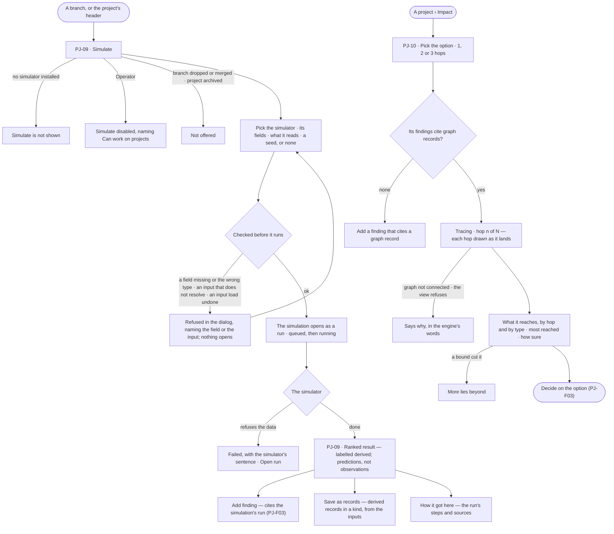
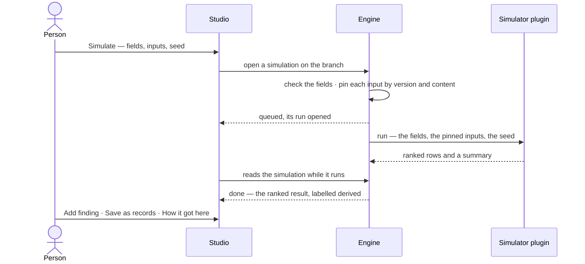

# Simulation and impact

> Before committing to a branch, try it: run a simulator over pinned loads to rank what is likely to work, and see
> what the option reaches over the graph, hop by hop. The decisions it helps make: *which option is the best bet before I commit?* —
> and *who does this decision reach before I commit to it?*

## User journey

## Stories

| ID | Story | Status |
|---|---|---|
| PJ-09 | [Simulate before committing](stories/PJ-09-simulate-before-committing/story.md) | idea |
| PJ-10 | [See what a decision reaches](stories/PJ-10-see-what-a-decision-reaches/story.md) | idea |

## Access

| Act | Role (`.claude/team/TEAM.md` §7) | Everyone else sees |
|---|---|---|
| Read a project's simulations, their results and their runs | Operator — every member who can see the project | — |
| Simulate · add a finding from a result · save a result as records | `contributor` · shown as *Can work on projects* · Admin; saving records also needs what RC-F02 asks to load into that kind | *Simulate*, *Add finding* and *Save as records* disabled, naming *Can work on projects* |
| Read the impact of an option | Operator — every member who can see the project; every read is under the Graph's view | — |
| Install a simulator | Admin — as a plugin (RT-F02) | — |

## States

| State | What the person sees |
|---|---|
| First use | A branch with no simulations: its *Simulations* tab reads *No simulations yet*, with *Simulate*. Impact with no record cites: *Add a finding that cites a graph record* |
| Empty after a filter | — |
| Loading | The result and the Impact tab drawn at once; rows and rings land in place |
| Has data | A ranked result, labelled derived; impact rings by hop and by type, with the most reached records and how sure the evidence is |
| Failed | A refused simulation stays in the dialog naming the field or input; a failed run shows the simulator's sentence beside *Open run*; an impact read that is refused says why |
| Agent working or proposing | A simulation queued or running, its run's status shown and followed; impact tracing, saying which hop it is on |
| No access | Results and impact read; *Simulate*, *Add finding* and *Save as records* disabled, naming *Can work on projects* |

## Rules

| Rule | Detail |
|---|---|
| The simulator does the science | A simulator is a plugin; Invana checks its fields, pins its inputs, runs it and labels the result — it never computes a figure itself |
| A simulation is a run | It runs the simulator's plan under the Graph's rules, with no agent; its run page, trace and tokens are the run's own, and its result is read from the run |
| Inputs are pinned | Each input is a load, pinned by its stable id and content hash at open; a load undone since is refused before any record is read |
| Reproducible | The seed is kept — Invana picks one when none is given; the same simulator version, fields, inputs and seed give the same result |
| Fields are what the simulator declares | The dialog draws one control per declared field; a missing or mistyped field is refused before a run opens. Data a simulator cannot use is its own refusal, in its words |
| Where it is offered | On a branch's header, and on the project's with the branch to pick. Never on a dropped or merged branch or an archived project; a parked branch may be simulated. Hidden while no simulator is installed |
| Always derived | Every result reads *derived* and says its rows are predictions, not observations; saved as records they are labelled *derived*, with the simulation's run and inputs as their provenance |
| Reuse, not new acts | *Add finding* is the finding of PJ-F03, citing the simulation's run; *Save as records* is a load of derived records into one kind (RC-F02) |
| Numbered per project | *s1*, *s2*, like branches and findings, because people type them |
| A record, never edited | A simulation is kept as it ran; to change it, simulate again. A simulator removed since still reads, with the version it ran |
| Reach starts from the evidence | Impact starts from the graph records the option's findings cite, every stance, and walks 1, 2 or 3 hops (2 by default); each hop is what the one before reached, less what was already reached |
| Bounded, and says so | At most 12 records expanded per hop, each to 50 neighbours, the most-reached first; a cut reach reads *More lies beyond* |
| Under the view | Every impact read is Explore's expand, under the Graph's view, so a type the view hides is never reached |
| How sure is the evidence's | How many of the findings it starts from a person reviewed, and the sources of the loads they cite — upload, CLI, API or by hand — and their licences — never a score |
| Reach only | No what-if values and no figure in any currency |
| Leans on | Branches and findings (PJ-F03) · loads (RC-F02) · runs (AG-F03) · Explore's expand (EX-F01) · plugins (RT-F02) |

## Data touched

| Record | Read or write |
|---|---|
| Simulations — branch, number, simulator and its version, fields, seed, pinned inputs, the run, who and when | Write · read |
| The simulation's run and its result (AG-F03) | Write · read |
| Loads it reads, and the derived records it may save (RC-F02) | Read · write |
| Findings citing a simulation's run (PJ-F03) | Write |
| The graph, through Explore's expand, for impact | Read |

## Engine

The low-level design: what this feature stores, serves and refuses. Conventions — naming, errors, lists, events — are
[system-design.md](../../../../system-design.md) §§ 6–8; this section only fills them in. Impact has no engine of its
own (Mechanisms).

### Records

| Table | Columns | Notes |
|---|---|---|
| `projects_simulations` | `project_id` · `branch_id` · `number` · `simulator` · `simulator_version` · `plugin` · `plugin_version` · `spec` · `seed` · `inputs` (`[{load_id, content_hash}]`, the pins) · `run_id` (set null when the run is deleted) · `created_by_id` · `created_at` | The result is read off the run. `number` counts per project ([PJ-F03 › Mechanisms](../PJ-F03-branches-findings-and-decisions/feature.md#mechanisms)). No route updates or deletes a row |

### Reads

| Record | Owner |
|---|---|
| Branches and the findings whose load cites fill *Reads* | [PJ-F03](../PJ-F03-branches-findings-and-decisions/feature.md#engine) |
| Loads — stable id, content hash, undone — and a load of derived records | [RC-F02](../../../records/features/RC-F02-bring-records-in/feature.md#engine) |
| The simulation's run, its steps, status and tokens | [AG-F03](../../../agents/features/AG-F03-runs-and-how-the-agents-are-doing/feature.md#engine) |
| Plugins, and the plugin kind `simulator` | [RT-F02](../../../../os/runtime/features/RT-F02-plugins-and-outside-tools/feature.md#engine) |
| The queue the run waits on | [RT-F03](../../../../os/runtime/features/RT-F03-workers-and-the-queue/feature.md#engine) |
| Explore's expand, for impact | [EX-F01](../../../explore/features/EX-F01-the-board-and-its-canvas/feature.md#engine) |

### Routes

| Route | Does | Story |
|---|---|---|
| `GET /api/v1/projects/simulators` | Every installed simulator, with its declared fields | PJ-09 |
| `POST /api/v1/u/{u}/{g}/projects/{key}/branches/{n}/simulations` | `SimulationCreate` → `202` `SimulationRead` | PJ-09 |
| `GET /api/v1/u/{u}/{g}/projects/{key}/simulations` | The project's simulations, newest first; `?branch=n` | PJ-09 |
| `GET /api/v1/u/{u}/{g}/projects/{key}/simulations/{n}` | One simulation, with its result once the run succeeded | PJ-09 |

| `SimulationCreate` | Notes |
|---|---|
| `simulator` | A key, or `key@version` to pin one |
| `spec` | The simulator's declared fields — checked for presence and type before a run opens |
| `inputs` | 0–20 loads by id; each resolved, readable by the caller and not undone |
| `seed` | Optional; Invana picks one and keeps it |

| `SimulationRead` | Notes |
|---|---|
| `number` · `branch` | `s1`; the branch's number |
| `simulator` | `{key, version, plugin, plugin_version, title}` — what ran |
| `spec` · `seed` · `inputs` | As run; inputs are `[{load_id, content_hash}]` |
| `origin` | `derived`, always |
| `run_id` · `status` · `outcome` · `error` · `tokens` | The run's |
| `result` | `{ranked: [...], summary: {...}}`, or null until the run succeeded |
| `created_by_id` · `created_at` · `started_at` · `finished_at` · `duration_ms` | Who opened it and when; the run's start, end and length, null until they happen |

| `SimulatorListResponse` | Notes |
|---|---|
| `items[]` | `SimulatorRead`: `key` · `version` · `plugin` · `plugin_version` · `handle` (the plugin's short name, which `simulator` also takes) · `title` · `summary` · `spec[]` (the declared fields) |
| `total` | The count |

### Events

| Event | When |
|---|---|
| — | None of its own: the simulation's run writes the run's events ([AG-F03](../../../agents/features/AG-F03-runs-and-how-the-agents-are-doing/feature.md#engine)); *Save as records* writes the load's ([RC-F02](../../../records/features/RC-F02-bring-records-in/feature.md#engine)) |

### Refusals

| Status | When | Sentence | Criterion |
|---|---|---|---|
| 403 | A simulation by someone without *Can work on projects* | *This needs Can work on projects — ask {owner}.* | PJ-09.16 |
| 422 | A field missing, mistyped or not declared by the simulator | *`{field}`: {why}.* | PJ-09.5 |
| 422 | An input load that does not resolve, the caller may not read, or was undone | *Load `{id}` {why} — nothing ran.* | PJ-09.5 |
| 422 | More than 20 inputs | *A simulation reads at most 20 loads.* | PJ-09.17 |
| 422 | A simulator, or a pinned version, that is not installed | *No simulator `{simulator}` is installed.* | API only — PJ-09.1 hides *Simulate* |
| 409 | A dropped or merged branch, or an archived project | *{bN} is {status} — it cannot be simulated.* | API only — PJ-09.4 does not offer it |
| — | A refusal saving the result as records | RC-F02's, in the dialog | PJ-09.12 |

### CLI

| Command | Does |
|---|---|
| — | No command of its own |

### Mechanisms

| Mechanism | How |
|---|---|
| The run reads only its pins | The run reads only the loads in `inputs` and checks each content hash |
| The seed | Recorded on the simulation and on the run's step |
| Data the simulator cannot use | Fails the run with the simulator's own sentence, never a 4xx |
| The simulator contract | A plugin of kind `simulator` (RT-F02), Python in the engine. It declares its key, version, title, summary and fields (`spec[]`, each with its type). It is given the fields, the pinned inputs and the seed; it returns ranked rows — each labelled by its row name, with its figures — and a summary, in its own order. A better model is a new plugin version; a simulation keeps `simulator_version` and `plugin_version` and still reads when the simulator is removed |
| Always derived | `origin = derived` on every simulation and every record saved from it |
| Save as records | One load of derived records into the kind the person picks (RC-F02), keyed by the row label; each row flattens to its label and its figures, one property each; each record's provenance is the simulation's run and its pinned loads |
| Impact | No engine of its own: Studio walks the reach through Explore's expand, one run per record expanded. It is drawn on the shared layered canvas, kind `impact`: a column per hop, a node per type at that hop with its count, an edge per relationship type joining two groups |

## System impact

| HLD section | Change | NFRs |
|---|---|---|
| § 6 Data and storage | One table in Invana's own store; no new store | — |
| § 8 APIs and events | The routes above; `simulators` is install-wide, outside a Graph | — |
| § 9 Distributed execution | A simulation is a queued run on a worker (RT-F03); no new worker kind | — |

## Decisions

| Decision | Detail |
|---|---|
| Simulating is project work | It needs *Can work on projects*, like any act on a branch; no new role |
| The result is a drill-in of the project | It polls every 2 s while the run is queued or running, drawing the run's status meanwhile, and stays on reload; a failed run shows the simulator's sentence beside *Open run page*; the branch lists its simulations in a *Simulations* tab, newest first |
| Impact is a tab of the project | The option and the hops are picked on it and kept on reload; it is read from the graph each time, never saved |
| One option at a time | Impact shows one option's reach; switching the option replaces it |
| Words for every reader | The impact canvas is also listed in words, every group and link, for a reader who cannot see it |
| One control per declared field | A whole number or a decimal is a number field with its default filled in, text a text field, yes/no a switch, an object JSON, a list one entry per line; a list entry written `name >= value` or `name <= value`, optionally `± sd`, is a target. *Reads* lists the loads the branch's findings cite, all ticked, and takes more by load id |
| The result reads the ranked rows | Each row is labelled by the simulator's row name; the share meeting every target is a bar, each target its mean ± spread and share meeting it, any other figure a column; a muted line says the rows are predictions, not observations |
| Save as records is one derived load | The ranked rows saved as records of one kind the person picks, keyed by the row label, each labelled *derived* with the simulation's run and pinned loads as its provenance; a refusal — a kind that does not fit, a missing right — stays in the dialog |

## Open questions

| Question | Who answers |
|---|---|
| — | — |

## Not building

| Item | Why not |
|---|---|
| What-if values per node | A simulator's job, when a policy model exists |
| Parameter sweeps · game theory | After 1.0 |
| An agent simulating | A simulation is a person's act on a branch; an agent proposes |
| Editing or deleting a simulation | It is the record of a run; simulate again |
| Comparing two options' impact side by side | One option at a time |
| Impact saved as a record | A decision cites findings, not a reach |
| Enabling a simulator per Graph | A simulator is there whenever its plugin is installed |
