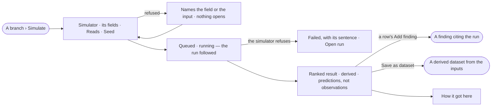

# PJ-09 · Simulate before committing

**As** a scientist on a research project **I want** to simulate crosses against target traits before making them
**so that** I spend a season on the best bet.

Tasks: [task.md](task.md) · Feature: [PJ-F04](../../feature.md)

## Who can

| Lens | Can | Otherwise sees |
|---|---|---|
| Admin | Simulate on any open or parked branch; add a finding from a result; save a result as a dataset; read every simulation and its run | — |
| Operator | Read every simulation of a project they can see, its result and its run | *Simulate*, *Add finding* and *Save as dataset* disabled, naming *Can work on projects*. *With Can work on projects: as Admin* |

## Flow

## Acceptance criteria

| # | Given | When | Then |
|---|---|---|---|
| PJ-09.1 | A Graph with no simulator installed | a member opens a branch | *Simulate* is not shown |
| PJ-09.2 | An open or parked branch | a member who can work on projects presses *Simulate* | the dialog shows one control per field the simulator declares, *Reads* with the branch's cited dataset versions ticked, and an optional seed |
| PJ-09.3 | The project's header | *Simulate* is pressed | the branch is picked in the dialog; dropped and merged branches are not offered |
| PJ-09.4 | A dropped or merged branch, or an archived project | it is opened | *Simulate* is not offered |
| PJ-09.5 | The dialog | a required field is missing or mistyped, an input does not resolve, or an input is retracted | it is refused in the dialog, naming the field or the input, and no run opens |
| PJ-09.6 | A valid simulation | it is sent | the dialog closes and the result opens over the branch, reading *queued*, then *running*, until the run settles |
| PJ-09.7 | A running simulation | the page is reloaded | the result reopens and still follows the run |
| PJ-09.8 | The simulator refuses the data | the run settles | the result reads *failed* with the simulator's sentence and *Open run*; nothing is half-written |
| PJ-09.9 | A simulation that succeeded | its result is read | the rows are ranked in the simulator's order with their figures and a summary, labelled *derived*, with a line saying they are predictions, not observations |
| PJ-09.10 | A simulation with no seed given | it runs | the seed Invana picked is kept; running the same simulator version, fields, inputs and seed again gives the same rows |
| PJ-09.11 | A result row | the member presses *Add finding* | *Add a finding* opens on the simulation's branch, the statement drawn from the row and the simulation's run as its cite |
| PJ-09.12 | A result | the member presses *Save as dataset* and names it, with a licence | a derived dataset is saved whose source is the simulation's inputs; a taken name is refused in the dialog |
| PJ-09.13 | A result | the member opens *How it got here* | it shows the run's steps, its pinned inputs and its tokens |
| PJ-09.14 | A branch | its *Simulations* tab is opened | every simulation is listed newest first, numbered *s1*, *s2*, each opening its result; with none it reads *No simulations yet* |
| PJ-09.15 | A simulator removed since a simulation ran | the simulation is opened | it still reads, naming the simulator version it ran |
| PJ-09.16 | An Operator | they open a branch and a result | both read; *Simulate*, *Add finding* and *Save as dataset* are disabled, naming *Can work on projects* |

## Screens

| Surface | Lens | First use | Empty after a filter | Loading | Has data | Failed | Agent working or proposing | No access |
|---|---|---|---|---|---|---|---|---|
| Simulate | Admin | — | — | — | projects.options · Simulate | projects.options · Simulate refused | — | — |
| Simulate | Operator | — | — | — | — | — | — | projects.options · Read only |
| The result | Admin | — | — | projects.options · Simulation result · Loading | projects.options · Simulation result | projects.options · Simulation failed | projects.options · Simulation running | — |
| The result | Operator | — | — | projects.options · Simulation result · Loading | projects.options · Simulation result · Read only | projects.options · Simulation failed | projects.options · Simulation running | projects.options · Simulation result · Read only |
| A branch › Simulations | Admin | projects.options · No simulations yet | — | projects.options · Loading | projects.options · Simulations | projects.options · Could not load | projects.options · Simulation running | — |
| A branch › Simulations | Operator | projects.options · No simulations yet · Read only | — | projects.options · Loading | projects.options · Simulations · Read only | projects.options · Could not load | projects.options · Simulation running | projects.options · Simulations · Read only |
| Save as dataset | Admin | — | — | — | projects.options · Save as dataset | projects.options · Save as dataset refused | — | — |
| Save as dataset | Operator | — | — | — | — | — | — | projects.options · Simulation result · Read only |
