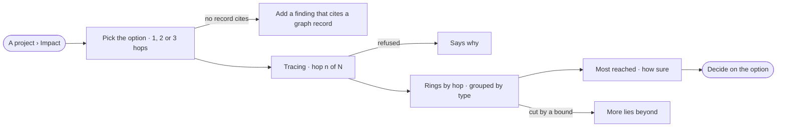

# PJ-10 · See what a decision reaches

**As** a policy maker **I want** to see what an option reaches across the graph, hop by hop **so that** I know who a
decision touches before I commit to it.

Tasks: [task.md](task.md) · Feature: [PJ-F04](../../feature.md)

## Who can

| Lens | Can | Otherwise sees |
|---|---|---|
| Admin | Read any option's impact, pick its hops, open any record reached | — |
| Operator | The same — impact is a read, under the Graph's view | — |

## Flow

## Acceptance criteria

| # | Given | When | Then |
|---|---|---|---|
| PJ-10.1 | An option whose findings cite no graph record | its impact is opened | it reads *Add a finding that cites a graph record* |
| PJ-10.2 | An option whose findings cite graph records | its impact is opened | it starts from those records, of every stance, and walks 2 hops by default |
| PJ-10.3 | Impact | the member picks 1, 2 or 3 hops | each hop shows what the one before reached, less what was already reached, counted by type — *2 hops · 38 District* |
| PJ-10.4 | Impact tracing | a hop is being read | it says which hop it is on, and earlier hops are drawn as they land |
| PJ-10.5 | A reach cut by a bound | it is drawn | at most 12 records were expanded per hop, each to 50 neighbours, the most reached first, and it reads *More lies beyond* |
| PJ-10.6 | A traced reach | it is read | the most reached records are listed with their type and hop, and *How sure* names how many of the starting findings a person reviewed and the sources of the loads they cite — upload, CLI, API or by hand — and their licences |
| PJ-10.7 | A type the Graph's view hides | impact is traced | it is never reached |
| PJ-10.8 | The graph not connected, or a read refused | impact is traced | it says why, in the engine's words |
| PJ-10.9 | A cited record gone from the graph | impact is traced | it counts at hop 0 and reaches nothing |
| PJ-10.10 | Impact with an option and hops picked | the page is reloaded | the same option and hops are traced again |
| PJ-10.11 | A traced reach | it is read | every group and link is also listed in words, and no figure in any currency appears |
| PJ-10.12 | An Operator | they open Impact | it reads and traces as for an Admin |

## Screens

| Surface | Lens | First use | Empty after a filter | Loading | Has data | Failed | Agent working or proposing | No access |
|---|---|---|---|---|---|---|---|---|
| A project › Impact | Admin | projects.decide · Impact · No record cites | — | projects.decide · Impact · Loading | projects.decide · Impact | projects.decide · Impact · Refused | projects.decide · Impact · Tracing | — |
| A project › Impact | Operator | projects.decide · Impact · No record cites | — | projects.decide · Impact · Loading | projects.decide · Impact | projects.decide · Impact · Refused | projects.decide · Impact · Tracing | — |
