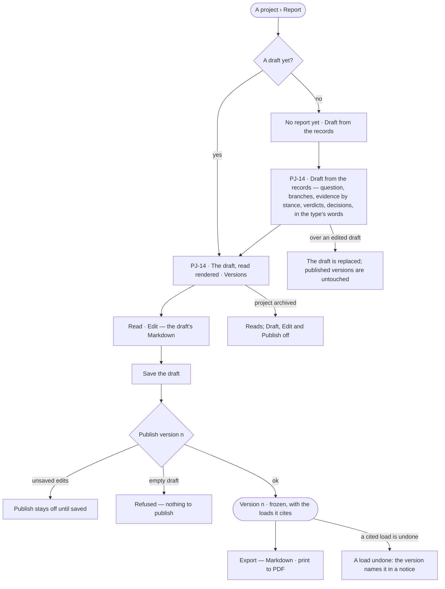

# Project reports

> A project written up from its own records — drafted, edited by a person, and published as frozen versions that cite
> the loads behind them. The decision it helps make: *is this what we decided, and is it ready to
> circulate?* — and later, *does a load undone since change what we published?*

## User journey

Journeys this feature is a step of: [J03 · Give an agent work and decide on the result](../../../../journeys/J03-give-an-agent-work-and-decide-on-the-result.md)

## Stories

| ID | Story | Status |
|---|---|---|
| PJ-14 | [Publish what we decided](stories/PJ-14-publish-what-we-decided/story.md) | idea |

## Access

Who may do what is the [role table](../../../../os/access/features/AC-F02-access-policies/feature.md#the-role-table):
*Reports* is *Acts* for Operator, Modeller and Admin — on every project the person can see
([PJ-F01](../PJ-F01-projects-and-tasks/feature.md#access)).

| Act | Who | Everyone else sees |
|---|---|---|
| Read the draft and every version · export a version | Anyone who can see the project | A private project's report is absent for anyone not on it |
| Draft from the records · edit the draft · publish a version | Anyone who can see the project — Operator · Modeller · Admin | On an archived project, every version reads; *Draft from the records*, *Edit* and *Publish* are off |

## States

| State | What the person sees |
|---|---|
| First use | *No report yet*, with *Draft from the records* |
| Empty after a filter | — |
| Loading | The Report tab drawn at once; the draft lands in place |
| Has data | The draft or a version, read rendered, its cites numbered and listed once under *Cites*; *Versions* counts the draft and every version |
| Failed | The report could not load, saying why, with *Try again*; publishing an empty draft is refused |
| Agent working or proposing | — |
| No access | A private project's report is absent for anyone not on it; on an archived project the draft and every version read and *Draft from the records*, *Edit* and *Publish* are off |

## Rules

| Rule | Detail |
|---|---|
| Drafted from the records | The draft is written by the project type's report template (PJ-F03) from the project's question, branches, evidence by stance, verdicts and current decisions, in the project type's words — nothing invented, no AI model. A finding resting on a what-if reads *predicted*; a superseded decision is named beside the one that supersedes it |
| A person edits | The draft is Markdown, edited by a person before it is published |
| One report per project | A single draft and its numbered versions |
| Published is frozen | A version freezes its body and the loads its findings cite at that moment, by id and content hash; nothing changes it. A later change is a new version |
| What is published is saved | *Publish* stays off while the draft has unsaved edits |
| Read, never stored | A version that cites a load undone since names it in a *load undone* notice, read each time it is opened |
| Read rendered | Headings, lists, bold and paragraphs in the kit's typography; a finding's cites as numbered marks listed once under *Cites*, a run as *run 8195c5e8*. *Read · Edit* switches the draft to its Markdown |
| Export | Markdown — the version's body, or the draft's, as it reads; PDF — the browser's print of the rendered version |
| An archived project | Its report reads; drafting, editing and publishing are off |
| Leans on | Branches, findings and decisions (PJ-F03) · loads and undoing a load (RC-F02) |

## Data touched

| Record | Read or write |
|---|---|
| The report — its draft, who last edited it and when | Write · read |
| Report versions — number, body, the loads cited, who published and when | Write · read |
| The project's question, branches, findings, verdicts and decisions (PJ-F03) | Read |
| Loads and whether each was undone (RC-F02) | Read |
| History rows of every draft and publish (AC-F06) | Write |

## Engine

The low-level design: what this feature stores, serves and refuses. Conventions — naming, errors, lists, events — are
[system-design.md](../../../../system-design.md) §§ 6–8; this section only fills them in.

### Records

| Table | Columns | Notes |
|---|---|---|
| `projects_reports` | `project_id` (unique) · `draft` · `draft_updated_by_id?` · `draft_updated_at?` | One report per project: one draft |
| `projects_report_versions` | `report_id` · `version` · `body` · `cites[]` (`{load_id, content_hash}`) · `published_by_id` · `published_at` | Frozen: never edited. `version` counts from 1 |

### Reads

| Record | Owner |
|---|---|
| The project, its question and type · the type's report template | [PJ-F01](../PJ-F01-projects-and-tasks/feature.md#engine) |
| Branches, findings, verdicts and decisions | [PJ-F03](../PJ-F03-branches-findings-and-decisions/feature.md#engine) |
| Loads and whether each was undone | [RC-F02](../../../records/features/RC-F02-bring-records-in/feature.md#engine) |
| History | [AC-F06](../../../../os/access/features/AC-F06-history/feature.md#engine) |

### Routes

| Route, after `/api/v1/projects` | Does | Story |
|---|---|---|
| `GET /{key}/report` · `PUT /{key}/report` | The draft and its versions · save the draft | PJ-14 |
| `POST /{key}/report/generate` | Draft from the records, replacing the draft | PJ-14 |
| `POST /{key}/report/publish` | Freeze the saved draft as the next version | PJ-14 |
| `GET /{key}/report/versions/{v}` | One version, with its `undone[]` notice | PJ-14 |
| `GET /{key}/report/export` | A version's Markdown, or the draft's, with the notice above it | PJ-14 |

### Events

| Event | When |
|---|---|
| `projects.reports.generate` | The draft is written from the records |
| `projects.reports.publish` | A version is frozen |

### Refusals

| Status | When | Sentence | Criterion |
|---|---|---|---|
| 422 | Publishing an empty draft | *There is nothing to publish.* | PJ-14.6 |
| 404 | A private project the caller is not on | [PJ-F01 › Refusals](../PJ-F01-projects-and-tasks/feature.md#refusals) | PJ-14.13 |
| 409 | Drafting, saving or publishing on an archived project | [PJ-F01 › Refusals](../PJ-F01-projects-and-tasks/feature.md#refusals) | PJ-14.12 |

### CLI

| Command | Does |
|---|---|
| — | No command of its own |

### Mechanisms

| Mechanism | How |
|---|---|
| Generate | `POST /{key}/report/generate` runs the type's report template (from `GET /api/v1/projects/types`) over the project's records and replaces `draft` |
| Publish | Copies the saved `draft` into the next `projects_report_versions` row with `cites[]`, the loads its findings cite at that moment |
| The notice | `undone[]` names each cited load undone since, computed each time the version is read |
| Export | The version's body, or the draft's, as Markdown with the notice above it |
| Hidden projects | Every read here applies the private-project filter of [PJ-F01 › Mechanisms](../PJ-F01-projects-and-tasks/feature.md#mechanisms) |

## System impact

| HLD section | Change | NFRs |
|---|---|---|
| § 6 Data and storage | Two tables in Invana's own store; no new store | — |
| § 8 APIs and events | The routes and events above | — |

## Decisions

| Decision | Detail |
|---|---|
| A template drafts, not a model | *Nothing invented* is a property of the template; a rewrite by the assistant is a later act on the draft, never the draft itself |
| A report is a tab of the project | The draft and its versions sit on the project's Report tab |

## Open questions

| Question | Who answers |
|---|---|
| The `projects.report` board draws the draft as written by an agent; the rules say a template drafts it. Redraw the board, or let an agent draft it? Recommend: redraw — a template keeps *nothing invented* provable | Ravi |

## Not building

| Item | Why not |
|---|---|
| PDF made by the engine | The browser's print of the rendered version is the PDF |
| Drafting by an AI model | A template draws only on the records |
| Several reports per project | One draft, numbered versions |
| Editing a published version | Publish a new one |
