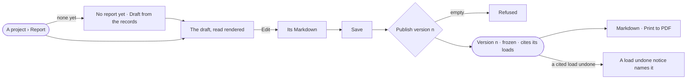

# PJ-14 · Publish what we decided

**As** the person running a project **I want** a report drafted from its records, edited and published as a frozen
version **so that** what we decided can be circulated, cited and audited.

Tasks: [task.md](task.md) · Feature: [PJ-F05](../../feature.md)

## Who can

*Reports* is *Acts* for every role in the [role table](../../../../../../os/access/features/AC-F02-access-policies/feature.md#the-role-table),
on every project the person can see ([PJ-F01](../../../PJ-F01-projects-and-tasks/feature.md#access)).

| Lens | Can | Otherwise sees |
|---|---|---|
| Admin | Draft from the records, edit and save the draft, publish a version, read and export every version, on any project they can see | On an archived project, *Draft from the records*, *Edit* and *Publish* are off |
| Operator | The same; a Modeller the same | On an archived project, *Draft from the records*, *Edit* and *Publish* are off; a private project they are not on is absent |

## Flow

## Acceptance criteria

| # | Given | When | Then |
|---|---|---|---|
| PJ-14.1 | A project with no report | a person who can see it opens its Report tab | it reads *No report yet*, with *Draft from the records* |
| PJ-14.2 | A project with branches, findings and decisions | a person who can see it presses *Draft from the records* | the draft holds the question, every branch, its evidence by stance, verdicts and current decisions, in the project type's words, and nothing the records do not hold; a finding resting on a what-if reads *predicted*, and a superseded decision is named beside the one that supersedes it |
| PJ-14.3 | An edited draft | *Draft from the records* is pressed again | the draft is replaced; published versions are untouched |
| PJ-14.4 | The draft | the person switches *Read · Edit* | it shows the draft's Markdown to edit, and *Save* keeps it |
| PJ-14.5 | A draft with unsaved edits | the person looks at *Publish* | it is off until the draft is saved |
| PJ-14.6 | An empty draft | the person publishes | it is refused, saying there is nothing to publish |
| PJ-14.7 | A saved draft | the person publishes | a version numbered next is frozen with its body and the loads the findings cite; *Versions* counts it and the draft |
| PJ-14.8 | A published version | anyone opens it later | it reads exactly as published, whatever changed in the project since |
| PJ-14.9 | A version citing a load undone since | it is opened | a *load undone* notice names the load, who undid it and when |
| PJ-14.10 | The draft or a version | it is read | it reads rendered, its cites numbered and listed once under *Cites*, a run as *run 8195c5e8* linking to the run |
| PJ-14.11 | A version | the person presses *Markdown* · *Print* | the body downloads as Markdown, as it reads · the browser prints the rendered version to PDF |
| PJ-14.12 | An archived project | its Report tab is opened | the draft and versions read; *Draft from the records*, *Edit* and *Publish* are off |
| PJ-14.13 | A private project | a person not on it asks for its report | it reads *Not found* |

## Screens

| Surface | Lens | First use | Empty after a filter | Loading | Has data | Failed | Agent working or proposing | No access |
|---|---|---|---|---|---|---|---|---|
| A project › Report | Admin | projects.report · No report yet | — | projects.report · Loading | projects.report | projects.report · Publish refused | — | — |
| A project › Report | Operator | projects.report · No report yet | — | projects.report · Loading | projects.report | projects.report · Publish refused | — | projects.report · Archived |
| Editing the draft | Admin | — | — | — | projects.report · Edit | projects.report · Unsaved edits | — | — |
| Editing the draft | Operator | — | — | — | projects.report · Edit | projects.report · Unsaved edits | — | projects.report · Archived |
| A published version | Admin | — | — | projects.report · Version · Loading | projects.report · Version | projects.report · Version · Retracted source | — | — |
| A published version | Operator | — | — | projects.report · Version · Loading | projects.report · Version | projects.report · Version · Retracted source | — | — |
