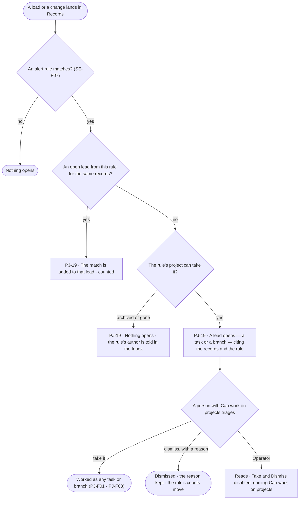
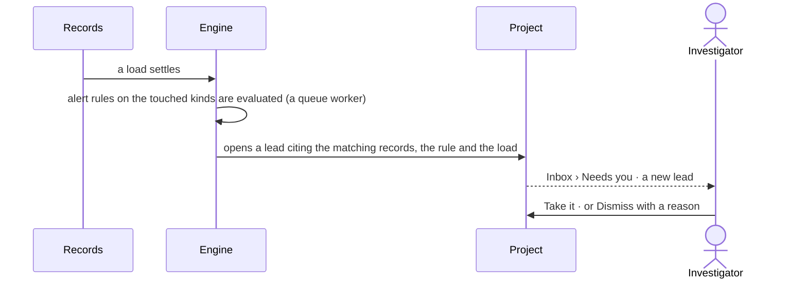

# Alerts

> A rule of kind *alert* notices a pattern in the records — a ring of linked accounts, a watchlist hit — and opens a lead
> in a project: a task, or a branch to weigh. The decision it helps make: *is this pattern worth pursuing, and by whom?*

## User journey

## Stories

| ID | Story | Status |
|---|---|---|
| PJ-19 | [Open a lead when the records show a pattern](stories/PJ-19-open-a-lead-when-the-records-show-a-pattern/story.md) | idea |

## Access

| Act | Role (`.claude/team/TEAM.md` §7) | Everyone else sees |
|---|---|---|
| Write an alert rule and the project it opens leads in | `modeller` · shown as *Can shape the model* (SE-F07) | As SE-F07 |
| Read a project's leads and the rule behind each | Operator — every member who can see the project | A private project's leads are absent for anyone not on it |
| Take or dismiss a lead | `contributor` · shown as *Can work on projects* · Admin | *Take* and *Dismiss* disabled, naming *Can work on projects* |
| Open a lead | The engine, on the rule's behalf — never an agent's own act | — |

## States

| State | What the person sees |
|---|---|
| First use | *No alerts yet — an alert rule in Semantics opens leads here*, naming who can write one |
| Empty after a filter | *No leads match*, with the filter to clear |
| Loading | The list holds its shape; rows are skeletons |
| Has data | Leads newest first: the rule, the records matched, how many matches, opened when, open · taken · dismissed |
| Failed | The list could not load, saying why, with *Try again* |
| Agent working or proposing | An agent assigned a taken lead works it as any task (PJ-F01) |
| No access | A private project's leads are absent; an Operator reads every lead and triages none |

## Rules

| Rule | Detail |
|---|---|
| An alert is a rule | Its condition, the kinds it watches and the project it opens leads in are SE-F07's; Projects only receives the lead |
| A lead is a task or a branch | The rule says which; the lead is an ordinary task (PJ-F01) or branch (PJ-F03) with the rule, the load and the matched records as its cites |
| One open lead per pattern | A match on the same records while a lead from the same rule is open adds to it and counts, never a second lead |
| Evaluated after the write | Alert rules run on a queue worker after a load or change settles; they never block or slow the write |
| Generic | The rule names kinds and conditions; no pattern is built into the platform — Domain packs ship ready alert rules (RT-F02) |
| The engine counts | Matches per lead, leads per rule, taken and dismissed are stored by the engine |

## Data touched

| Record | Read or write |
|---|---|
| Alert rules — condition, kinds watched, project, task or branch (SE-F07) | Read |
| Leads — the rule, the load, the matched records, match count, state, dismissal reason | Write · read |
| Tasks and branches a lead opens (PJ-F01 · PJ-F03) | Write |
| Inbox notices to a rule's author (GR-F05) | Write |

## Engine

> Placeholder — its records, reads, routes, events, refusals, CLI and mechanisms.

## System impact

> Placeholder — `None`, or the `system-design.md` sections it changes and the NFRs it touches.

## Decisions

| Decision | Detail |
|---|---|
| Leads land in a project | An alert never stands alone: it opens work where the decision about it will be made |
| A dismissal keeps its reason | So a rule that only makes noise shows it in its counts |

## Open questions

| Question | Who answers |
|---|---|
| Should a lead open as a task or a branch by default? Recommend: a task — a branch is for a line of inquiry a person has chosen to pursue | Ravi |

## Not building

| Item | Why not |
|---|---|
| A separate alerts place | Leads are project work; Inbox › Needs you already says what waits |
| Alerts sent outside Invana | A send is an act under the access rules; a schedule's delivery covers it (AG-F07) |
| Real-time streaming detection | Rules run after a write settles; Invana is not a monitoring platform |
