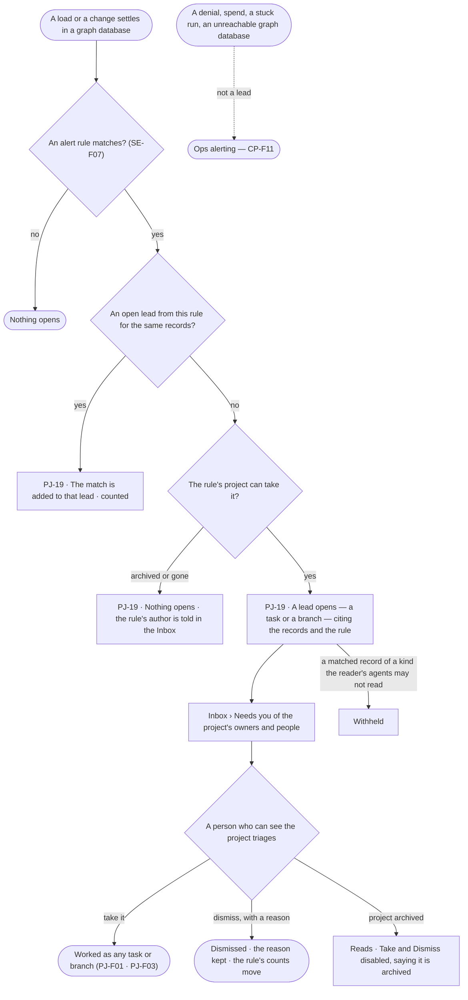
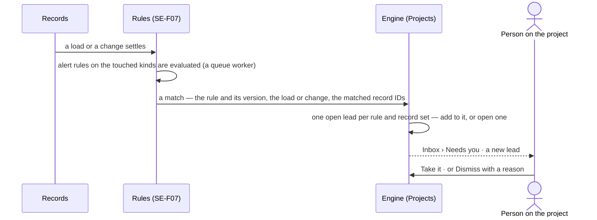

# Alerts

> An alert rule notices a pattern in the records — a Customer whose Orders in the last 30 days fall below a threshold,
> a Supplier linked to more Products than it should be — and opens a lead in a project: a task, or a branch to weigh.
> The decision it helps make: *is this pattern worth pursuing, and by whom?*
>
> What goes wrong with the platform — denials, spend, stuck runs, a graph database that cannot be reached — is not an
> alert here: it is [ops alerting](../../../../os/control/features/CP-F11-ops-alerting/feature.md) in the Control Plane.

## User journey

## Stories

| ID | Story | Status |
|---|---|---|
| PJ-19 | [Open a lead when the records show a pattern](stories/PJ-19-open-a-lead-when-the-records-show-a-pattern/story.md) | idea |

## Access

Who may do what is the [role table](../../../../os/access/features/AC-F02-access-policies/feature.md#the-role-table):
*Alerts* is *Acts* for Operator, Modeller and Admin — on every project the person can see
([PJ-F01](../PJ-F01-projects-and-tasks/feature.md#access)). Writing an alert rule is the Ontology's.

| Act | Who | Everyone else sees |
|---|---|---|
| Write an alert rule and the project it opens leads in | Modeller · Admin ([SE-F07](../../../semantics/features/SE-F07-rules/feature.md)) | As SE-F07 |
| Read a project's leads and the rule behind each | Anyone who can see the project | A private project's leads are absent for anyone not on it |
| Read the records a lead matched | Through the agents the reader may use, under their Access Policies ([AC-F02](../../../../os/access/features/AC-F02-access-policies/feature.md)) | A record of a kind the reader's agents may not read reads *Withheld* |
| Take or dismiss a lead | Anyone who can see the project — Operator · Modeller · Admin | On an archived project, *Take* and *Dismiss* are disabled, saying it is archived |
| Open a lead | The engine, on a rule's match — never an agent's own act | — |

## States

| State | What the person sees |
|---|---|
| First use | *No alerts yet — an alert rule in the Ontology opens leads here*, naming the Modellers and Admins who can write one |
| Empty after a filter | *No leads match*, with the filter to clear |
| Loading | The list holds its shape; rows are skeletons |
| Has data | Leads newest first: the rule, the records matched, how many matches, opened when, open · taken · dismissed |
| Failed | The list could not load, saying why, with *Try again*; a dismissal with no reason is refused |
| Agent working or proposing | An agent assigned a taken lead works it as any task (PJ-F01) |
| No access | A private project's leads are absent; a matched record the reader's agents may not read reads *Withheld*; on an archived project *Take* and *Dismiss* are disabled |

## Rules

| Rule | Detail |
|---|---|
| An alert is a rule | Its condition, the kinds it watches, the project it opens leads in and whether a lead is a task or a branch are SE-F07's; Projects only receives the match and opens the lead |
| A pattern in the records | A rule watches the records — counts, thresholds, links between kinds — never the platform. Denials, spend, stuck runs, unreachable graph databases and skipped schedules are [ops alerts](../../../../os/control/features/CP-F11-ops-alerting/feature.md) |
| A lead is a task or a branch | The lead is an ordinary task (PJ-F01) or branch (PJ-F03) with the rule, the load or change and the matched records as its cites |
| One open lead per pattern | A match on the same records while a lead from the same rule is open adds to it and counts, never a second lead |
| Evaluated after the write | Alert rules run on a queue worker after a load or change settles; they never block or slow the write |
| A lead waits in the Inbox | A new lead is listed in the Inbox › Needs you of the project's owners and people ([CP-F08](../../../../os/control/features/CP-F08-the-inbox/feature.md)); a rule whose project is archived or gone tells its author instead |
| Take | A task lead is assigned as the taker picks — a person, or an agent they may use — and worked as any task; a branch lead is worked as any branch |
| Dismiss | Needs a reason. A task lead is cancelled with the reason as its note; a branch lead is dropped by a *drop* decision in the dismisser's name, the reason its rationale, checked by the rules like any decision (PJ-F03) |
| Records read as the reader | A lead stores record IDs; opening one reads it through the agents the reader may use |
| Generic | The rule names kinds and conditions; no pattern is built into the platform — Domain packs ship ready alert rules (CP-F02) |
| The engine counts | Matches per lead, leads per rule, taken and dismissed are stored by the engine |
| Leans on | Rules and their evaluation (SE-F07) · tasks (PJ-F01) · branches and decisions (PJ-F03) · loads (RC-F02) · the Inbox (CP-F08) |

## Data touched

| Record | Read or write |
|---|---|
| Alert rules — condition, kinds watched, project, task or branch (SE-F07) | Read |
| Leads — the rule and its version, the load or change, the matched records, match count, state, dismissal reason | Write · read |
| Tasks and branches a lead opens, and a dismissal's cancel or *drop* decision (PJ-F01 · PJ-F03) | Write |
| Inbox items — a new lead, a rule whose project cannot take it (CP-F08) | Write |
| History rows of every lead opened, matched, taken and dismissed (AC-F06) | Write |

## Engine

The low-level design: what this feature stores, serves and refuses. Conventions — naming, errors, lists, events — are
[system-design.md](../../../../system-design.md) §§ 6–8; this section only fills them in.

### Records

| Table | Columns | Notes |
|---|---|---|
| `projects_leads` | `project_id` · `number` · `rule_id` · `rule_version` · `opened_as` (`task` · `branch`) · `task_id?` · `branch_id?` · `match_key` (a hash of the sorted matched record IDs) · `records[]` (`{graph_database, kind, record_id}`) · `source_kind` (`load` · `change`) · `source_id` · `matches` · `state` (`open` · `taken` · `dismissed`) · `reason?` · `resolved_by_id?` · `opened_at` · `resolved_at?` | Unique (`rule_id`, `match_key`) among rows with `state = open`. `number` counts per project (`l3`). Record IDs only — never record values |

### Reads

| Record | Owner |
|---|---|
| Alert rules, their versions, and the match their evaluation hands over | [SE-F07](../../../semantics/features/SE-F07-rules/feature.md#engine) |
| Projects, their owners and people, the private-project filter · tasks | [PJ-F01](../PJ-F01-projects-and-tasks/feature.md#engine) |
| Branches and the *drop* decision a dismissal records | [PJ-F03](../PJ-F03-branches-findings-and-decisions/feature.md#engine) |
| Loads | [RC-F02](../../../records/features/RC-F02-bring-records-in/feature.md#engine) |
| The Inbox items a lead raises | [CP-F08](../../../../os/control/features/CP-F08-the-inbox/feature.md#engine) |
| History | [AC-F06](../../../../os/access/features/AC-F06-history/feature.md#engine) |

### Routes

| Route, after `/api/v1/projects` | Does | Story |
|---|---|---|
| `GET /{key}/leads` | A project's leads, newest first, by the list contract; `?state=` · `?rule=`; `total` and `by_state` | PJ-19 |
| `GET /{key}/leads/{n}` | One lead: its rule, source, records, matches and state, and its task or branch | PJ-19 |
| `POST /{key}/leads/{n}/take` | `{assignee?}` — a task lead assigned; a branch lead taken | PJ-19 |
| `POST /{key}/leads/{n}/dismiss` | `{reason}` — the task cancelled, or the branch dropped by a decision | PJ-19 |

### Events

| Event | When |
|---|---|
| `projects.leads.opened` | A lead opens, its task or branch with it |
| `projects.leads.matched` | A match is added to an open lead |
| `projects.leads.taken` · `projects.leads.dismissed` | A person takes · dismisses a lead, the reason on the event |
| `projects.leads.not_opened` | A rule matched but its project is archived or gone; its author is told |

### Refusals

| Status | When | Sentence | Criterion |
|---|---|---|---|
| 404 | A private project the caller is not on | [PJ-F01 › Refusals](../PJ-F01-projects-and-tasks/feature.md#refusals) | PJ-19.8 |
| 422 | A dismissal with no reason | *Say why this lead is dismissed.* | PJ-19.6 |
| 409 | Take or dismiss on an archived project | [PJ-F01 › Refusals](../PJ-F01-projects-and-tasks/feature.md#refusals) | PJ-19.11 |
| 409 | Take or dismiss a lead not open | *{lN} is already {state}.* | API only — Studio offers each act only on an open lead |
| 403 | Taking a task lead for an agent the taker may not use | *You may not use {agent} — ask {owner}.* | PJ-19.5 |
| 409 | A rule blocks the *drop* decision a branch lead's dismissal records | PJ-F03's rule refusal | PJ-19.12 |

### CLI

| Command | Does |
|---|---|
| — | No command of its own |

### Mechanisms

| Mechanism | How |
|---|---|
| Receiving a match | SE-F07's worker calls `projects.leads.open(rule_id, rule_version, source, records[])`. The engine computes `match_key`; an open lead with the same `rule_id` and `match_key` gets `matches + 1` and `projects.leads.matched`; otherwise a lead row and its task or branch are written in one transaction, citing the rule, the source and the records, `projects.leads.opened` |
| A project that cannot take it | An archived or deleted project writes no lead; `projects.leads.not_opened` raises an Inbox item to the rule's author naming the project |
| Needs you | A new lead raises one Needs you item to the project's owners and people ([CP-F08](../../../../os/control/features/CP-F08-the-inbox/feature.md#engine)); taking or dismissing it closes the item for everyone |
| Take | A task lead writes its assignee through PJ-F01's assign — an agent opens its run with the taker behind it; `state = taken` |
| Dismiss | A task lead is cancelled through PJ-F01 with `reason` as its note; a branch lead records a *drop* decision through PJ-F03 as the dismisser, `reason` its rationale; a rule that blocks it leaves the lead open. `state = dismissed` only once that write succeeds |
| Rule counts | Leads per rule, taken and dismissed are counted from `projects_leads` and served to SE-F07's rule page |
| Records read as the reader | `records[]` are opened through the agents the reader may use; a kind their policies deny is returned as `withheld` |
| Hidden projects | Every read here applies the private-project filter of [PJ-F01 › Mechanisms](../PJ-F01-projects-and-tasks/feature.md#mechanisms) |

## System impact

| HLD section | Change | NFRs |
|---|---|---|
| § 6 Data and storage | One table in Invana's own store, holding record IDs only; no new store | — |
| § 8 APIs and events | The routes and events above | — |
| § 9 Distributed execution | None of its own: alert rules run on SE-F07's queue worker after a write settles | — |

## Decisions

| Decision | Detail |
|---|---|
| Leads land in a project | An alert never stands alone: it opens work where the decision about it will be made |
| A dismissal keeps its reason | So a rule that only makes noise shows it in its counts |
| Records, not the platform | A lead is about the customer's records; what goes wrong with Invana itself is an ops alert in the Control Plane |
| Dismissing a branch is a decision | A branch is closed only by a decision, so a dismissed branch lead is a *drop* the rules check like any other |

## Open questions

| Question | Who answers |
|---|---|
| Should a lead open as a task or a branch by default? Recommend: a task — a branch is for a line of inquiry a person has chosen to pursue | Ravi |

## Not building

| Item | Why not |
|---|---|
| A separate alerts place | Leads are project work; Inbox › Needs you already says what waits |
| Platform alerts — denials, spend, stuck runs, unreachable graph databases | Ops alerting in the Control Plane ([CP-F11](../../../../os/control/features/CP-F11-ops-alerting/feature.md)) |
| Alerts sent outside Invana | A send is an agent's act under its Access Policies; a schedule's delivery covers it (AG-F07) |
| Real-time streaming detection | Rules run after a write settles; Invana is not a monitoring platform |
