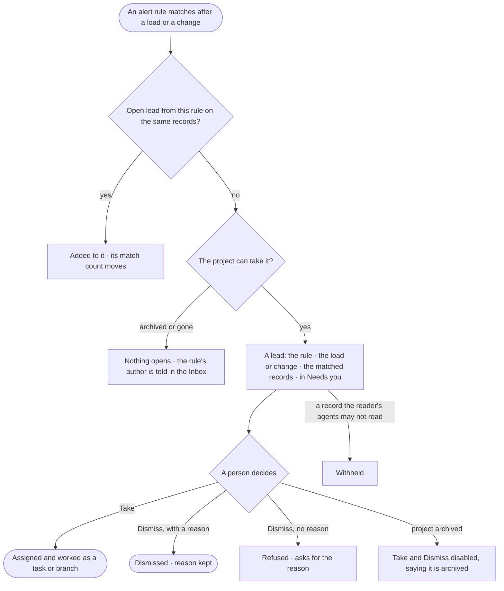

# PJ-19 · Open a lead when the records show a pattern

**As** an investigator **I want** a lead opened in my project when the records show a pattern an alert rule watches
for — a Customer whose Orders in the last 30 days fall below a threshold — **so that** I act on it while it matters:
the rule proposes the lead, and a person decides whether to pursue it.

Tasks: [task.md](task.md) · Feature: [PJ-F06](../../feature.md)

## Who can

*Alerts* is *Acts* for every role in the [role table](../../../../../../os/access/features/AC-F02-access-policies/feature.md#the-role-table),
on every project the person can see; writing the alert rule is a Modeller's or an Admin's
([SE-F07](../../../../../semantics/features/SE-F07-rules/feature.md)).

| Lens | Can | Otherwise sees |
|---|---|---|
| Admin | Read every lead of a project they can see, the rule and the records behind it; take or dismiss a lead | A matched record of a kind their agents may not read reads *Withheld*; on an archived project *Take* and *Dismiss* are disabled |
| Operator | The same; take a task lead for a person or an agent they may use; a Modeller the same | As Admin. An agent they may not use is disabled in *Take* — *You may not use {agent} — ask an Admin* |

## Flow

## Acceptance criteria

| # | Given | When | Then |
|---|---|---|---|
| PJ-19.1 | An alert rule naming a project — *a Customer whose Orders in the last 30 days fall below 3* — and a load whose records match it | the load settles | a lead opens in that project — a task or a branch, as the rule says — citing the rule, the load and the matched records |
| PJ-19.2 | An open lead from a rule | the same records match it again | the match is added to that lead and its count moves; no second lead opens |
| PJ-19.3 | A rule whose project is archived or deleted | it matches | no lead opens, and the rule's author is told in the Inbox, naming the project |
| PJ-19.4 | A project with leads | its *Alerts* list opens | leads read newest first with the rule, how many records matched, when it opened and open · taken · dismissed — each count from the engine |
| PJ-19.5 | A lead | a person who can see the project takes it | it becomes ordinary work, assigned as they pick — a person, or an agent they may use (PJ-F01); an agent they may not use is refused — *You may not use {agent} — ask an Admin* |
| PJ-19.6 | A lead | a person dismisses it without a reason | it is refused, asking for the reason; nothing changes |
| PJ-19.7 | A lead | it is opened | *How it got here* shows the rule, its condition, the load or change and the records that matched |
| PJ-19.8 | A project the person's default agent may not Read | they look at its leads | they read how many there are, and each lead's content reads *Withheld — your agent may not read `project/{key}`*; nothing reads *Not found* |
| PJ-19.9 | A new lead | the project's members open the Inbox | it is listed in their *Needs you*; taking or dismissing it clears it for all of them |
| PJ-19.10 | A matched record of a kind the reader's agents may not read | they open the lead | that record reads *Withheld*; the rule and every other record read |
| PJ-19.11 | An archived project | someone opens a lead | it reads; *Take* and *Dismiss* are disabled, saying the project is archived |
| PJ-19.12 | A branch lead | a person dismisses it with a reason | a *drop* decision is recorded in their name with the reason as its rationale, checked by the rules (PJ-07); a rule that blocks it leaves the lead open, naming the rule |
| PJ-19.13 | Something going wrong with the platform, not the records | it happens | it opens no lead here; it is an alert of its kind ([CP-F11](../../../../../../os/control/features/CP-F11-ops-alerting/feature.md#the-alert-kinds)) |

## Screens

| Surface | Lens | First use | Empty after a filter | Loading | Has data | Failed | Agent working or proposing | No access |
|---|---|---|---|---|---|---|---|---|
| Alerts | Admin | projects.alerts · No alerts yet | projects.alerts · No leads match | projects.alerts · Loading | projects.alerts | projects.alerts · Could not load | — | — |
| Alerts | Operator | projects.alerts · No alerts yet | projects.alerts · No leads match | projects.alerts · Loading | projects.alerts | projects.alerts · Could not load | — | projects.alerts · Archived |
| A lead | Admin | — | — | projects.task · Loading | projects.task · Lead | projects.task · Dismiss refused | projects.task.thinking | projects.task · Lead · Record withheld |
| A lead | Operator | — | — | projects.task · Loading | projects.task · Lead | projects.task · Dismiss refused | projects.task.thinking | projects.task · Lead · Record withheld |
