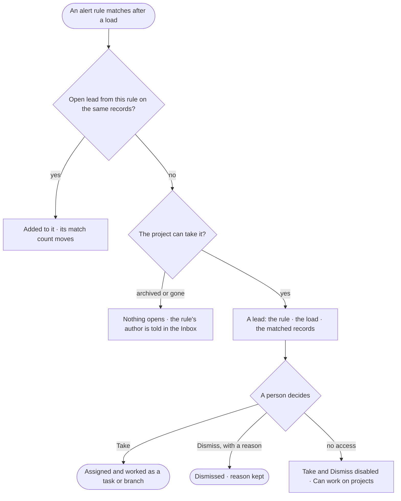

# PJ-19 · Open a lead when the records show a pattern

**As** an investigator **I want** a lead opened in my project when the records show a pattern an alert rule watches for
**so that** I act on it while it matters — the rule proposes the lead, and a person decides whether to pursue it.

Tasks: [task.md](task.md) · Feature: [PJ-F06](../../feature.md)

## Who can

| Lens | Can | Otherwise sees |
|---|---|---|
| Admin | Read every lead of a project they can see; take or dismiss a lead | — |
| Operator | Read every lead of a project they can see, the rule and the records behind it | *Take* and *Dismiss* disabled, naming *Can work on projects*. *With Can work on projects: as Admin* |

## Flow

## Acceptance criteria

| # | Given | When | Then |
|---|---|---|---|
| PJ-19.1 | An alert rule naming a project, and a load whose records match it | the load settles | a lead opens in that project — a task or a branch, as the rule says — citing the rule, the load and the matched records |
| PJ-19.2 | An open lead from a rule | the same records match it again | the match is added to that lead and its count moves; no second lead opens |
| PJ-19.3 | A rule whose project is archived or deleted | it matches | no lead opens, and the rule's author is told in the Inbox, naming the project |
| PJ-19.4 | A project with leads | its *Alerts* list opens | leads read newest first with the rule, how many records matched, when it opened and open · taken · dismissed — each count from the engine |
| PJ-19.5 | A lead | a person with *Can work on projects* takes it | it becomes ordinary work, assigned as they pick (PJ-F01) |
| PJ-19.6 | A lead | a person with *Can work on projects* dismisses it without a reason | it is refused, asking for the reason; nothing changes |
| PJ-19.7 | A lead | it is opened | *How it got here* shows the rule, its condition, the load and the records that matched |
| PJ-19.8 | A private project | a member not on it looks | its leads are absent |
| PJ-19.9 | An Operator without *Can work on projects* | they open a lead | it reads; *Take* and *Dismiss* are disabled, naming *Can work on projects* |

## Screens

| Surface | Lens | First use | Empty after a filter | Loading | Has data | Failed | Agent working or proposing | No access |
|---|---|---|---|---|---|---|---|---|
| Alerts | Admin | projects.alerts · No alerts yet | projects.alerts · No leads match | projects.alerts · Loading | projects.alerts | projects.alerts · Could not load | — | — |
| Alerts | Operator | projects.alerts · No alerts yet | projects.alerts · No leads match | projects.alerts · Loading | projects.alerts · Read only | projects.alerts · Could not load | — | projects.alerts · Read only |
| A lead | Admin | — | — | projects.task · Loading | projects.task · Lead | projects.task · Dismiss refused | projects.task.thinking | — |
| A lead | Operator | — | — | projects.task · Loading | projects.task · Lead · Read only | projects.task · Could not load | projects.task.thinking · Read only | projects.task · Lead · Read only |
