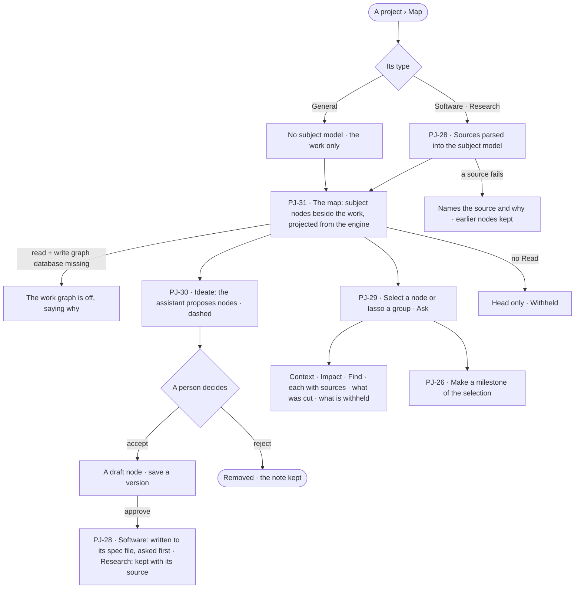
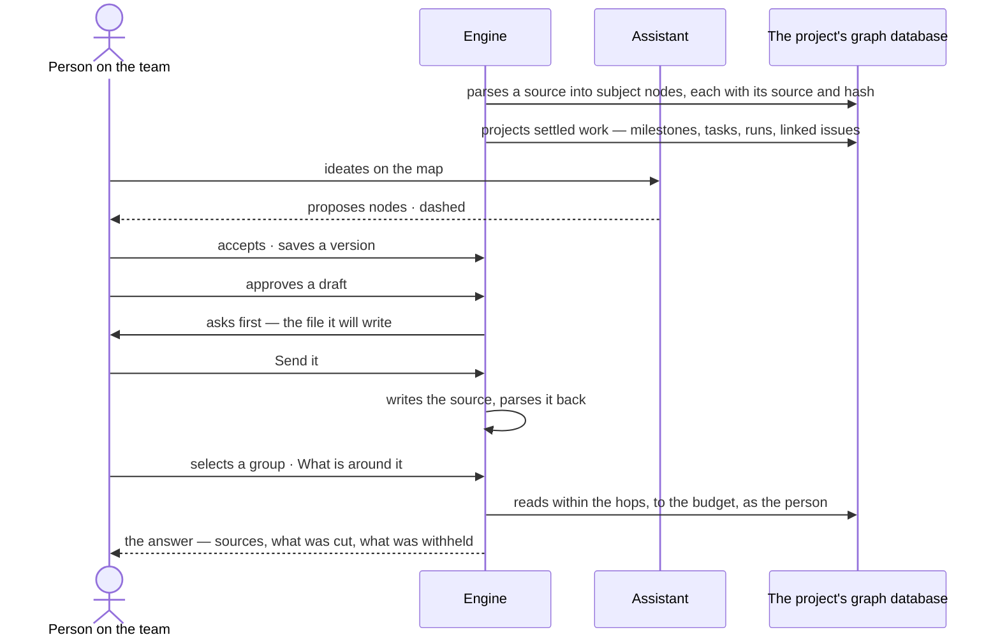

# The project graph

> What a project is about, and what is moving on it, in one graph: the **subject model** its type parses from its
> sources, and the **work model** — milestones, tasks, runs, linked issues — projected beside it. A person selects a
> node or a group, asks what surrounds it or what it would touch, sketches new nodes with the assistant, and makes a
> milestone of a selection. The decision it helps make: *what does this change touch, and what should the project
> do next about it?*

## User journey

Journeys this feature is a step of: [J11 · Ideate and run a project with its assistant](../../../../journeys/J11-ideate-and-run-a-project-with-its-assistant.md) · [J13 · Plan and run work from the project graph](../../../../journeys/J13-plan-and-run-work-from-the-project-graph.md)

## Stories

| ID | Story | Status |
|---|---|---|
| PJ-28 | [Ground a project in its subject model](stories/PJ-28-ground-a-project-in-its-subject-model/story.md) | idea |
| PJ-31 | [See the work in the same graph](stories/PJ-31-see-the-work-in-the-same-graph/story.md) | idea |
| PJ-30 | [Sketch nodes with the assistant and save a version](stories/PJ-30-sketch-nodes-with-the-assistant/story.md) | idea |
| PJ-29 | [Ask the graph from a node or a group](stories/PJ-29-ask-the-graph-from-a-node-or-a-group/story.md) | idea |

## Access

Permissions are [the permission catalogue](../../../../os/access/features/AC-F02-access-policies/feature.md#the-permission-catalogue)'s; no act here is new to it. Inside a project every person on its team may do everything inside it ([PJ-F01 › Access](../PJ-F01-projects-and-tasks/feature.md#access)).

| Act | Who may | Everyone else sees |
|---|---|---|
| Read the map and ask it — context, impact, find | A person on the project's team, or with Read on Projects; each node only as far as their own reach | A project they may not read shows its head — *Withheld — join the team or ask who can grant it*; a node they may not read is withheld and counted |
| Add, remove or re-read a source · accept, reject or save a sketch · link models · make a milestone | Every person on the team | Disabled — *Join the team to change it* |
| Approve a draft into a source | A person on the team; the write itself is an outside act and asks first ([AC-F05](../../../../os/access/features/AC-F05-asks-and-approvals/feature.md)) | Disabled — *Join the team to change it* |
| Propose a node or a link | The project assistant, or any agent on the team the project's policies let work here | — |
| Edit a parsed or a projected node | Nobody — a parsed node changes at its source, a work node in the project | Refused — *Change it in the project* |

## States

| State | What the person sees |
|---|---|
| First use | *No nodes yet* with *Add a source* (a General project: *No subject model* and its work only) |
| Empty after a filter | The filter named — kind, subject, work, text — with *Clear it* |
| Loading | The map and Sources reading, nothing guessed |
| Has data | Nodes and links by kind, counts, work beside subject, each answer with its sources |
| Failed | A source that failed, or the work graph off — naming which and why; earlier nodes stay |
| Agent working or proposing | Dashed proposed nodes and links, the assistant reading, a source being read |
| No access | The head only, or a node withheld and counted; acts disabled — *Join the team to change it* |

## Rules

| Rule | Detail |
|---|---|
| Two models, one graph database | A project's **subject model** (what the work is about) and its **work model** (what is moving) are two models of the project's one read + write graph database, so one question reads both. Models of different types in one Graph join through links between models — a competitor Capability `matches` or `gaps` our Feature; a link never crosses graph databases |
| The subject model is parsed, never hand-kept | It is read from the project's sources — specs folders and code for Software, web pages and documents for Research — each node citing its source, place and content hash. The source is the truth; the sync is one way: source to graph. Only an approved draft ever writes a source |
| The work model is projected | Milestones, tasks, runs and linked issues stay recorded in the engine's tables ([PJ-F01](../PJ-F01-projects-and-tasks/feature.md#engine)); the engine projects each into the graph database as it settles, labelled *derived*. The graph can be rebuilt from the tables, never the other way |
| Core nodes are generic | A project's core nouns are Project · Milestone · Task (with sub-tasks) · Run · Check · Review · Subject model. A milestone `covers` any subject node and `waits on` a milestone; a task is `about` any node, `changes` a node and is `linked to` an outside issue. No software word is in the core, a screen or the engine: the type supplies its own labels |
| A project type is a manifest | A type is one file, `project_types/<id>.yaml`, with the fields of [the type manifest](#the-project-type-manifest): subject model, sources and the connectors that parse them, milestones, default tags, default checks as workflows, labels, suggested agents and skills. It is built in or from a Team pack ([CP-F02](../../../../os/control/features/CP-F02-plugins-and-outside-tools/feature.md)); never authored in Studio. Two ship — **Software** ([the pack](../../../../packs/software-delivery.md#the-project-type)) and **Research** ([the pack](../../../../packs/market-research.md#the-project-type)) — and **General** is built in with no subject model |
| One flow for every type | Ideate with the assistant → it proposes nodes, dashed until accepted → save a version → explore, ask and query from a node or a group → plan milestones from a selection → agents pick up tasks → checks → a person reviews and accepts. A type changes the nodes and the words, never the flow |
| The agent proposes, the person decides | A proposed node, link or milestone is a person's to accept; an approved draft asks first before it writes anything outside Invana |
| A context bundle is bounded and narrowed | Every read answers to the caller's token budget and reach; what it cannot include it counts |
| Backend owns every number | Node counts by kind, the hops reached, how many were cut and withheld, and a milestone's progress are the engine's |

## The project type manifest

A type is declared once, in a manifest the engine reads when its pack is installed and offers in *New project*
([PJ-02](../PJ-F01-projects-and-tasks/stories/PJ-02-start-a-project-of-its-type/story.md)). The manifest holds what the
type *chooses*; the engine's generic core holds everything else, so no type adds a screen, a route or a table.

| Field | Holds | Required | Used by |
|---|---|---|---|
| `id` · `title` · `description` · `group` | The type's key (unique in the deployment), its card title and one line, and the group it sits under in the type grid (*Built in* or the pack's title) | Yes | PJ-02 About |
| `labels` | The type's words for the core nouns — `project` · `task` · `milestone` · `check` · `review` · and the name of each node kind in the plural — used inside a project only | `project` and `task` | PJ-02.19 |
| `fields` | The fields About asks for beside the name — each `key` · `label` · `type` (`text` · `choice` · `person` · `url`) · `required` · `default` | No | PJ-02 About |
| `subject_model` | The `ontology` file declaring the node kinds, their fields and the links between them; none for General | No — absent means *No subject model* | PJ-28.1 · PJ-28.2 |
| `sources` | Each source the type can read: `kind` (`specs` · `code` · `web` · `documents` · `tracker`) · `connector` (the id of the `source` or tracker connector that reads it) · `parses_to` (the node kinds it may produce) · `required` | No | PJ-28.3 · PJ-28.13 |
| `milestones` | The ordered starting milestones — each a `name`, with the previous one as what it waits on | No | PJ-18 · PJ-26 |
| `tags` | The default tags, each a label ([PJ-27](../PJ-F01-projects-and-tasks/stories/PJ-27-tag-a-task/story.md)) | No | PJ-27 |
| `task_kinds` | Kinds beyond *Task* and *Recommendation*, each with its fields and its default checks | No | PJ-20 |
| `checks` | The default checks: each a `when` (a tag, a kind, a milestone, or a story that touches access, data, agents or an outside system) and an ordered list of steps — a `workflow` key ([AG-F06](../../../agents/features/AG-F06-plans-and-workflows/feature.md)) run in an evaluator run of its own, or `person` (a person on the team) | No | PJ-25 |
| `reviewers` | The default reviewer — `creator` or the field holding a person | No | PJ-22 |
| `agents` | The suggested agents, the `assistant` among them, and the skills each carries | No | PJ-02.14 |
| `pick_up` | The default pick-up mode, `ask` unless a pack asks narrower | No | PJ-15 |
| `access_template` | The Access template chosen first in the Access step | No | PJ-02.21 |
| `report_template` | The report's starting point | No | [PJ-F05](../PJ-F05-project-reports/feature.md) |
| `requires` | The connectors the type needs installed — every `connector` named in `sources`, and the code host when the type opens pull requests | Derived | PJ-02 About |

| Type | `subject_model` | `sources` · connectors | `labels` | `milestones` | Where it is declared |
|---|---|---|---|---|---|
| **General** | none | none; a tracker may be linked ([CP-F12](../../../../os/control/features/CP-F12-issue-trackers/feature.md)) | *Project* · *Task* | none | Built in |
| **Software** | `ontology/software.yaml` — Feature · Requirement · Story · Module · Persona · Journey · Decision | `specs` and `code` by `invana-files`; `tracker` by a code host | *Project* · *Story* | *Spec* → *Design* → *Build* → *Verify* | [`software-delivery`](../../../../packs/software-delivery.md#the-project-type) |
| **Research** | `ontology/research.yaml` — Competitor · Offering · Capability · Price · Segment · Claim · Source | `web` and `documents` by `invana-web`; `tracker` | *Project* · *Task* | *Landscape* → *Gaps* → *Brief* | [`market-research`](../../../../packs/market-research.md#the-project-type) |

| Rule | Detail |
|---|---|
| The core is not in the manifest | Project · Milestone · Task · Run · Check · Review, the sub-task, the dependency and the `covers` · `about` · `changes` links are the engine's; a manifest cannot rename an id or remove one of them |
| A parser is a connector | A type ships no parser code. A source names the connector that reads it — `invana-files` for specs folders and code (an import parser per language), `invana-web` for pages and documents — and that connector's `connector.yaml` lists the node kinds it can produce; a `parses_to` kind a connector does not list fails the manifest |
| Checks are workflows | Each check step is the key of a workflow or a person; a key no workflow answers to fails the manifest. A check is applied to a new task by its `when`, and is a run of its own ([PJ-25](../PJ-F01-projects-and-tasks/stories/PJ-25-gate-a-task-on-its-checks/story.md)) |
| A manifest is valid or not offered | Every field is checked when the pack is installed: a field the schema does not know, a required field missing, a node kind used and not declared, a link with an undeclared end, a milestone naming itself, a duplicate `id`. A pack whose manifest fails installs nothing and names the file, the field and why |
| A type with a missing connector is held | An installed type whose `requires` connector is not installed is listed in *New project* as unavailable, naming the connector — never hidden |
| General is one with no model | General has no `subject_model`, no sources and no milestones; the same flow, the same work graph, only the work shows |

## Data touched

| Record | Access |
|---|---|
| Sources of a project | Write · read |
| Subject nodes and links between models, in the project's graph database | Write (parsed, approved) · read |
| Work nodes in the project's graph database | Write (projected) · read |
| Draft nodes and sketch versions | Write · read |
| Tasks, milestones | Read ([PJ-F01](../PJ-F01-projects-and-tasks/feature.md#engine)) |

## Engine

The low-level design: what this feature stores, serves and refuses. Conventions — naming, errors, lists, events — are
[system-design.md](../../../../system-design.md) §§ 6–8; this section only fills them in.

### Records

| Table | Columns | Notes |
|---|---|---|
| `projects_sources` | `project_id` · `kind` (`specs` · `code` · `web` · `documents` · `tracker`) · `address` · `tracker_id?` ([CP-F12](../../../../os/control/features/CP-F12-issue-trackers/feature.md#engine)) · `status` (`ok` · `failed`) · `last_read_at?` · `last_hash?` · `error?` · `created_by_id` | Unique (`project_id`, `kind`, `address`) |
| `projects_draft_nodes` | `project_id` · `kind` · `name` · `fields` (JSON, checked against the type's node kind) · `links` (JSON) · `state` (`proposed` · `draft` · `approved` · `rejected`) · `proposed_by_kind` (`user` · `run`) · `proposed_by_id` · `decided_by_id?` · `note?` · `source_id?` (what an approval writes to or cites) | A `proposed` node is drawn dashed; none is in the graph until `approved` |
| `projects_sketch_versions` | `project_id` · `name` · `snapshot` (JSON — the draft nodes and links as they stand) · `created_by_id` · `created_at` | Immutable |
| `projects_graph_state` | `project_id` · `database_id?` · `work_projected_at?` · `work_graph` (`on` · `off`) · `off_reason?` | One row; `database_id` the project's read + write graph database |

Subject nodes, work nodes and links between models are records of the project's graph database, stamped with the
`_inv_` provenance and `derived` where projected ([system-design.md](../../../../system-design.md) § 6); they are not tables here.

### Reads

| Record | Owner |
|---|---|
| Projects, tasks, groups (milestones), runs, checks | [PJ-F01 › Engine](../PJ-F01-projects-and-tasks/feature.md#engine) |
| Links between models, models, nodes | [SE-F06](../../../semantics/features/SE-F06-links-and-mappings/feature.md) |
| Tracker connections and issues | [CP-F12 › Engine](../../../../os/control/features/CP-F12-issue-trackers/feature.md#engine) |
| What a person or agent may read | [AC-F02](../../../../os/access/features/AC-F02-access-policies/feature.md#engine) · [AC-F04](../../../../os/access/features/AC-F04-what-an-agent-may-touch/feature.md#engine) |

### Routes

| Route, after `/api/v1/u/{u}/{g}/projects` | Does | Story |
|---|---|---|
| `GET /{key}/sources` · `POST /{key}/sources` · `DELETE /{key}/sources/{id}` · `POST /{key}/sources/{id}/read` | Sources and their last read · add · remove · read again | PJ-28 |
| `GET /{key}/graph` | The map: `?view=` `subject` · `work` · `both`, `?kind=`, `?q=`; nodes and links by the list contract, counts by kind, `withheld` | PJ-28 · PJ-31 |
| `POST /{key}/graph/context` · `/impact` · `/find` | `context`: `nodes[]` · `hops` · `budget`; `impact`: `node`; `find`: `q` — each returns its nodes with sources, `cut` and `withheld` | PJ-29 |
| `GET /{key}/draft-nodes` · `POST /{key}/draft-nodes/{id}/accept` · `/reject` · `/approve` | The sketch · decide a proposal · approve a draft into its source | PJ-30 · PJ-28 |
| `GET /{key}/sketch-versions` · `POST /{key}/sketch-versions` | Versions · save one | PJ-30 |

### Events

| Event | When |
|---|---|
| `projects.sources.add` · `projects.sources.remove` · `projects.sources.read` | A source added · removed · read, with what changed |
| `projects.graph.proposed` · `projects.graph.accepted` · `projects.graph.rejected` · `projects.graph.approved` | A node or link proposed · accepted · rejected · approved into a source |
| `projects.sketch.saved` | A version saved |
| `projects.graph.projected` | A settled fact projected into the graph database |

### Refusals

| Status | When | Sentence | Criterion |
|---|---|---|---|
| 422 | A source that cannot be read or parsed | *{source} could not be read — {why}.* | PJ-28.5 |
| 422 | A link between two models of different graph databases | *Models in different graph databases cannot be linked.* | PJ-28.6 |
| 422 | A research draft approved with no source | *{node} cites no source.* | PJ-28.8 |
| 403 | Reading a node, a project or a work node the caller may not read | *Withheld — join the team or ask {who can grant}.* | PJ-29.9 |
| 422 | A context `budget` over the project's limit | *{n} tokens is over this project's limit of {m}.* | PJ-29.3 |
| 422 | A proposal of a kind the type does not declare, or a link it does not allow | *{kind}: the {type} type has no such node or link.* | PJ-30.5 |
| 409 | A version saved with nothing changed since the last | *Nothing has changed since {version}.* | PJ-30.6 |
| 422 | A Web address or folder outside its connection's hosts or root | *{address} is outside what {connection} may reach.* | PJ-28.13 |
| 403 | A link with an end the caller may not read | *Withheld — join the team or ask {who can grant}.* | PJ-28.6 |
| 409 | Editing a parsed or projected node | *Change it in {where}.* | PJ-31.6 |
| 409 | Any write to an archived project | *{project} is archived — unarchive it first.* | PJ-28.12 |
| 422 | A pack whose `project_types/<id>.yaml` fails the manifest schema | *{file}: {field} — {why}. Nothing was installed.* | PJ-28.15 |
| 422 | A project created of a type whose required connector is not installed | *{type} needs {connector} — install it first.* | PJ-02.32 |

### CLI

| Command | Does |
|---|---|
| — | |

### Mechanisms

| Mechanism | How |
|---|---|
| Parsing | A worker reads a source with its type's parser into nodes of the type's kinds, upserting by (`source`, place); a node absent from the read is retired, its history kept. A failed read keeps the earlier nodes and writes `status = failed`. Parsers run in the worker sandbox ([NFR-SEC-14](../../../../system-design.md#3-non-functional-requirements)) with caps on size, time, memory and archive depth, and run no script or macro. Code is read into Module nodes by an import parser per language — Python and TypeScript first — each import a `depends on` link; a file in another language is listed as skipped. A Web or folder source is fetched under CP-F12's rules ([CP-73.19 · CP-73.20](../../../../os/control/features/CP-F12-issue-trackers/stories/CP-73-connect-an-issue-tracker-and-link-a-project/story.md)). Spec folders and code are read through the local-files and web adapters of [CP-F12](../../../../os/control/features/CP-F12-issue-trackers/feature.md) |
| Projection | A settled fact — a milestone, task, run, check or issue link — writes an outbox row in its own transaction; one relay applies it to the project's graph database as a node or link marked `derived`, in order, retrying with a doubling delay, within 5 seconds p95 ([NFR-PERF-8](../../../../system-design.md#3-non-functional-requirements)). Each node carries its project and kind as policy attributes and holds ids, kind, state, title and dates only; every read surface filters it by the project's reach and it is Hidden from agents outside the project by default. With no read + write graph database `work_graph = off` and the reason is shown. The graph is rebuilt from the tables, never the reverse |
| Context | `nodes[]` expand breadth first to `hops`; each node is checked against the caller's reach before it is added; nodes are ranked by link count and recency and added until `budget` tokens, counting what is cut and withheld. The budget is held like a model call's ([system-design.md](../../../../system-design.md) § 10) |
| Impact | Follows `depends on`, `covers`, `about` and `changes` links outward from the node; groups what it reaches by kind with the open tasks and milestones among them |
| Reading a manifest | When a pack is installed the engine validates each `project_types/<id>.yaml` against [the manifest schema](#the-project-type-manifest) and the pack's connectors, workflows and ontology, and stores nothing of a type that fails; `GET /types` ([PJ-F01](../PJ-F01-projects-and-tasks/feature.md#routes)) serves the valid ones, General first |
| Approving a draft | In Software: renders the node into its spec file with the type's template and asks first — the file and its text — as an outside write ([AC-F05](../../../../os/access/features/AC-F05-asks-and-approvals/feature.md)); after *Send it* it writes the file in the project's workspace and reads the source again, so the parsed node replaces the draft. In Research: writes the node with its source and approver, refusing one with no source |
| A version | `projects_sketch_versions.snapshot` is the draft nodes and links as they stand; opening one reads it beside the live sketch with what was added and removed |

## System impact

| HLD section | Change | NFRs |
|---|---|---|
| § 6 Data and storage | Four tables; the project's read + write graph database gains subject and work nodes beside the model it already holds, the work nodes labelled *derived* and carrying their project's reach; no new store | NFR-REL-6 · NFR-PERF-8 · NFR-SEC-11 |
| § 7 Architecture and components | A parser per source kind on the workers, in the sandbox; the projection relay, the system graph's relay pointed at the project's graph database | NFR-REL-6 · NFR-SEC-14 |
| § 8 APIs and events | The routes and events above, under `projects` | NFR-PERF-3 |
| § 10 AI and agents | The assistant proposes nodes and links; every context read is bounded by a token budget and the caller's reach | NFR-COST-1 · NFR-SEC-5 |
| § 12 Qualities | Security: a bundle never includes what the caller may not read; a read never writes; a parsed source is untrusted text, fenced as data, never an instruction; a work node answers to its project's reach; a fetch goes only where allowed | NFR-SEC-5 · NFR-SEC-9 · NFR-SEC-11 · NFR-SEC-15 · NFR-SEC-16 |

## Decisions

| Decision | Detail |
|---|---|
| One graph database, two models | The subject and work models sit in the project's graph database so one question reads both; the work's truth stays in the engine's tables, so the graph is disposable |
| Parsed, not hand-kept | A subject node is never edited in the graph; it changes at its source. A sketch is drafts; approving writes the source |
| Software's source of truth stays its files | A canvas edit is a draft; approving writes the story file; the next read parses it back |
| Core is generic | No software word in the core; a type supplies its labels, so Software and Research run the same flow |
| Links between models, one graph database | A cross-type link (a competitor Capability and our Feature) needs both models in one graph database, as every link between models does |
| Draft before node | The assistant's proposal is dashed, an accepted one is a *Draft*, an approved one is written to its source — three steps, each a person's yes where it matters |
| Code is read as an import graph | Module nodes and their `depends on` links come from the imports of each file, per language — Python and TypeScript first — not from manifests alone; parsers keep the sandbox and caps above |
| A work node answers to its project | A projected node carries its project's reach, is filtered on every read surface and Hidden from agents outside the project by default |
| A type is data, never code | A type is a manifest of choices over the generic core; a parser is a connector it names, a check a workflow it names — so a new type is a pack, never a change to the engine or Studio |
| An invalid manifest installs nothing | A pack with a manifest that fails the schema is refused whole, naming the file and field, so *New project* never offers a type that cannot run |
| A context bundle is a budget | A bundle is cut to the caller's token budget and reports what it cut; it is never silently truncated |

## Open questions

| Question | Who answers |
|---|---|
| Security's medium row R555 is scheduled with PJ-28 and is should-fix before it is `built`: the path an approved draft writes is built from a fixed template under the source's spec folder, normalised, never an existing file outside it and never through a symlink, and the ask shows the path and the whole text. The coder adds a task for it at the story's `designed` gate | Coder, at build |

## Not building

| Item | Why not |
|---|---|
| Hand-editing a parsed node | The source is the truth |
| A second record store for the work | The engine's tables are the truth; the graph is a projection |
| Joining nodes across graph databases | Links stay in one graph database |
| Authoring project types or node kinds in Studio | Built-in types and Team packs |
| A sync from the graph to a source other than an approved draft | One way only |
