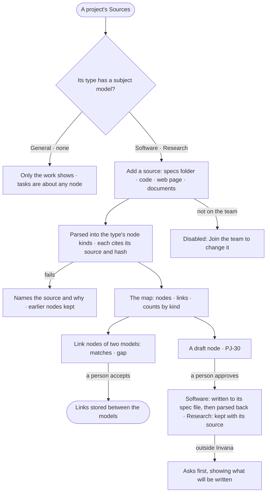

# PJ-28 · Ground a project in its subject model

**As** a person starting a project **I want** its type's subject model — what the work is about — parsed from its sources and never typed by hand, and linked to the models of other types **so that** every task, milestone and question rests on nodes that cite where they came from.

Tasks: [task.md](task.md) · Feature: [PJ-F07](../../feature.md)

## Who can

| Access | Can | Otherwise sees |
|---|---|---|
| Admin | Add and remove a source, re-read it, approve a draft into its source and link models, on any project they may read; every parsed node reads | On an archived project the acts are disabled, saying it is archived |
| Operator | The same on every project they are on the team of; a node they may not read is withheld and counted | On a project they are not on the team of, the acts are disabled — *Join the team to change it* |

## Flow

## Acceptance criteria

| # | Given | When | Then |
|---|---|---|---|
| PJ-28.1 | A project of the Software or Research type | its Sources open | the type's node kinds list with their counts and each source's last read — Software: Feature · Requirement · Story · Module · Persona · Journey · Decision; Research: Competitor · Offering · Capability · Price · Segment · Claim · Source |
| PJ-28.2 | A project of the General type | its Sources open | it reads *No subject model* and tasks may still be about any node |
| PJ-28.3 | A source is added | it is read | it is parsed into nodes of the type's kinds, each citing its source, its place in it and a content hash; a parsed node is never edited by hand |
| PJ-28.4 | A source that changes | it is read again | nodes are added, changed or retired to match; a retired node keeps its history; the engine records what changed |
| PJ-28.5 | A source that cannot be read or parsed | it is read | it fails naming the source and why; the nodes from its earlier read stay |
| PJ-28.6 | Two models of one Graph | a person accepts a proposed link between a node of each, and both ends are nodes they and the proposing agent may read | it is stored as a link between models in that graph database, kind `matches` or `gap`, and both maps show it; a link across graph databases is refused, and a link with an end the accepter or proposer may not read is refused; a context or impact read checks both ends of a link on every traversal |
| PJ-28.7 | A draft node (PJ-30) | a person approves it in the Software type | the engine asks first, showing the file it will write; once sent, the spec file is written at its source and parsed back, and the draft is gone |
| PJ-28.8 | A draft node | a person approves it in the Research type | it is kept as a node citing its source and who approved it; a node without a source is refused |
| PJ-28.9 | The graph | a node is changed | no change in the graph ever writes to a source except an approved draft |
| PJ-28.10 | A person who may not read a node | they read the map | it is withheld and counted, never silently left out |
| PJ-28.11 | A node | its *How it got here* is opened | it shows its source, hash, the read that made it, and who approved any draft |
| PJ-28.12 | An Operator not on the team, or an archived project | they add a source or approve a draft | it is disabled, saying *Join the team to change it* or that the project is archived; a call is refused the same way |
| PJ-28.13 | A person on the team | they add a Web source or a Local files, specs or code source | a Web address must be in the Web connection's hosts and a folder under the Local files workspace root an Admin set (CP-73.19); one outside is refused, naming it, and the source reads *Failed*; the fetch follows CP-73.20 |
| PJ-28.14 | A Software project's code source in Python or TypeScript | it is read | the files' imports become Module nodes and `depends on` links — an import graph per language, not manifests alone — each citing its file, place and hash; a file in a language with no parser is listed as skipped, naming it |

## Screens

| Surface | Access | First use | Empty after a filter | Loading | Has data | Failed | Agent working or proposing | No access |
|---|---|---|---|---|---|---|---|---|
| Sources and the subject model | Admin | projects.graph · Sources · None yet | projects.graph · Sources · Nothing matches | projects.graph · Sources · Reading | projects.graph · Sources | projects.graph · Sources · Source failed | projects.graph · Sources · Reading a source | — |
| Sources and the subject model | Operator | projects.graph · Sources · None yet | projects.graph · Sources · Nothing matches | projects.graph · Sources · Reading | projects.graph · Sources | projects.graph · Sources · Source failed | projects.graph · Sources · Reading a source | projects.graph · Sources · Not on the team |
| Link two models | Admin | — | — | — | projects.graph · Link models | projects.graph · Link models · Refused | projects.graph · Link models · Proposed | — |
| Link two models | Operator | — | — | — | projects.graph · Link models | projects.graph · Link models · Refused | projects.graph · Link models · Proposed | projects.graph · Link models · Not on the team |
| Approve a draft | Admin | — | — | projects.graph · Approve a draft · Writing | projects.graph · Approve a draft · Asks first | projects.graph · Approve a draft · Refused | — | — |
| Approve a draft | Operator | — | — | projects.graph · Approve a draft · Writing | projects.graph · Approve a draft · Asks first | projects.graph · Approve a draft · Refused | — | projects.graph · Approve a draft · Not on the team |
