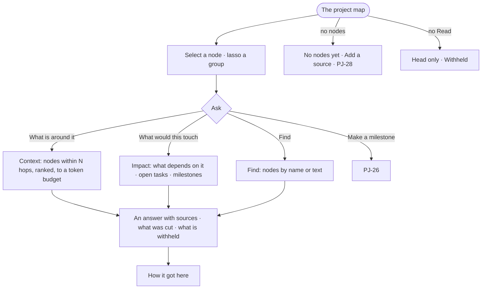

# PJ-29 · Ask the graph from a node or a group

**As** a person weighing a change or a finding **I want** to select a node, or lasso a group of them, and ask what surrounds it, what it would affect or where a thing is **so that** I decide with what the graph holds — each fact citing its source — instead of searching by hand.

Tasks: [task.md](task.md) · Feature: [PJ-F07](../../feature.md)

## Who can

| Access | Can | Otherwise sees |
|---|---|---|
| Admin | Ask from any node or group of a project they may read; make a milestone from a group | — |
| Operator | The same on every project they may read; a node they may not read is withheld and counted | A project they may not read shows its head only — *Withheld — join the team or ask who can grant it* |

## Flow

## Acceptance criteria

| # | Given | When | Then |
|---|---|---|---|
| PJ-29.1 | A project with nodes | a person selects a node or lassos a group | *Ask* offers *What is around it* · *What would this touch* · *Find* · *Make a milestone*, naming the selection |
| PJ-29.2 | *What is around it* on a node or a group | it runs | it returns the nodes within the chosen hops — 2 unless chosen, at most 4 — of every selected node, stopping at a 5 second deadline and saying how many were cut, most relevant first, each citing its source, and says how many more were not shown |
| PJ-29.3 | Any answer of *What is around it* | it is built | it never passes its token budget — the chosen one, never above the project's limit ([CP-F04](../../../../../../os/control/features/CP-F04-limits/feature.md)); a budget over it is refused naming the limit |
| PJ-29.4 | Any answer | a node on it is one the person may not read | it is left out, and the answer says how many were withheld |
| PJ-29.5 | *What would this touch* on a node | it runs | it lists what depends on it through links, by kind, with the open tasks and milestones that touch them |
| PJ-29.6 | *Find* with a text | it runs | it lists up to 25 nodes whose name or text match, ranked, each with its kind and source; no match reads *Nothing found*; it never says how many matches were withheld |
| PJ-29.7 | A question put to the assistant that needs these reads | it answers | *How it got here* lists each read, its hops, its budget and what was withheld |
| PJ-29.8 | A project with no nodes | the map opens | it reads *No nodes yet* with *Add a source* (PJ-28) |
| PJ-29.9 | A person without Read on the project and not on its team | they open it | they see its head only, *Withheld — join the team or ask who can grant it*; a call is refused the same way |
| PJ-29.10 | The same reads | a client calls Invana's MCP server | they return the same answers, as CP-75 says |
| PJ-29.11 | An answer that holds outside text — a page, an issue, a parsed source | it is shown or given to an agent | each such node is marked *outside text* beside its source, and what an agent or a client receives is fenced and labelled data, not instructions (CP-75.13) |

## Screens

| Surface | Access | First use | Empty after a filter | Loading | Has data | Failed | Agent working or proposing | No access |
|---|---|---|---|---|---|---|---|---|
| The map and its ask | Admin | projects.graph · Map · No nodes yet | projects.graph · Map · Nothing matches | projects.graph · Map · Loading | projects.graph · Map · Ask | projects.graph · Map · Ask failed | — | — |
| The map and its ask | Operator | projects.graph · Map · No nodes yet | projects.graph · Map · Nothing matches | projects.graph · Map · Loading | projects.graph · Map · Ask | projects.graph · Map · Ask failed | — | projects.graph · Map · Withheld |
| The answer | Admin | — | — | projects.graph · Answer · Reading | projects.graph · Answer · Sources | projects.graph · Answer · Over the limit | projects.graph · Answer · Assistant reading | — |
| The answer | Operator | — | — | projects.graph · Answer · Reading | projects.graph · Answer · Sources | projects.graph · Answer · Over the limit | projects.graph · Answer · Assistant reading | projects.graph · Answer · Withheld |
| How it got here | Admin | — | — | — | projects.graph · Answer · How it got here | — | — | — |
| How it got here | Operator | — | — | — | projects.graph · Answer · How it got here | — | — | projects.graph · Answer · How it got here |
