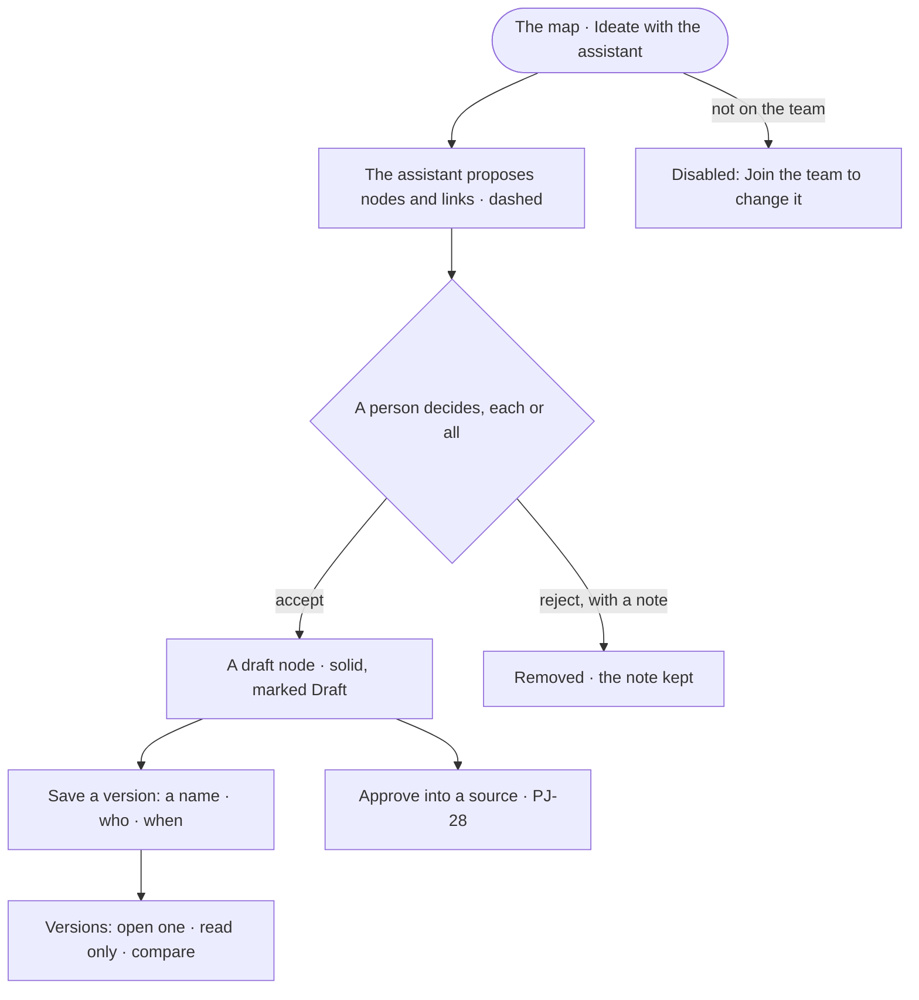

# PJ-30 · Sketch nodes with the assistant and save a version

**As** a person ideating **I want** the project assistant to propose nodes and links on the map, drawn dashed until I accept them, and to save a version of the sketch **so that** an idea becomes part of the graph only by my yes, and I can return to where the thinking stood.

Tasks: [task.md](task.md) · Feature: [PJ-F07](../../feature.md)

## Who can

| Access | Can | Otherwise sees |
|---|---|---|
| Admin | Ideate, accept or reject each proposed node or all of them, save and open a version, on any project they may read | On an archived project the acts are disabled, saying it is archived |
| Operator | The same on every project they are on the team of | On a project they are not on the team of, the sketch reads; accepting and saving are disabled — *Join the team to change it* |

## Flow

## Acceptance criteria

| # | Given | When | Then |
|---|---|---|---|
| PJ-30.1 | A person on the team who ideates with the assistant (PJ-21) | it proposes nodes of the type's kinds and links | they are drawn dashed on the map, each with the assistant's reason, and nothing is stored in the graph |
| PJ-30.2 | A proposed node or link | a person on the team accepts it | it becomes a draft node, solid and marked *Draft*, recorded in their name |
| PJ-30.3 | A proposed node or link | a person rejects it, with or without a note | it is removed and the note is kept on the thread |
| PJ-30.4 | Several proposals | a person accepts or rejects all | the list shows each proposal with its source, and which come from outside text, before it applies; each is then decided the same way and recorded one by one |
| PJ-30.5 | A proposal of a kind the project's type does not declare, or a link between kinds it does not allow | it is made | it is refused to the assistant, naming the kind; nothing is drawn |
| PJ-30.6 | A sketch | a person saves a version | it keeps the draft nodes and links as they stand, with a name, who and when; saving with nothing changed since the last version is refused, saying so |
| PJ-30.7 | A saved version | it is opened | it reads, read only, beside the map as it stands, with what was added and removed since |
| PJ-30.8 | A draft node | it is approved into a source | PJ-28 governs what is written |
| PJ-30.9 | The assistant's proposals | any is opened | *How it got here* shows its steps and the nodes it read |
| PJ-30.10 | An Operator not on the team, or an archived project | they accept or save | it is disabled, saying *Join the team to change it* or that the project is archived; a call is refused the same way |

## Screens

| Surface | Access | First use | Empty after a filter | Loading | Has data | Failed | Agent working or proposing | No access |
|---|---|---|---|---|---|---|---|---|
| The sketch | Admin | projects.graph · Sketch · Nothing proposed | — | projects.graph · Sketch · Loading | projects.graph · Sketch · Draft nodes | projects.graph · Sketch · Refused | projects.graph · Sketch · Proposed · Dashed | — |
| The sketch | Operator | projects.graph · Sketch · Nothing proposed | — | projects.graph · Sketch · Loading | projects.graph · Sketch · Draft nodes | projects.graph · Sketch · Refused | projects.graph · Sketch · Proposed · Dashed | projects.graph · Sketch · Not on the team |
| Versions | Admin | projects.graph · Versions · None yet | — | projects.graph · Versions · Loading | projects.graph · Versions | projects.graph · Versions · Nothing changed | — | — |
| Versions | Operator | projects.graph · Versions · None yet | — | projects.graph · Versions · Loading | projects.graph · Versions | projects.graph · Versions · Nothing changed | — | projects.graph · Versions · Read only |
