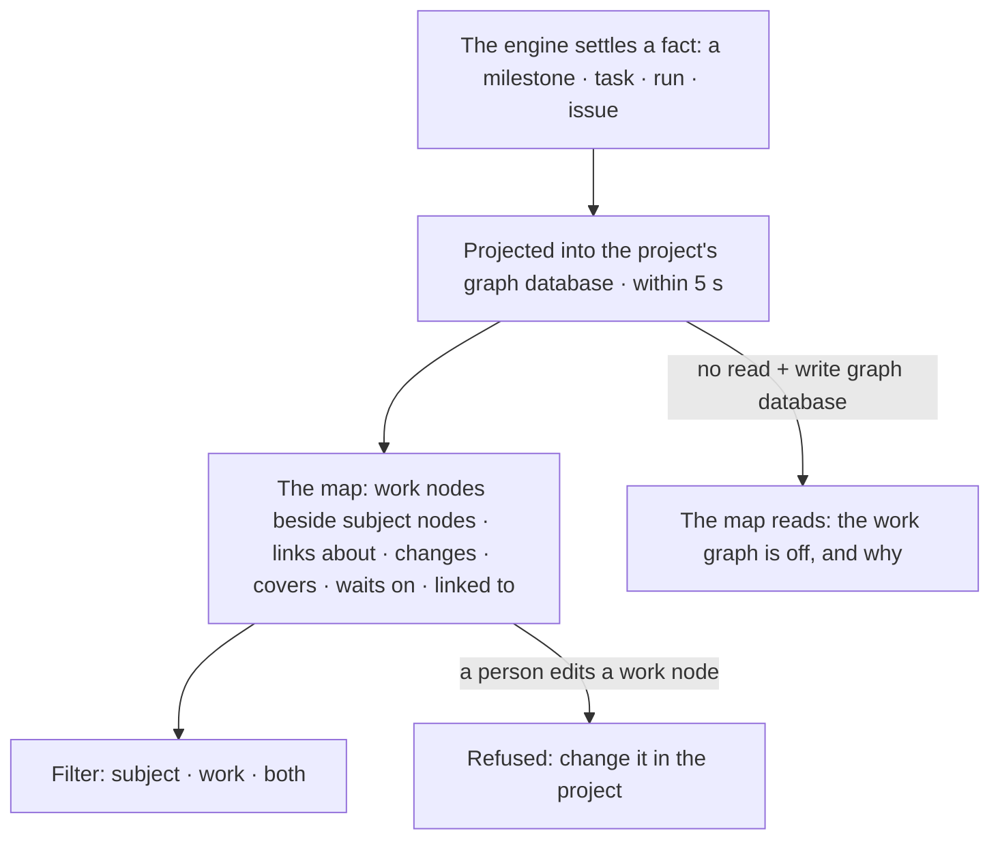

# PJ-31 · See the work in the same graph

**As** a person reading a project's map **I want** its milestones, tasks, runs and linked issues drawn in the same graph as the nodes they are about **so that** I see what is moving on what, and ask one question over both.

Tasks: [task.md](task.md) · Feature: [PJ-F07](../../feature.md)

## Who can

| Access | Can | Otherwise sees |
|---|---|---|
| Admin | See the work nodes, filter them, follow a link from a task to a node and a node to its tasks | — |
| Operator | The same, on the work they may read | Work they may not read is withheld and counted |

## Flow

## Acceptance criteria

| # | Given | When | Then |
|---|---|---|---|
| PJ-31.1 | A project with a read + write graph database | a milestone, task, run or issue link settles | within 5 seconds p95 (NFR-PERF-8) it is a work node in that graph database, with its links: a milestone *covers* any subject node and *waits on* a milestone; a task is *about* any node, *changes* a node and is *linked to* an outside issue |
| PJ-31.2 | The work graph | it is rebuilt from the engine's own records | it is the same; the engine's records are the truth, the graph the projection |
| PJ-31.3 | The map | its filter is set to *Work*, *Subject* or *Both* | only those nodes and the links among them draw |
| PJ-31.4 | A person | they open a task, a milestone or a node | its links to the other kind read — a node lists the tasks about it and the milestones covering it |
| PJ-31.5 | A project whose graph database is read-only or missing | the map opens | it draws subject nodes only and says the work graph is off, naming why |
| PJ-31.6 | A work node | a person tries to edit it in the graph | it is refused — *Change it in the project* — and nothing is written |
| PJ-31.7 | A work node the person may not read | the map is read | it is withheld and counted |
| PJ-31.8 | A projected node | it is opened | it reads *derived*, with the engine's record it came from |
| PJ-31.9 | A projected work node | it is written | it carries its project and kind as policy attributes and holds only ids, kind, state, title and dates — never a run's content, a comment or an issue's body |
| PJ-31.10 | A person or an agent with Read on the graph database but not on the project | they read it by the map, a question, Explorer, a typed plan, a raw query or a client | every read surface filters the node by the project's reach (NFR-SEC-5 · NFR-SEC-11); it is Hidden from agents outside the project by default and an Admin opens it by a policy |
| PJ-31.11 | A link between a work node and a subject node | it is read | it needs Read on both ends, as PJ-28.6 says |

## Screens

| Surface | Access | First use | Empty after a filter | Loading | Has data | Failed | Agent working or proposing | No access |
|---|---|---|---|---|---|---|---|---|
| The work on the map | Admin | projects.graph · Map · Work · None yet | projects.graph · Map · Nothing matches | projects.graph · Map · Loading | projects.graph · Map · Work | projects.graph · Map · Work graph off | projects.graph · Map · Work · Tasks running | — |
| The work on the map | Operator | projects.graph · Map · Work · None yet | projects.graph · Map · Nothing matches | projects.graph · Map · Loading | projects.graph · Map · Work | projects.graph · Map · Work graph off | projects.graph · Map · Work · Tasks running | projects.graph · Map · Work · Withheld |
