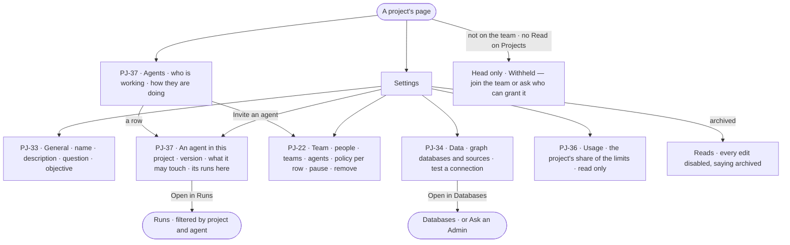

# Project settings and the agents in a project

> One place for what a project is, what it reads, who is on it, what its agents may do and how much of the limits it
> uses — and a section of the project page that shows its agents at work. The decisions it helps make: *is this
> project still about the right thing, does it read the right data, and may its agents keep working?*

A project's settings are a place with five tabs: **General** (PJ-33) · **Data** (PJ-34) · **Team** (people, teams and
agents in one list — [PJ-22](../PJ-F01-projects-and-tasks/stories/PJ-22-set-the-project-team-and-its-lead-agent/story.md);
the create-project Team step is its first form) · **An agent in this project** (PJ-37) · **Usage** (PJ-36). *Agents in
this project* (PJ-37) is a section of the project page.

## User journey

Journeys this feature is a step of: [J03 · Give an agent work and decide on the result](../../../../journeys/J03-give-an-agent-work-and-decide-on-the-result.md)

## Stories

| ID | Story | Status |
|---|---|---|
| PJ-33 | [Say what a project is about](stories/PJ-33-say-what-a-project-is-about/story.md) | idea |
| PJ-34 | [See the data a project reads](stories/PJ-34-see-the-data-a-project-reads/story.md) | idea |
| PJ-36 | [See how much of the limits a project uses](stories/PJ-36-see-how-much-of-the-limits-a-project-uses/story.md) | idea |
| PJ-37 | [See the agents in a project](stories/PJ-37-see-the-agents-in-a-project/story.md) | idea |

## Access

Who may do what is [PJ-F01 › Access](../PJ-F01-projects-and-tasks/feature.md#access): every person on a project's team,
and anyone with Manage on Projects, may do everything inside it; settings add no permission of their own.

| Act | Permission | Everyone else sees |
|---|---|---|
| Read any tab · the agents section | Read on the project — a person on its team or with Read on Projects | A project they may not read: its head only, *Withheld — join the team or ask {who can grant}* |
| Change General · the Team tab | A person on the team, or Manage on Projects | The tab reads; its acts are disabled — *Join the team or ask {who can grant}* |
| Test a connection | Read on the project | Not offered for a graph database they may not read |
| Change a connection, mode or switch | Manage on the connector, in Databases ([CP-F05](../../../../os/control/features/CP-F05-graph-databases/feature.md)) | *Open in Databases* reads *Ask an Admin* |
| Read what an agent may touch | Read on `access/policies` | *No access*, naming it and who can grant it |
| Set a limit | Not here — limits are set where [CP-F04](../../../../os/control/features/CP-F04-limits/feature.md) says | Usage reads only |

## States

| State | What the person sees |
|---|---|
| First use | General on a project just created; Data on *Nothing reached*; *No agent on this team*; Usage on *No limit of its own* |
| Empty after a filter | An agent's runs here with none: *No runs here*; the agents section with a filter matching none |
| Loading | The tab is drawn at once; its rows and numbers fill in |
| Has data | Each tab as its story says |
| Failed | The tab could not load, saying why, with *Try again*; a save refused names its field; a test that cannot connect names the database's error |
| Agent working or proposing | An agent *Working*; the assistant drafting the question and objective; a connection test running |
| No access | *Withheld*; a tab that reads with its acts disabled; *No access* on what an agent may touch |

## Rules

| Rule | Detail |
|---|---|
| The question and the objective | *The question* is the decision the project helps make (`goal`); *the objective* is what success looks like (`success`). Every agent plans from them |
| Settings read; Databases change | A project reads the graph databases its policies reach; it never connects, switches or sets the mode of one |
| Limits are shown here, set elsewhere | Usage reads the project's limits and its share of every limit that binds it; each is set where CP-F04 says — the project's own in its policy's *Fleet / Workers* tab |
| One list for the team | People, teams and agents sit in one list with a policy per row ([PJ-22](../PJ-F01-projects-and-tasks/stories/PJ-22-set-the-project-team-and-its-lead-agent/story.md)); the create-project Team step and this tab are one form |
| Numbers are the engine's | Every count, limit and share is stored when the fact settles; Studio formats and never derives |

## Data touched

| Record | Read or write |
|---|---|
| The project — name, description, goals, fields, status | Read · write (PJ-F01) |
| The project's team — each row's policy, paused and Lead agent | Read · write (PJ-F01) |
| Graph databases the project's policies reach — mode, switch, health, region | Read |
| The project's sources and parse state | Read ([PJ-F07](../PJ-F07-the-project-graph/feature.md)) |
| An agent's version and effective access | Read (AG-F01 · AC-F04) |
| Runs of an agent in the project | Read (CP-F10) |
| Limits and their stored counts | Read (CP-F04) |
| History rows of every settings change (AC-F06) | Write |

## Engine

The low-level design: what this feature serves and refuses. Conventions — naming, errors, lists, events — are
[system-design.md](../../../../system-design.md) §§ 6–8; this section only fills them in.

### Records

| Table | Columns | Notes |
|---|---|---|
| — | No table of its own | Every tab reads or writes a record another feature owns |

### Reads

| Record | Owner |
|---|---|
| The project, its goals, fields, status and team, with each row's policy and pause | [PJ-F01](../PJ-F01-projects-and-tasks/feature.md#engine) |
| The project's sources | [PJ-F07](../PJ-F07-the-project-graph/feature.md#engine) |
| Graph databases — mode, switch, health, region | [CP-F05](../../../../os/control/features/CP-F05-graph-databases/feature.md#engine) · [CP-F13](../../../../os/control/features/CP-F13-data-stores/feature.md#engine) |
| An agent's version and the agents list | [AG-F01](../../../agents/features/AG-F01-build-an-agent/feature.md#engine) |
| An agent's effective access in a project | [AC-F04](../../../../os/access/features/AC-F04-what-an-agent-may-touch/feature.md#engine) |
| An agent's runs, filtered by `project` and `agent` | [CP-F10](../../../../os/control/features/CP-F10-runs-and-how-the-agents-are-doing/feature.md#engine) |
| Limits and their stored counts | [CP-F04](../../../../os/control/features/CP-F04-limits/feature.md#engine) |

### Routes

| Route, after `/api/v1/projects` | Does | Story |
|---|---|---|
| `PATCH /{key}` | Edit the name, description, goals and fields — [PJ-F01](../PJ-F01-projects-and-tasks/feature.md#routes)'s route; History records it | PJ-33 |
| `POST /drafts/goals` | Draft the question and the objective again — [PJ-F01](../PJ-F01-projects-and-tasks/feature.md#routes)'s route | PJ-33 |
| `GET /{key}/data` | The graph databases the project's policies reach the reader may read — mode, switch, health, region, kinds read — the count of those hidden from the reader, and the project's sources | PJ-34 |
| `POST /{key}/data/{database}/test` | A read that writes nothing against one graph database the project reaches → `{ok, holds, ms, error?}` | PJ-34 |
| `GET /{key}/agents` | The agents on the team — version, Lead agent, state, policy, runs this week, tokens this month, last run | PJ-37 |
| `GET /{key}/agents/{agent}` | One agent: its head and its effective access *In* this project; its runs come from `GET /api/v1/control/runs?project=&agent=` | PJ-37 |
| `GET /{key}/usage` | Each limit that binds the project's runs — `{limit, scope, ceiling?, used, left, project_share, at_limit}` as last stored | PJ-36 |
| `GET /{key}/team` · `PUT /{key}/team/{principal}` · `DELETE /{key}/team/{principal}` | The Team tab — [PJ-F01](../PJ-F01-projects-and-tasks/feature.md#routes)'s routes | PJ-22 |

### Events

| Event | When |
|---|---|
| — | None of its own: a settings change is [PJ-F01](../PJ-F01-projects-and-tasks/feature.md#events)'s `projects.update` and team events |

### Refusals

| Status | When | Sentence | Criterion |
|---|---|---|---|
| 422 | A name left empty | *A project needs a name.* | PJ-33.3 |
| 422 | A field the type requires, left empty | *{field} is required.* | PJ-33.4 |
| 409 | A save on an archived project | [PJ-F01 › Refusals](../PJ-F01-projects-and-tasks/feature.md#refusals) | PJ-33.8 |
| 404 | A test of a graph database the project's policies do not reach | *There is no graph database {name} in this project.* | PJ-34.5 |

### CLI

| Command | Does |
|---|---|
| — | No command of its own |

### Mechanisms

| Mechanism | How |
|---|---|
| A test is a read | `POST /{key}/data/{database}/test` runs the connector's own reachability read as the project's default agent; it writes nothing and returns the database's own error |
| Reading as the reader | `GET /{key}/data` leaves out a graph database the reader's default agent may not read and returns how many it left out |
| The share | `project_share` is the project's runs' use of a limit divided by the use of the whole limit, from [CP-F04](../../../../os/control/features/CP-F04-limits/feature.md#engine)'s stored counts; never derived in Studio |

## System impact

| HLD section | Change | NFRs |
|---|---|---|
| § 8 APIs and events | The read routes above under `/api/v1/projects`; no new event | — |

## Decisions

| Decision | Detail |
|---|---|
| Settings is a place with five tabs | General · Data · Team · An agent in this project · Usage, in the airy form density; Team is the create-project Team step's form, edited afterwards |
| Settings replace the Graph's settings | A project reads what a Graph's settings used to hold; nothing sits above a graph database |
| Limits are read here, set where CP-F04 says | Usage never sets a limit — the project's own are set in its policy's *Fleet / Workers* tab. A request to remove per-project limits is Ravi's |
| Agents in this project is a section of the page | It reads the team's agents with the rows of the Agents list; detail is a peek, then the agent's tab in settings |

## Open questions

| Question | Who answers |
|---|---|
| The Usage tab reads a project's *Runs at once* and *Tokens a month*; [CP-F04](../../../../os/control/features/CP-F04-limits/feature.md) keeps them per project while the project hand-off note says limits are never set per project. Recommend: keep CP-F04 as written — Usage reads, the policy tab sets | Ravi |

## Not building

| Item | Why not |
|---|---|
| Setting a limit on the Usage tab | Limits are set where CP-F04 says; Usage reads |
| Connecting, switching or changing the mode of a graph database from a project | Databases owns it |
| Per-project connectors | A connector is installed on the command line and attached in Databases |
| A project's own settings for notifications | Notifications are the person's and the deployment's (CP-F08) |
| PJ-35 — merged into PJ-37 | An agent's head, what it may touch and its runs here are one story with the agents section |
