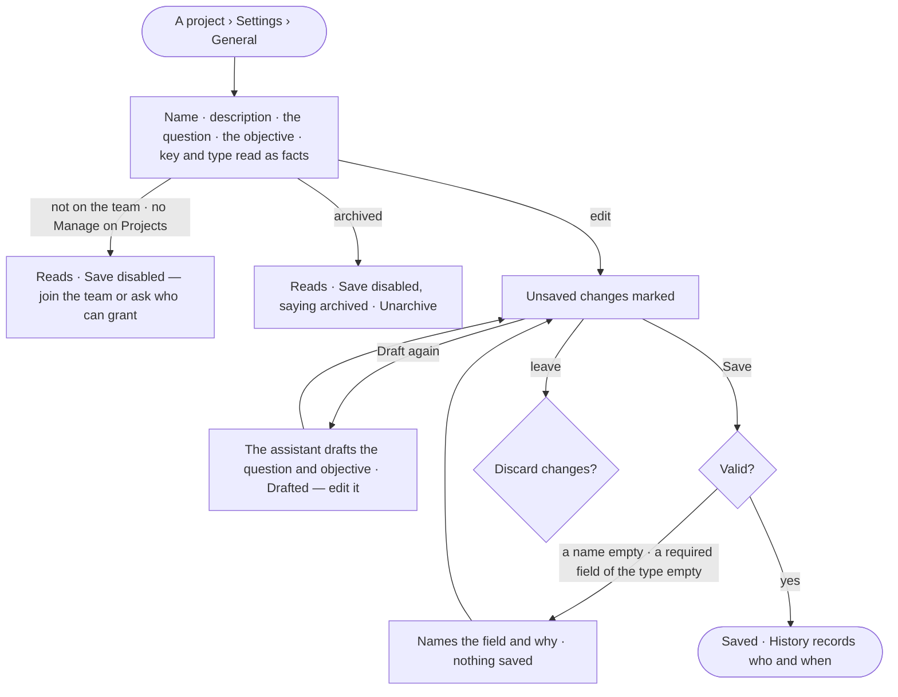

# PJ-33 · Say what a project is about

**As** a person on a project **I want** to read and change its name, description, question and objective in one place **so that** every agent plans from a goal that still says what the project is for.

Tasks: [task.md](task.md) · Feature: [PJ-F08](../../feature.md)

## Who can

A person on the project's team, or with Manage on Projects, may do everything inside it ([PJ-F01 › Access](../../../PJ-F01-projects-and-tasks/feature.md#access)); the settings place follows it.

| Access | Can | Otherwise sees |
|---|---|---|
| Admin | Read and change the name, description, question and objective on any project; ask the assistant to draft the question and objective again; unarchive | — |
| Operator | The same on a project they are on | A project they are not on, without Read on Projects: its head only, *Withheld — join the team or ask {who can grant}* |

## Flow

## Acceptance criteria

| # | Given | When | Then |
|---|---|---|---|
| PJ-33.1 | A person on the team, or with Manage on Projects | they open Settings › General | it reads the project's name, description, question (the decision it helps make) and objective (what success looks like) as saved; the key and the type read as facts, never fields |
| PJ-33.2 | A person who may edit | they change any of the four and press *Save* | it is saved, History records who and when, and the project's heading, assistant and report use the new words from then on |
| PJ-33.3 | A name left empty | they press *Save* | it is refused in place — *A project needs a name.*; nothing is saved |
| PJ-33.4 | A field the type requires, left empty | they press *Save* | it is refused, naming the field and why; nothing is saved |
| PJ-33.5 | Unsaved changes | the person leaves General or presses Esc | a confirm asks *Discard changes?* — *Keep editing* · *Discard*; nothing is saved until *Save* |
| PJ-33.6 | The question or the objective | the person presses *Draft again* | the assistant drafts both from the name, type and description, each marked *Drafted — edit it*; *How it got here* shows its steps and sources; nothing is saved until *Save* |
| PJ-33.7 | A person not on the team and without Manage on Projects | they open General | it reads; *Save* and *Draft again* are disabled — *Join the team or ask {who can grant}*; a call is refused the same way |
| PJ-33.8 | An archived project | General opens | it reads in full; *Save* is disabled, saying the project is archived; a person who may edit sees *Unarchive*, and a call to save is refused |
| PJ-33.9 | A save the engine cannot make | it is pressed | it says *Could not save* with the reason and *Try again*; every edit stays |

## Screens

| Surface | Access | First use | Empty after a filter | Loading | Has data | Failed | Agent working or proposing | No access |
|---|---|---|---|---|---|---|---|---|
| Settings · General | Admin | projects.settings · General · Just created | — | projects.settings · General · Loading | projects.settings · General | projects.settings · General · Could not save | projects.settings · General · Drafting | — |
| Settings · General | Operator | projects.settings · General · Just created | — | projects.settings · General · Loading | projects.settings · General | projects.settings · General · Could not save | projects.settings · General · Drafting | projects.settings · General · Read only |
| Settings · General · archived | Admin | — | — | — | projects.settings · General · Archived | — | — | — |
| Settings · General · archived | Operator | — | — | — | projects.settings · General · Archived | — | — | projects.settings · General · Read only |
| Settings · General · save | Admin | projects.settings · General · Just created | — | projects.settings · General · Saving | projects.settings · General · Saved | projects.settings · General · Could not save | — | — |
| Settings · General · save | Operator | projects.settings · General · Just created | — | projects.settings · General · Saving | projects.settings · General · Saved | projects.settings · General · Could not save | — | — |
