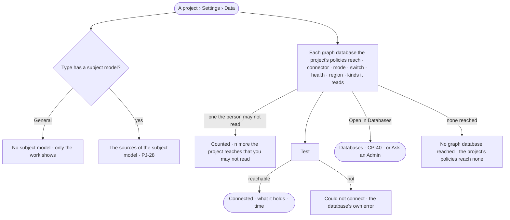

# PJ-34 · See the data a project reads

**As** a person on a project **I want** to see which graph databases and sources it reads, their mode and health, and test a connection **so that** I know the project is reading what I think it reads before I trust its answers.

Tasks: [task.md](task.md) · Feature: [PJ-F08](../../feature.md)

## Who can

Reading a project's settings needs no permission beyond seeing the project ([PJ-F01 › Access](../../../PJ-F01-projects-and-tasks/feature.md#access)).

| Access | Can | Otherwise sees |
|---|---|---|
| Admin | Read the graph databases the project reaches and its sources; test a connection; *Open in Databases* to change one | — |
| Operator | The same, for the graph databases they may read; *Open in Databases* reads *Ask an Admin* — changing a connection, its mode or its switch needs Manage on the connector | A project they may not read: its head only, *Withheld — join the team or ask {who can grant}* |

## Flow

## Acceptance criteria

| # | Given | When | Then |
|---|---|---|---|
| PJ-34.1 | A person who can read the project | they open Settings › Data | each graph database the project's policies reach reads its name, connector, mode (*Read-only* · *Read + write*), switch (*On* · *Off*), health, region tag and the kinds the project reads from it; never its address or credential |
| PJ-34.2 | A project of a type with a subject model | Data opens | the sources of its subject model read below the graph databases, each with its kind and when it was last parsed ([PJ-28](../../../PJ-F07-the-project-graph/stories/PJ-28-ground-a-project-in-its-subject-model/story.md)) |
| PJ-34.3 | The General type | Data opens | it says *No subject model — only the work shows* and lists the graph databases the project's policies reach, if any |
| PJ-34.4 | A graph database a project reaches | the person presses *Test* | the engine checks the connection with a read that writes nothing and reports *Connected*, with what it holds and the time, or *Could not connect* with the database's own error |
| PJ-34.5 | A graph database the project's policies do not reach | a test is asked for it by the API | it is refused — *There is no graph database {name} in this project.* — and nothing is tested |
| PJ-34.6 | A graph database the person may not read | Data opens | it is not named; a count reads *{n} more the project reaches that you may not read* |
| PJ-34.7 | A row | the person looks for a way to change it | nothing on this tab connects, switches or sets a mode; *Open in Databases* opens it for a person with Manage on the connector, and reads *Ask an Admin* for anyone else |
| PJ-34.8 | A project whose policies reach no graph database | Data opens | it says so, and names Team as where access is given |
| PJ-34.9 | The engine cannot return the data | the tab loads | it says *Could not load* with the reason and *Try again* |

## Screens

| Surface | Access | First use | Empty after a filter | Loading | Has data | Failed | Agent working or proposing | No access |
|---|---|---|---|---|---|---|---|---|
| Settings · Data | Admin | projects.settings · Data · Nothing reached | — | projects.settings · Data · Loading | projects.settings · Data | projects.settings · Data · Could not load | projects.settings · Data · Testing | — |
| Settings · Data | Operator | projects.settings · Data · Nothing reached | — | projects.settings · Data · Loading | projects.settings · Data | projects.settings · Data · Could not load | projects.settings · Data · Testing | projects.settings · Data · Withheld |
| Settings · Data · test a connection | Admin | projects.settings · Data · Test | — | projects.settings · Data · Testing | projects.settings · Data · Connected | projects.settings · Data · Could not connect | — | — |
| Settings · Data · test a connection | Operator | projects.settings · Data · Test | — | projects.settings · Data · Testing | projects.settings · Data · Connected | projects.settings · Data · Could not connect | — | projects.settings · Data · Withheld |
