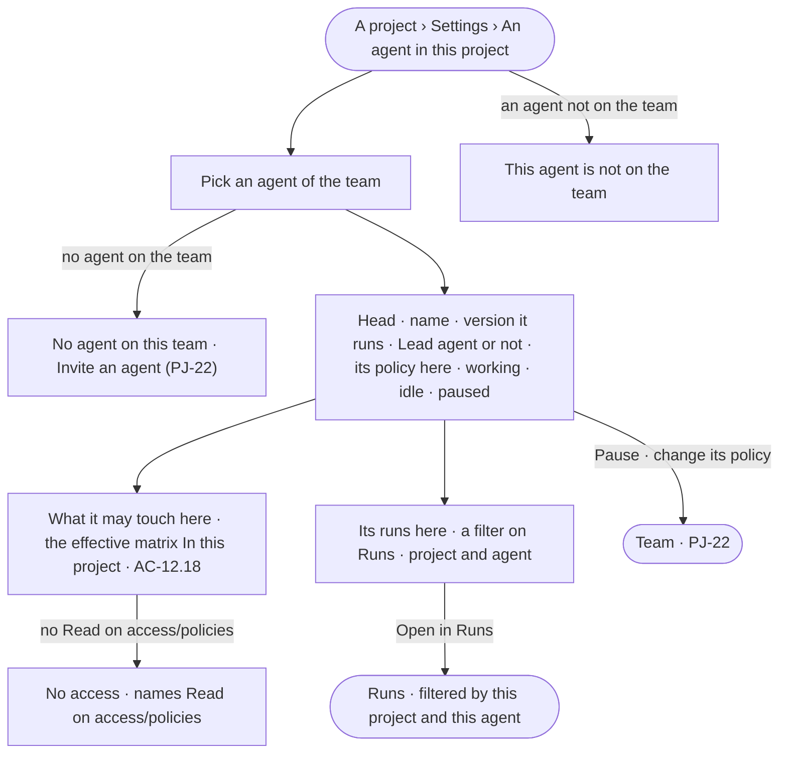

# PJ-35 · See an agent in a project

**As** a person on a project **I want** to open one of its agents and see its version, what it may touch here and its runs here **so that** I know what the agent can do in this project and what it has done.

Tasks: [task.md](task.md) · Feature: [PJ-F08](../../feature.md)

## Who can

Reading a project's settings needs no permission beyond seeing the project ([PJ-F01 › Access](../../../PJ-F01-projects-and-tasks/feature.md#access)).

| Access | Can | Otherwise sees |
|---|---|---|
| Admin | Open any agent on the team; read its version, what it may touch in this project and its runs here; open its runs in Runs | — |
| Operator | The same for an agent on a project they can read; *What it may touch* reads *No access* without Read on `access/policies` | A project they may not read: its head only, *Withheld — join the team or ask {who can grant}* |

## Flow

## Acceptance criteria

| # | Given | When | Then |
|---|---|---|---|
| PJ-35.1 | A project with agents on its team | the person opens *An agent in this project* | the team's agents are listed, the Lead agent first, and the first is open; picking another replaces it |
| PJ-35.2 | An agent | it opens | its head reads its name, the version it runs, whether it is the Lead agent, the access policy it holds in this project, and its state — *Working* · *Idle* · *Paused* |
| PJ-35.3 | An agent's *What it may touch* | it is read | it is the effective matrix of AC-12.18 for that agent *In* this project — action × resource, each row with its effect and why — read only, with *Open in Access* for a person who may open it |
| PJ-35.4 | A person without Read on `access/policies` | they open *What it may touch* | it reads *No access*, naming Read on `access/policies` and who can grant it; no rule or policy shows |
| PJ-35.5 | An agent's *Its runs here* | it is read | it lists the agent's runs in this project — status, when, the task, tokens — newest first, as a filter on Runs; *Open in Runs* opens Runs with that project and agent set, kept in the address; a run whose content the person may not read reads as AC-31 says |
| PJ-35.6 | An agent paused or without a policy | it opens | the head says *Paused* or *Chooses nothing yet — pick a policy*; its runs here still read; *Change in Team* opens PJ-22 |
| PJ-35.7 | A project with no agent on its team | the tab opens | it says *No agent on this team* with *Invite an agent* (PJ-22.21) |
| PJ-35.8 | A link to an agent not on the team | it is opened | it reads *This agent is not on the team* with *Back to the team*; nothing about it is shown |
| PJ-35.9 | The engine cannot return the agent | the tab loads | it says *Could not load* with the reason and *Try again* |

## Screens

| Surface | Access | First use | Empty after a filter | Loading | Has data | Failed | Agent working or proposing | No access |
|---|---|---|---|---|---|---|---|---|
| Settings · An agent in this project | Admin | projects.settings · Agent · No agent on the team | — | projects.settings · Agent · Loading | projects.settings · Agent | projects.settings · Agent · Could not load | projects.settings · Agent · Working | — |
| Settings · An agent in this project | Operator | projects.settings · Agent · No agent on the team | — | projects.settings · Agent · Loading | projects.settings · Agent | projects.settings · Agent · Could not load | projects.settings · Agent · Working | projects.settings · Agent · Withheld |
| Settings · An agent · what it may touch | Admin | — | — | projects.settings · Agent · Loading | projects.settings · Agent · What it may touch | projects.settings · Agent · Could not load | — | — |
| Settings · An agent · what it may touch | Operator | — | — | projects.settings · Agent · Loading | projects.settings · Agent · What it may touch | projects.settings · Agent · Could not load | — | projects.settings · Agent · No access |
| Settings · An agent · its runs here | Admin | — | projects.settings · Agent · No runs here | projects.settings · Agent · Loading | projects.settings · Agent · Runs here | projects.settings · Agent · Could not load | projects.settings · Agent · Working | — |
| Settings · An agent · its runs here | Operator | — | projects.settings · Agent · No runs here | projects.settings · Agent · Loading | projects.settings · Agent · Runs here | projects.settings · Agent · Could not load | projects.settings · Agent · Working | projects.settings · Agent · Content withheld |
