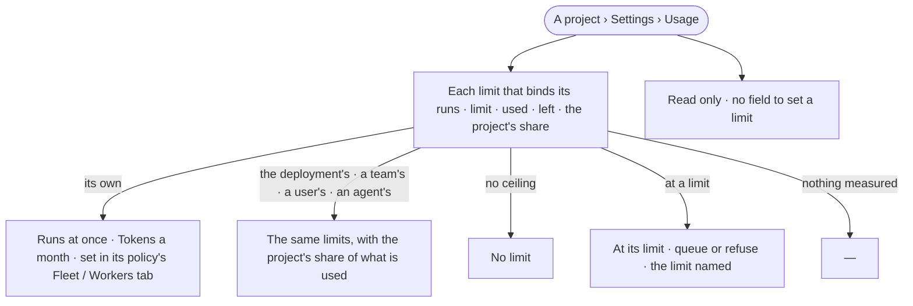

# PJ-36 · See how much of the limits a project uses

**As** a person on a project **I want** to see how much of its limits the project uses and what share of the deployment's, team's, user's and agents' limits it takes **so that** I know whether the work will keep running before a limit stops it.

Tasks: [task.md](task.md) · Feature: [PJ-F08](../../feature.md)

## Who can

Reading a project's settings needs no permission beyond seeing the project ([PJ-F01 › Access](../../../PJ-F01-projects-and-tasks/feature.md#access)).

| Access | Can | Otherwise sees |
|---|---|---|
| Admin | Read every limit that binds the project's runs and the project's share of each; set none here | — |
| Operator | The same; nothing on the tab is set by anyone — limits are set where [CP-11](../../../../../../os/control/features/CP-F04-limits/stories/CP-11-set-limits-for-the-deployment-a-team-a-user-or-an-agent/story.md) says | A project they may not read: its head only, *Withheld — join the team or ask {who can grant}* |

## Flow

## Acceptance criteria

| # | Given | When | Then |
|---|---|---|---|
| PJ-36.1 | A person who can read the project | they open Settings › Usage | it lists every limit that binds the project's runs — the project's own *Runs at once* and *Tokens a month*, and the deployment's, the team's, the user's and the agent's that also apply — each with the limit, what is used now, what is left and the project's share of what is used, every number the engine's, as last stored |
| PJ-36.2 | Usage | it is read | it is read only: there is no field to set a limit; the project's own limits are set in its policy's *Fleet / Workers* tab and read here as set |
| PJ-36.3 | A limit with no ceiling | it is read | it reads *No limit*, with what is used |
| PJ-36.4 | A project at a limit | Usage is read | the limit reads *At its limit*, names it and what happens — runs queue or are refused, as the limit says; and the project's Needs you carries the same notice |
| PJ-36.5 | A number the engine has not stored | it is read | it reads `—`, never an estimate |
| PJ-36.6 | A project with no limit of its own | Usage is read | it says *No limit of its own* and reads the limits of the deployment, team, user and agent that apply |
| PJ-36.7 | The engine cannot return the usage | the tab loads | it says *Could not load* with the reason and *Try again* |

## Screens

| Surface | Access | First use | Empty after a filter | Loading | Has data | Failed | Agent working or proposing | No access |
|---|---|---|---|---|---|---|---|---|
| Settings · Usage | Admin | projects.settings · Usage · No limit of its own | — | projects.settings · Usage · Loading | projects.settings · Usage | projects.settings · Usage · Could not load | — | — |
| Settings · Usage | Operator | projects.settings · Usage · No limit of its own | — | projects.settings · Usage · Loading | projects.settings · Usage | projects.settings · Usage · Could not load | — | projects.settings · Usage · Withheld |
| Settings · Usage · at a limit | Admin | — | — | — | projects.settings · Usage · At its limit | — | — | — |
| Settings · Usage · at a limit | Operator | — | — | — | projects.settings · Usage · At its limit | — | — | projects.settings · Usage · Withheld |
