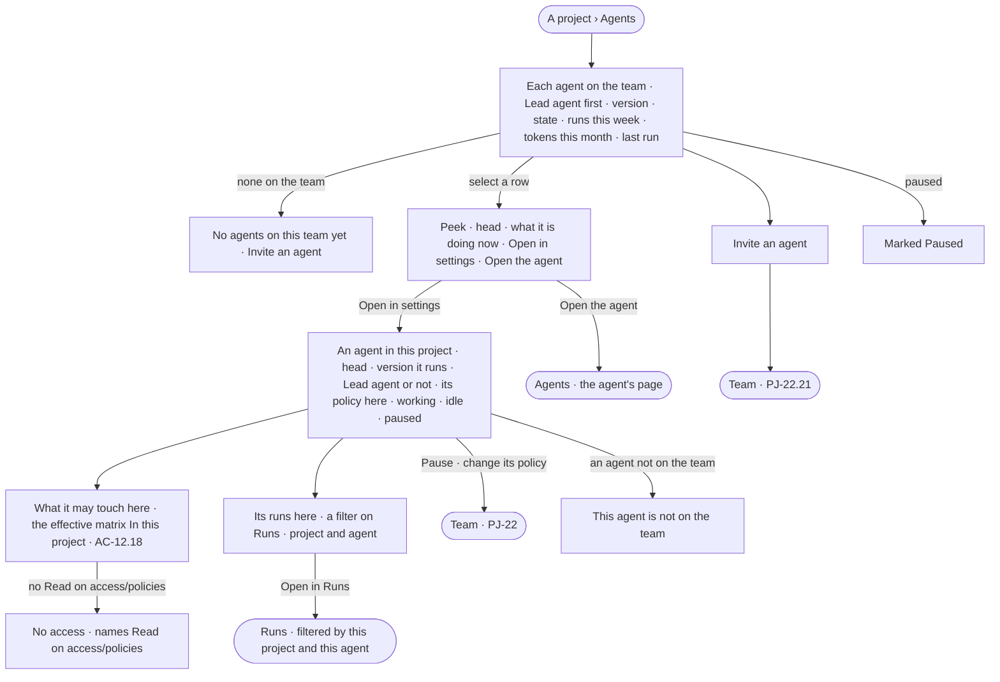

# PJ-37 · See the agents in a project

**As** a person on a project **I want** a section of the project page that lists the agents on its team with what each is doing and how it is doing, and to open one to see its version, what it may touch here and its runs here **so that** I see who is working on the project, what each can do in it and what it has done, and whether to give them more, or take them off.

Tasks: [task.md](task.md) · Feature: [PJ-F08](../../feature.md)

## Who can

Reading a project's settings needs no permission beyond seeing the project ([PJ-F01 › Access](../../../PJ-F01-projects-and-tasks/feature.md#access)).

| Access | Can | Otherwise sees |
|---|---|---|
| Admin | Read the agents on the team and how they are doing; open one — its version, what it may touch in this project and its runs here; open its runs in Runs; invite an agent | — |
| Operator | The same on a project they can read; *What it may touch* reads *No access* without Read on `access/policies`; *Invite an agent* disabled — *Join the team or ask {who can grant}* | A project they may not read: its head only, *Withheld — join the team or ask {who can grant}* |

## Flow

## Acceptance criteria

| # | Given | When | Then |
|---|---|---|---|
| PJ-37.1 | A project with agents on its team | the person opens its *Agents* section | each agent reads its name, version, whether it is the Lead agent, its state (*Working* · *Idle* · *Paused*), runs this week, tokens this month and its last run, every number the engine's, the Lead agent first — the same row as the agents list of Agents |
| PJ-37.2 | A row | the person selects it | a peek opens with its head and what it is doing now, with *Open in settings* and *Open the agent*; selecting another replaces it |
| PJ-37.3 | A project with no agent on its team | the section opens | it says *No agents on this team yet* with *Invite an agent*; the project's assistant is offered beside it |
| PJ-37.4 | *Invite an agent* | it is pressed | it opens the invite of [PJ-22.21](../../../PJ-F01-projects-and-tasks/stories/PJ-22-set-the-project-team-and-its-lead-agent/story.md); an Operator not on the team reads it disabled — *Join the team or ask {who can grant}* |
| PJ-37.5 | A paused agent | the section is read | its row is marked *Paused* and its numbers still read |
| PJ-37.6 | An agent working on a run the person may not read | its row is read | it reads that it is working and the run's status; the run's content reads *Content withheld* |
| PJ-37.7 | The engine cannot return the agents | the section loads | it says *Could not load* with the reason and *Try again* |
| PJ-37.8 | An agent opened in settings | it opens | its head reads its name, the version it runs, whether it is the Lead agent, the access policy it holds in this project, and its state — *Working* · *Idle* · *Paused* |
| PJ-37.9 | An agent's *What it may touch* | it is read | it is the effective matrix of AC-12.18 for that agent *In* this project — action × resource, each row with its effect and why — read only, with *Open in Access* for a person who may open it |
| PJ-37.10 | A person without Read on `access/policies` | they open *What it may touch* | it reads *No access*, naming Read on `access/policies` and who can grant it; no rule or policy shows |
| PJ-37.11 | An agent's *Its runs here* | it is read | it lists the agent's runs in this project — status, when, the task, tokens — newest first, as a filter on Runs; *Open in Runs* opens Runs with that project and agent set, kept in the address; a run whose content the person may not read reads as AC-31 says |
| PJ-37.12 | An agent paused or without a policy | it opens in settings | the head says *Paused* or *Chooses nothing yet — pick a policy*; its runs here still read; *Change in Team* opens PJ-22 |
| PJ-37.13 | A link to an agent not on the team | it is opened | it reads *This agent is not on the team* with *Back to the team*; nothing about it is shown |

## Screens

| Surface | Access | First use | Empty after a filter | Loading | Has data | Failed | Agent working or proposing | No access |
|---|---|---|---|---|---|---|---|---|
| Agents in this project | Admin | projects.projects · Detail · Agents · None yet | projects.projects · Detail · Agents · Nothing matches | projects.projects · Detail · Agents · Loading | projects.projects · Detail · Agents | projects.projects · Detail · Agents · Could not load | projects.projects · Detail · Agents · Working | — |
| Agents in this project | Operator | projects.projects · Detail · Agents · None yet | projects.projects · Detail · Agents · Nothing matches | projects.projects · Detail · Agents · Loading | projects.projects · Detail · Agents | projects.projects · Detail · Agents · Could not load | projects.projects · Detail · Agents · Working | projects.projects · Detail · Agents · Withheld |
| Agents in this project · peek | Admin | — | — | — | projects.projects · Detail · Agents · Peek | — | — | — |
| Agents in this project · peek | Operator | — | — | — | projects.projects · Detail · Agents · Peek | — | — | projects.projects · Detail · Agents · Withheld |
| Settings · An agent in this project | Admin | projects.settings · Agent · No agent on the team | — | projects.settings · Agent · Loading | projects.settings · Agent | projects.settings · Agent · Could not load | projects.settings · Agent · Working | — |
| Settings · An agent in this project | Operator | projects.settings · Agent · No agent on the team | — | projects.settings · Agent · Loading | projects.settings · Agent | projects.settings · Agent · Could not load | projects.settings · Agent · Working | projects.settings · Agent · Withheld |
| Settings · An agent · what it may touch | Admin | — | — | projects.settings · Agent · Loading | projects.settings · Agent · What it may touch | projects.settings · Agent · Could not load | — | — |
| Settings · An agent · what it may touch | Operator | — | — | projects.settings · Agent · Loading | projects.settings · Agent · What it may touch | projects.settings · Agent · Could not load | — | projects.settings · Agent · No access |
| Settings · An agent · its runs here | Admin | — | projects.settings · Agent · No runs here | projects.settings · Agent · Loading | projects.settings · Agent · Runs here | projects.settings · Agent · Could not load | projects.settings · Agent · Working | — |
| Settings · An agent · its runs here | Operator | — | projects.settings · Agent · No runs here | projects.settings · Agent · Loading | projects.settings · Agent · Runs here | projects.settings · Agent · Could not load | projects.settings · Agent · Working | projects.settings · Agent · Content withheld |
| Settings · An agent not on the team | Admin | — | — | — | — | projects.settings · Agent · Not on the team | — | — |
| Settings · An agent not on the team | Operator | — | — | — | — | projects.settings · Agent · Not on the team | — | — |
