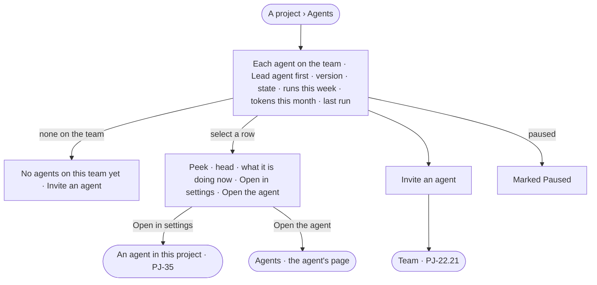

# PJ-37 · See the agents in a project

**As** a person on a project **I want** a section of the project page that lists the agents on its team with what each is doing and how it is doing **so that** I see who is working on the project and whether to give them more, or take them off.

Tasks: [task.md](task.md) · Feature: [PJ-F08](../../feature.md)

## Who can

Reading a project's settings needs no permission beyond seeing the project ([PJ-F01 › Access](../../../PJ-F01-projects-and-tasks/feature.md#access)).

| Access | Can | Otherwise sees |
|---|---|---|
| Admin | Read the agents on the team and how they are doing; open one; invite an agent | — |
| Operator | The same on a project they can read; *Invite an agent* disabled — *Join the team or ask {who can grant}* | A project they may not read: its head only, *Withheld — join the team or ask {who can grant}* |

## Flow

## Acceptance criteria

| # | Given | When | Then |
|---|---|---|---|
| PJ-37.1 | A project with agents on its team | the person opens its *Agents* section | each agent reads its name, version, whether it is the Lead agent, its state (*Working* · *Idle* · *Paused*), runs this week, tokens this month and its last run, every number the engine's, the Lead agent first — the same row as the agents list of Agents |
| PJ-37.2 | A row | the person selects it | a peek opens with its head and what it is doing now, with *Open in settings* (PJ-35) and *Open the agent*; selecting another replaces it |
| PJ-37.3 | A project with no agent on its team | the section opens | it says *No agents on this team yet* with *Invite an agent*; the project's assistant is offered beside it |
| PJ-37.4 | *Invite an agent* | it is pressed | it opens the invite of [PJ-22.21](../../../PJ-F01-projects-and-tasks/stories/PJ-22-set-the-project-team-and-its-lead-agent/story.md); an Operator not on the team reads it disabled — *Join the team or ask {who can grant}* |
| PJ-37.5 | A paused agent | the section is read | its row is marked *Paused* and its numbers still read |
| PJ-37.6 | An agent working on a run the person may not read | its row is read | it reads that it is working and the run's status; the run's content reads *Content withheld* |
| PJ-37.7 | The engine cannot return the agents | the section loads | it says *Could not load* with the reason and *Try again* |

## Screens

| Surface | Access | First use | Empty after a filter | Loading | Has data | Failed | Agent working or proposing | No access |
|---|---|---|---|---|---|---|---|---|
| Agents in this project | Admin | projects.projects · Detail · Agents · None yet | projects.projects · Detail · Agents · Nothing matches | projects.projects · Detail · Agents · Loading | projects.projects · Detail · Agents | projects.projects · Detail · Agents · Could not load | projects.projects · Detail · Agents · Working | — |
| Agents in this project | Operator | projects.projects · Detail · Agents · None yet | projects.projects · Detail · Agents · Nothing matches | projects.projects · Detail · Agents · Loading | projects.projects · Detail · Agents | projects.projects · Detail · Agents · Could not load | projects.projects · Detail · Agents · Working | projects.projects · Detail · Agents · Withheld |
| Agents in this project · peek | Admin | — | — | — | projects.projects · Detail · Agents · Peek | — | — | — |
| Agents in this project · peek | Operator | — | — | — | projects.projects · Detail · Agents · Peek | — | — | projects.projects · Detail · Agents · Withheld |
